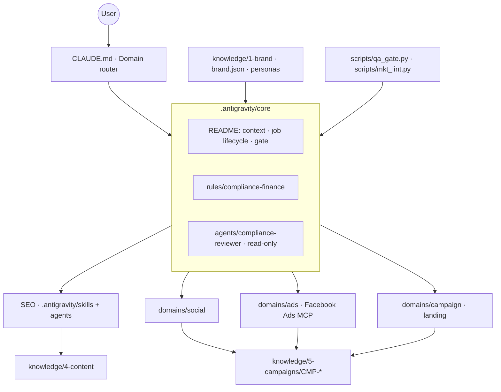
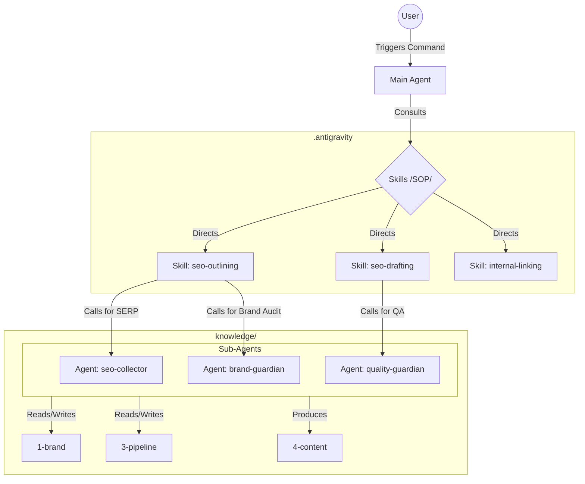

# 🧠 Project Knowledge Hub (agent.md)

DSC Marketing Workspace: 1 lớp **core** dùng chung (brand, compliance, vòng đời job, QA) + các **domain** gắn vào. SEO là domain đầy đủ nhất; Social, Ads, Campaign/Landing thêm từ 2026-11-24.

---

## 🎯 Project Goal
Sản xuất nội dung marketing đứng tên Chứng khoán DSC — rank được, được AI trích, chuyển đổi được — không "AI-vibe", không vi phạm compliance tài chính, mọi output qua QA máy + gate duyệt của người.

## 🧱 Layers

---

## 👥 Sub-Agent Ecosystem (SEO)
- **SEO Collector** (`.antigravity/agents/seo-collector.md`): SERP research & Content Briefing.
- **Brand Guardian** (`.antigravity/agents/brand-guardian.md`): Identity & Style compliance.
- **Quality Guardian** (`.antigravity/agents/quality-guardian.md`): Independent QA & Fact-checking.
- **Research Agent** (`.antigravity/agents/research-agent.md`): Knowledge Base building.

## 🗺️ Relationship Map

## 🔄 Content Pipeline
The production process is split across two skills:
1. **Discovery:** `/setup` to build KB.
2. **Strategy:** `/cluster` to map topics. `/keyword-plan` to pick next articles.
3. **Outlining:** `/outlining` — `.antigravity/skills/seo-outlining/SKILL.md`
4. **Drafting:** `/drafting` or `/write` — `.antigravity/skills/seo-drafting/SKILL.md`

## 🗂️ Data Hierarchy
- **`.antigravity/`**: The system (skills, agents, internal templates).
- **`knowledge/`**: The strategic brain (Brand, Market, Pipeline, Content).

## 🛠️ Key Utilities
- **Internal Linking:** Use `/link` to backfill internal links from existing articles.
- **Skill Center:** Check `.antigravity/skills/` for specialized capabilities.

## 📈 Performance Data (SEO Dashboard MCP)
- GSC / GA4 / Ads / cannibalization lấy qua MCP **SEO Dashboard** — playbook `.antigravity/skills/seo-dashboard/SKILL.md`, cấu hình Antigravity `.antigravity/config/seo-dashboard-mcp.md`.
- Agent có MCP gọi tool rồi lưu cache bằng `python scripts/dashboard_cache.py save ...`; agent không có MCP đọc `python scripts/dashboard_cache.py report <slug>`. Không bịa số GSC.
