# DSC Digital Marketing Agent (SEO là lõi)

**Điều hành:** mở [bảng công việc và tiến độ](knowledge/0-dashboard/index.html): bài SEO theo bước, đối thủ tuần này, báo cáo tháng, bản nháp kênh, internal link, stale, việc sau publish. Cập nhật bằng `python scripts/build_content_index.py`. [Hướng dẫn nguồn trạng thái](knowledge/0-dashboard/README.md).

Bộ skill marketing số cho Chứng khoán DSC: SEO (lõi) + Analytics, Google Ads, Social/syndication, Email, Landing. Dùng được với mọi coding agent đọc `AGENTS.md` + `.agents/skills/` (Claude Code, Antigravity, Codex, Cursor, Gemini CLI). Sau khi clone: `python scripts/link_agent_dirs.py` để Claude Code thấy skill. Bản đồ skill: [START-HERE.md](START-HERE.md).

## 🚀 Quick Start

1. **Initialize Project:**
   Copy the contents of this boilerplate into your new project directory.
   ```bash
   cp -r . /path/to/your-new-seo-project/
   ```

2. **Interactive Setup:**
   Run the following command to start the interactive onboarding and build your knowledge base:
   ```text
   /setup
   ```
   *The system will initialize your project structure and ask for your Brand Name, Website, and Competitors to build the `knowledge/1-brand` and `knowledge/2-market` contexts.*

3. **Plan Keywords:**
   Run the clustering command to generate a Topic Cluster Map from your keyword CSV or raw files:
   ```text
   /cluster
   ```
   Then choose which articles to write next:
   ```text
   /keyword-plan
   ```

4. **Start Writing:**
   Activate the standardized SEO writing framework:
   ```text
   /write "your target keyword"
   ```

5. **Review & Approve:**
   Approve the current stage (Outline → Draft → Final) to progress the pipeline:
   ```text
   /approve
   ```

## 🏗️ Architecture

Theo quy ước của các repo marketing skills phổ biến (coreyhaines31/marketingskills, OpenClaudia…):

### 1. Skills (`.agents/`)
- **`AGENTS.md`** (root): chỉ dẫn chung; `CLAUDE.md` / `GEMINI.md` chỉ import file này.
- **`.agents/context.md`**: bối cảnh marketing chung — skill ngoài SEO đọc trước.
- **`.agents/skills/<tên>/`**: mỗi skill 1 thư mục phẳng — `SKILL.md` (quy trình) + `references/` (playbook chi tiết, vai trò như Quality Guardian) + `scripts/`.
- **`.agents/rules/`**, **`.agents/memory/`** (instincts), **`.agents/templates/`**, **`.agents/config/`** (gitignored).

### 2. Dữ liệu & sản phẩm (`knowledge/`) — chi tiết: [knowledge/README.md](knowledge/README.md)
- **`0-dashboard/`** bảng điều hành sinh tự động · **`1-brand/`** DSC + cách viết cho mọi kênh (brand-facts, anti-ai-rules, glossary, source-whitelist)
- **`2-market/`** thị trường, nghiên cứu, đối thủ (theo dõi tuần + hồ sơ) · **`3-seo/`** toàn bộ SEO: `strategy/` (registry `pages.csv`, `taxonomy.json`) · `content/` (outline → draft → final → cms) · `links/` · `logs/`
- **`4-channels/`** ads · email · landing · social · **`5-analytics/`** KPI + báo cáo · **`raw/`** dữ liệu thô, snapshot site live, snapshot đối thủ

## 🔄 Workflow

Nhịp tháng / tuần / từng bài và các kênh khác: [START-HERE.md § Workflow](START-HERE.md#workflow).

### Pipeline 1 bài SEO (chi tiết)

Ô xanh lá = script (0 token LLM) · ô xanh dương = người duyệt · ô vàng = bước LLM · ô cam = còn làm tay.
Bài tốt = rank được và được AI trích: mỗi tiêu chí (intent · entity · giá trị mới · tin cậy · AI trích xuất) có check máy ở outline và ở draft.

```mermaid
flowchart TD
    classDef script fill:#eef7ee,stroke:#27ae60,color:#000
    classDef human fill:#d6eaff,stroke:#2471a3,color:#000
    classDef llm fill:#fff7d6,stroke:#b7950b,color:#000
    classDef manual fill:#ffe9c7,stroke:#e67e22,stroke-width:2px,color:#000

    U(["/write keyword"]):::human --> S0

    subgraph P0["Bước 0 · Context ~35 KB, load 1 lần / session (AGENTS.md 12 KB)"]
        S0["profile 4 KB · anti-ai-rules 12,6 KB<br/>glossary 8 KB · instincts 9,8 KB + 1 topic 0,5 KB"]:::script
        S0c["topic_status.py --find / --add"]:::script
        S0 --> S0c
    end

    S0c --> G0{"Cannibalization gate<br/>GSC MCP / find_links"}
    G0 -- "đã có URL cùng intent" --> OPT["/optimize bài cũ<br/>vị trí ≤ 5: không tái cấu trúc<br/>Proposal có Thesis · Entities · Information_Gain"]:::llm
    G0 -- "chưa có" --> SERP

    subgraph P1["Giai đoạn 1 · Outline"]
        SERP["serp_research.py --extract 5<br/>digest gọn 6–10 KB (trước ~30 KB) · --full khi cần"]:::script
        FMT["SERP Format & Intent<br/>toplist / how-to / định nghĩa"]:::script
        TC["Topic Coverage (gộp đối thủ hợp lệ)<br/>thuật ngữ ≥ 3 đối thủ dùng · chủ đề con chung · nguồn họ trích"]:::script
        DATA["market_facts --brief · news_feed<br/>mỗi dữ kiện có URL nguồn (source-whitelist.md)"]:::script
        BG["Brand Guardian (inline)<br/>instincts + --show"]:::llm
        OUT["Outline: Thesis · Entities<br/>Information_Gain ≥ 2 mục (h2 + proof)<br/>PAA nguyên văn · điểm đối thủ /40"]:::llm
        OL{"outline_lint.py<br/>FMT · ENT-outline ≥ 70% · IG-shape<br/>SERP-paa-fake · DATA-source"}:::script
        A1(["APPROVAL GATE 1<br/>tóm tắt ≤ 25 dòng + đường dẫn file"]):::human
        SN1["article_snapshot --stage outline"]:::script
        SERP --> FMT --> TC --> DATA --> OUT
        BG --> OUT
        OUT --> OL -- PASS --> A1 --> SN1
        OL -- "FAIL (≤ 2 vòng)" --> OUT
    end

    SN1 --> DR

    subgraph P2["Giai đoạn 2 · Draft + QA"]
        DR["/drafting → Draft-slug.md<br/>giao 5 lời hứa của outline · câu đầu mỗi H2 trả lời ngay<br/>link nguồn gốc tại câu trích"]:::llm
        LK["find_links.py → 3–6 link<br/>quy tắc: link-rules.md 2,7 KB"]:::script
        CRO["CRO: Bridge + banner<br/>(skill CRO chỉ nạp ở bước này)"]:::llm
        GATE{"qa_gate.py — 1 lệnh<br/>A lint: hình thức + coverage + trust<br/>→ B slop ≥ 80 → F facts"}:::script
        SUB["coverage: ENT-missing · IG-missing · PAA · DUP-h2/faq<br/>trust: SRC-missing · YMYL-disclaimer · EEAT-firsthand · CL5-fact<br/>AEO: GEO-h2-answer"]:::script
        QG{"Quality Guardian<br/>dùng output gate, không chạy lại lint<br/>trích câu giao từng Information_Gain<br/>vòng 2: --changed"}:::llm
        SN2["article_snapshot --stage gate2"]:::script
        A2(["APPROVAL GATE 2<br/>score · coverage · trust · slop<br/>tóm tắt ≤ 25 dòng + đường dẫn file"]):::human
        DR --> LK --> CRO --> GATE
        GATE --- SUB
        GATE -- "FAIL (≤ 2 vòng)" --> DR
        GATE -- PASS --> QG
        QG -- FAIL --> DR
        QG -- PASS --> SN2 --> A2
    end

    A2 --> AG

    subgraph P3["Giai đoạn 3 · Finalize + Learn (trình tự chỉ ở approve/SKILL.md)"]
        AG{"qa_gate --all<br/>chặn: CRITICAL · MAJOR coverage/trust<br/>slop < 80 · không có outline"}:::script
        FIN["article_snapshot --stage final<br/>outline → archive/slug/ (exit 3 = thiếu outline)"]:::script
        LOG["qa_lint --log → qa-score-log.csv<br/>(+ coverage, trust, slop) · qa-check-log.csv"]:::script
        CMS["md_to_cms_html.py"]:::script
        IDX["find_links.py --add-anchor<br/>(ghi vào registry pages.csv)"]:::script
        LEARN["/learn: article_snapshot --diff<br/>→ cổng nhận rule → sửa tại chỗ theo ID"]:::llm
        CHK["optimize_instincts.py --check"]:::script
        AG -- PASS --> FIN --> LOG --> CMS --> IDX --> LEARN --> CHK
    end

    AG -- "FAIL → báo user" --> DR
    CMS --> PUB

    subgraph P4["/weekly · 1 lần/tuần"]
        PUB(["Dán HTML vào CMS<br/>+ ảnh thực tế còn thiếu"]):::manual
        WR["weekly_review.py<br/>đọc publish-ledger + snapshot live"]:::script
        SY["sync_live.py --only các bài mới"]:::script
        BF["1 spec backfill cho cả tuần<br/>→ sửa CMS 1 lượt → verify"]:::manual
        GSC["Bài live 28–56 ngày: MCP query<br/>+ get_ai_visibility / get_ai_traffic"]:::llm
        RES["--done gsc slug --result …<br/>sổ lưu kết quả GSC cạnh điểm QA"]:::script
        OC["weekly_review.py --outcomes<br/>điểm QA ↔ thứ hạng thật"]:::script
        ROT["rotate_revision_log · --stats rule tái diễn"]:::script
        PUB --> WR --> SY --> BF
        WR --> GSC --> RES --> OC
        WR --> ROT
    end

    GSC -. "CTR thấp / vị trí 11–30" .-> OPT
    OPT -.-> DR
    CHK -. "instincts.md mới" .-> S0
    ROT -. "rule còn tái diễn" .-> LEARN
    OC -. "điểm cao mà không rank → chỉnh ngưỡng / trọng số" .-> LEARN
```



Lịch sử các nút thắt đã xử lý (B1–B21): `.agents/memory/DECISIONS.md`.

**Còn làm tay:** dán HTML vào CMS, sửa link trên CMS (không có API) và chụp ảnh thực tế cho bài hướng dẫn thao tác — đã gom về 1 lần/tuần. Schema `Article` / `FAQPage` và byline phải làm ở template CMS.


## ⚡ Key Features

- **Zen Structure 2.0:** Standardized modular design for seamless scaling and multi-project portability without context degradation.
- **Token Efficiency:** Context-selective agents and progressive disclosure ensure you don't burn tokens on unnecessary context.
- **Hard Assertions & Quality Assurance:** Mandatory audit templates and independent QA/QC checkpoints maintain human-like, authoritative content.
- **Granular Pipeline Control:** Distinct stages for content (Planned, Optimizing, Finalized) aligned perfectly with brand and strategy rules.

## 🛠️ Requirements
- Coding agent đọc `AGENTS.md` + `.agents/skills/` (Claude Code, Antigravity, Codex, Cursor, Gemini CLI). Python 3.11+ (`python -m unittest discover -s tests`).
- Internet access (for SERP research and Web Fetching).
