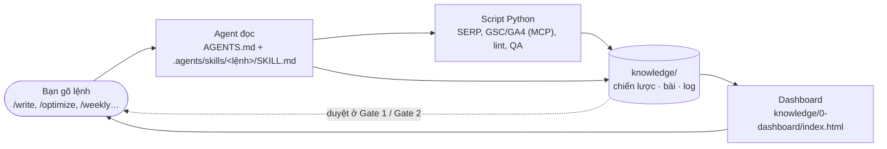
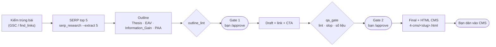
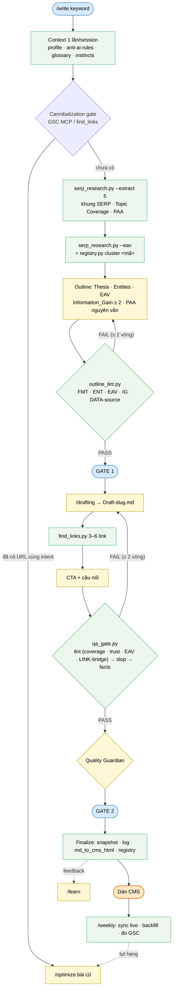

# DSC Digital Marketing Agent (SEO là lõi)

Bộ công cụ cho đội marketing **Chứng khoán DSC**. Bạn giao việc bằng lệnh trong chat (`/write`, `/optimize`, `/weekly`…), một coding agent (Claude Code, Codex, Cursor, Antigravity, Gemini CLI) làm theo quy trình viết sẵn, dùng script Python để kiểm tra và ghi kết quả vào thư mục `knowledge/`. Agent chỉ soạn bản nháp và đề xuất; đăng CMS, chạy quảng cáo, gửi email là việc của người.

- **Mỗi ngày:** mở [`knowledge/0-dashboard/index.html`](knowledge/0-dashboard/index.html) trên trình duyệt.
- **Danh sách lệnh đầy đủ:** [START-HERE.md](START-HERE.md) · **luật cho agent:** [AGENTS.md](AGENTS.md) · **thư mục và thuật ngữ:** [knowledge/README.md](knowledge/README.md).
- **Sau khi clone:** `python scripts/link_agent_dirs.py` (để Claude Code thấy skill) · test: `python -m unittest discover -s tests`.

---

## 1. Project hoạt động thế nào



| Thành phần | Ở đâu | Vai trò |
|---|---|---|
| **Luật chung** | `AGENTS.md` | Agent nào cũng đọc: chọn skill, quy tắc bắt buộc (không bịa số, QA trước khi trình, tối đa 2 vòng sửa…) |
| **Skill** | `.agents/skills/<tên>/SKILL.md` | Quy trình của từng lệnh `/x` |
| **Script** | `scripts/`, `.agents/skills/*/scripts/` | Việc máy làm được, không tốn token: SERP, lint, QA, registry, dashboard. Mọi script có `--help` |
| **Dữ liệu** | `knowledge/` | Brand, thị trường, chiến lược, bài viết, log. Thư mục nào để làm gì: `knowledge/README.md` |
| **Số liệu thật** | SEO Dashboard MCP | GSC, GA4, Google Ads của `sc-domain:dsc.com.vn` (chỉ đọc) |
| **Dashboard** | `knowledge/0-dashboard/` | Sinh tự động từ dữ liệu, không sửa tay. Làm mới: `python scripts/build_content_index.py` |

---

## 2. Chiến lược nội dung — một nguồn cho mỗi khái niệm

Mọi skill và script đọc chung các file dưới đây. Muốn đổi định hướng thì sửa đúng file đó; dashboard và topical map tự cập nhật ở lần build sau.

| Khái niệm | Sửa ở | Xem |
|---|---|---|
| **Định vị nội dung** (Source Context) — DSC là ai, viết từ góc nào | `knowledge/1-brand/profile.md` §0 | Dashboard → Chiến lược |
| **Thực thể trung tâm** (Central Entity) — cả site nói về gì | `knowledge/1-brand/profile.md` §0 | như trên |
| **Khu vực site** — sản phẩm, hướng dẫn, kiến thức, phân tích, tin tức… và vai trò `core` / `outer` / `trust` / `off` | `knowledge/3-seo/strategy/taxonomy.json` → `site` | Topical map → Bản đồ site |
| **Cụm /kien-thuc** — mã, tên, vai trò, thực thể, `bridge_to`, thuộc tính | `taxonomy.json` → `topics` | `python scripts/registry.py cluster [mã]` |
| **Liên kết pillar / hub / bài** | `taxonomy.json` → `clusters` | Topical map → Cấu trúc link chuẩn |
| **Số liệu DSC** (phí, margin, eKYC…) | `knowledge/1-brand/brand-facts.json` | `python scripts/fact_consistency.py` |
| **Trạng thái từng bài** | `knowledge/3-seo/strategy/pages.csv` (qua script) | `python scripts/topic_status.py <slug>` |
| **Chuyển đổi** — Lead, micro-conversion, trọng số | `knowledge/5-analytics/kpi-definitions.md` | — |

**Vai trò:** `core` = trang chuyển đổi / phục vụ khách (bài khác dẫn về) · `outer` = kéo traffic, xây thẩm quyền chủ đề, mỗi cụm có 1 trang Core để dẫn về · `trust` = trang chứng minh DSC là ai (giới thiệu, IR, tin tức) · `off` = ngoài định vị: **không xoá**, giữ bài đang có traffic, không viết thêm trừ khi có góc dẫn về chứng khoán.

---

## 3. Các luồng làm việc

### 3.1. Viết bài SEO mới — `/write <keyword>`

- Outline có khối **`EAV:`**: thuộc tính bài phải nêu kèm giá trị và nguồn. Gợi ý lấy từ `serp_research.py "<kw>" --eav` (bài đối thủ trong cache) và `registry.py cluster <mã>` (thuộc tính của cụm). `outline_lint` kiểm đủ thuộc tính gốc và có ít nhất 1 thuộc tính đối thủ ít có; `qa_lint` kiểm draft có đúng các giá trị đó.
- Bài thuộc cụm `outer` phải có 1 đoạn cầu nối về trang Core của cụm (`qa_lint` báo `LINK-bridge`).
- Gate = bạn đọc bản trình (≤ 25 dòng + đường dẫn file, hoặc mở tab **Chờ duyệt** trên dashboard) rồi gõ `/approve`.

### 3.2. Làm lại bài cũ — `/optimize <slug>`
Dashboard → **Làm lại bài cũ** liệt kê bài nên xử lý theo `page-audit.csv`: *làm lại* (mất clicks / vị trí 4–15 / CTR thấp) → `/optimize`; *thêm cầu nối* (bài Outer có traffic nhưng 0 key event) → `/cro`; *cân nhắc gộp* → bạn quyết 301 hay giữ. Sửa 1 đoạn theo ý bạn thì dùng `/revise`.

### 3.3. Nhịp định kỳ
| Khi nào | Lệnh | Kết quả |
|---|---|---|
| Mỗi ngày | Mở dashboard → tab **Hôm nay** | Việc cần làm (kèm ngày cập nhật), file tồn đọng, biến động clicks, bài nên làm lại |
| Hằng tuần | `/weekly` · `/competitor-watch` | Sync web live, backfill link, đo bài live ≥ 14 ngày; đối thủ đăng gì |
| Đầu tháng | `/analytics-report` → `/ads-audit` → `/gsc-sync` → `/keyword-plan` | Báo cáo KPI; làm mới số liệu dashboard; danh sách việc tháng (40% làm lại · 20% cầu nối · 40% bài mới) ghi vào registry |
| Hằng quý | `/market-research` · `/competitor-profile` · `/link` (audit) · xem lại vai trò cụm (`registry.py suggest-core`) | Hướng đi quý, cấu trúc link |
| Sau đợt duyệt | `/learn` | Feedback của bạn thành rule cho lần sau |

### 3.4. Kênh khác
Google Ads (`/ads-audit`, `/ads-copy`), Meta Ads (`/ads-brief` → `/meta-ads-copy`, `/ads-review`), social (`/social-plan`, `/social-post`, `/syndicate`), chiến dịch đa kênh (`/campaign-brief` → … → `/campaign-report`), landing (`/landing`, `/copy-landing`), email (`/email-sequence`), ảnh (`/creative`, `/image`). Chi tiết: [START-HERE.md](START-HERE.md).

---

## 4. Bạn tương tác ở đâu

| Bạn muốn | Làm |
|---|---|
| Xem hôm nay làm gì | Dashboard → **Hôm nay**: mỗi việc có nút copy lệnh để dán vào chat |
| Đọc và duyệt bài | Dashboard → **Chờ duyệt**: đọc outline / draft / proposal ngay trên trang → copy `/approve <slug>` |
| Xem chiến lược, cụm nào core / outer | Dashboard → **Chiến lược**, hoặc [Topical map](knowledge/3-seo/strategy/topical-map.html) → **Bản đồ site** |
| Xem link giữa các bài | Topical map → **Cấu trúc link chuẩn** (nên có) / **Link đang có trên web** (thực tế) |
| Sửa bài | Gõ yêu cầu trong chat (`/revise`). Agent ghi `revision-log` trước khi sửa để `/learn` học lại |
| Đổi định hướng | Sửa file ở mục 2, rồi `python scripts/build_content_index.py` |
| Dọn file sau Finalize | `python scripts/topic_status.py --stale` (xem) → `--stale --apply` (chuyển vào `content/archive/<slug>/`, không xoá) |

**Ngày trên file:** outline / proposal / draft có `Created:` và `Updated:` (YYYY-MM-DD) trong YAML đầu file. `topic_status.py <slug> --set <trạng thái>` tự ghi `Updated`; dashboard đọc 2 trường này để xếp việc theo độ cũ.

**Còn làm tay:** dán HTML vào CMS, sửa link trên CMS (không có API), chụp ảnh thật cho bài hướng dẫn thao tác — đã gom về 1 lần/tuần trong `/weekly`.

---

## 5. Thư mục

```
AGENTS.md            luật chung cho agent (CLAUDE.md, GEMINI.md chỉ import file này)
START-HERE.md        bản đồ lệnh theo mảng
.agents/
  context.md         bối cảnh marketing chung
  skills/<tên>/      SKILL.md + references/ + scripts/
  rules/ memory/ core/ domains/ templates/
knowledge/
  0-dashboard/       bảng điều hành (sinh tự động)
  1-brand/           DSC là ai, viết thế nào: profile (§0 định vị), brand-facts, DESIGN.md, anti-ai-rules…
  2-market/          thị trường, đối thủ
  3-seo/             strategy/ (pages.csv, taxonomy.json, page-audit, topical-map) · content/ · links/ · logs/
  4-channels/        ads · email · landing · social
  5-analytics/       KPI, báo cáo
  6-campaigns/       job chiến dịch CMP-*
  raw/               dữ liệu thô: snapshot web, cache SERP, audit GSC/GA4
scripts/             script dùng chung · templates/ (HTML dashboard) · hooks/ (Claude Code)
tests/               unittest
```

<details>
<summary>Pipeline 1 bài SEO chi tiết (script / người / LLM ở từng bước)</summary>

Ô xanh lá = script (0 token LLM) · ô xanh dương = người duyệt · ô vàng = bước LLM · ô cam = còn làm tay.



Lịch sử các nút thắt đã xử lý: `.agents/memory/DECISIONS.md`.
</details>
