# SEO Writer Agent Boilerplate

**Điều hành SEO:** mở [bảng công việc và tiến độ](knowledge/operations/index.html) để tìm internal link, stale, audit, CMS và việc sau publish. Cập nhật bằng `python scripts/build_content_index.py`. [Hướng dẫn nguồn trạng thái](knowledge/operations/README.md).

A modular, cross-platform template for professional SEO content production. Works seamlessly with **Claude Code**, **Gemini CLI**, and **Antigravity**.

## 🚀 Quick Start

1. **Initialize Project:**
   Copy the contents of this boilerplate into your new project directory.
   ```bash
   cp -r . /path/to/your-new-seo-project/
   ```

2. **Interactive Setup:**
   Run the following command to start the interactive onboarding and build your knowledge base:
   ```text
   /setup
   ```
   *The system will initialize your project structure and ask for your Brand Name, Website, and Competitors to build the `knowledge/1-brand` and `knowledge/2-market` contexts.*

3. **Plan Keywords:**
   Run the clustering command to generate a Topic Cluster Map from your keyword CSV or raw files:
   ```text
   /cluster
   ```
   Then choose which articles to write next:
   ```text
   /keyword-plan
   ```

4. **Start Writing:**
   Activate the standardized SEO writing framework:
   ```text
   /write "your target keyword"
   ```

5. **Review & Approve:**
   Approve the current stage (Outline → Draft → Final) to progress the pipeline:
   ```text
   /approve
   ```

## 🏗️ Architecture

Following the **Zen Structure 2.0** methodology, the repository is logically divided into two main domains:

### 1. The Engine (`.agents/` & `.antigravity/`)
Contains the core logic, autonomous workflows, and isolated skills (Plan-Validate-Execute framework).

- **`.agents/workflows/`**: Command routing for tasks like `/setup`, `/write`, `/optimize`, etc.
- **`.antigravity/skills/`**: Specialized capabilities (e.g., `seo-optimization`, `seo-writing`) enforcing hard assertions and progressive disclosure.
- **`.antigravity/agents/`**: Task-specific, persona-based sub-agents (e.g., SEO Collector, Brand Guardian).

### 2. The Brain & Factory (`knowledge/`)
A centralized, standardized data structure ensuring multi-platform portability and token efficiency.

- **`knowledge/1-brand/`**: Brand Identity, Personas, ICP, and Voice guidelines.
- **`knowledge/2-market/`**: Market Landscape, Competitors, and Topic Cluster Maps.
- **`knowledge/3-pipeline/`**: Content strategy, backlog, keyword lists, and Sprint Planners.
- **`knowledge/4-content/`**: The production line spanning granular stages (`0-sources` -> `1-outlines` -> `2-drafts` -> `3-finalized`).
- **`knowledge/raw/`**: Raw, unprocessed uploads (e.g., client briefs, data dumps).

## 🔄 Workflow hiện tại (cập nhật 2026-11-10: cổng thực chất + cắt token)

Ô xanh lá = script (0 token LLM) · ô xanh dương = người duyệt · ô vàng = bước LLM · ô cam = còn làm tay.
Bài tốt = rank được và được AI trích: mỗi tiêu chí (intent · entity · giá trị mới · tin cậy · AI trích xuất) có check máy ở outline và ở draft.

```mermaid
flowchart TD
    classDef script fill:#eef7ee,stroke:#27ae60,color:#000
    classDef human fill:#d6eaff,stroke:#2471a3,color:#000
    classDef llm fill:#fff7d6,stroke:#b7950b,color:#000
    classDef manual fill:#ffe9c7,stroke:#e67e22,stroke-width:2px,color:#000

    U(["/write keyword"]):::human --> S0

    subgraph P0["Bước 0 · Context ~35 KB, load 1 lần / session (CLAUDE.md 12 KB)"]
        S0["profile 4 KB · anti-ai-rules 12,6 KB<br/>glossary 8 KB · instincts 9,8 KB + 1 topic 0,5 KB"]:::script
        S0c["topic_status.py --find / --add"]:::script
        S0 --> S0c
    end

    S0c --> G0{"Cannibalization gate<br/>GSC MCP / find_links"}
    G0 -- "đã có URL cùng intent" --> OPT["/optimize bài cũ<br/>vị trí ≤ 5: không tái cấu trúc<br/>Proposal có Thesis · Entities · Information_Gain"]:::llm
    G0 -- "chưa có" --> SERP

    subgraph P1["Giai đoạn 1 · Outline"]
        SERP["serp_research.py --extract 5<br/>digest gọn 6–10 KB (trước ~30 KB) · --full khi cần"]:::script
        FMT["SERP Format & Intent<br/>toplist / how-to / định nghĩa"]:::script
        TC["Topic Coverage (gộp đối thủ hợp lệ)<br/>thuật ngữ ≥ 3 đối thủ dùng · chủ đề con chung · nguồn họ trích"]:::script
        DATA["market_facts --brief · news_feed<br/>mỗi dữ kiện có URL nguồn (source-whitelist.md)"]:::script
        BG["Brand Guardian (inline)<br/>instincts + --show"]:::llm
        OUT["Outline: Thesis · Entities<br/>Information_Gain ≥ 2 mục (h2 + proof)<br/>PAA nguyên văn · điểm đối thủ /40"]:::llm
        OL{"outline_lint.py<br/>FMT · ENT-outline ≥ 70% · IG-shape<br/>SERP-paa-fake · DATA-source"}:::script
        A1(["APPROVAL GATE 1<br/>tóm tắt ≤ 25 dòng + đường dẫn file"]):::human
        SN1["article_snapshot --stage outline"]:::script
        SERP --> FMT --> TC --> DATA --> OUT
        BG --> OUT
        OUT --> OL -- PASS --> A1 --> SN1
        OL -- "FAIL (≤ 2 vòng)" --> OUT
    end

    SN1 --> DR

    subgraph P2["Giai đoạn 2 · Draft + QA"]
        DR["seo-drafting → Draft-slug.md<br/>giao 5 lời hứa của outline · câu đầu mỗi H2 trả lời ngay<br/>link nguồn gốc tại câu trích"]:::llm
        LK["find_links.py → 3–6 link<br/>quy tắc: link-rules.md 2,7 KB"]:::script
        CRO["CRO: Bridge + banner<br/>(skill CRO chỉ nạp ở bước này)"]:::llm
        GATE{"qa_gate.py — 1 lệnh<br/>A lint: hình thức + coverage + trust<br/>→ B slop ≥ 80 → F facts"}:::script
        SUB["coverage: ENT-missing · IG-missing · PAA · DUP-h2/faq<br/>trust: SRC-missing · YMYL-disclaimer · EEAT-firsthand · CL5-fact<br/>AEO: GEO-h2-answer"]:::script
        QG{"Quality Guardian<br/>dùng output gate, không chạy lại lint<br/>trích câu giao từng Information_Gain<br/>vòng 2: --changed"}:::llm
        SN2["article_snapshot --stage gate2"]:::script
        A2(["APPROVAL GATE 2<br/>score · coverage · trust · slop<br/>tóm tắt ≤ 25 dòng + đường dẫn file"]):::human
        DR --> LK --> CRO --> GATE
        GATE --- SUB
        GATE -- "FAIL (≤ 2 vòng)" --> DR
        GATE -- PASS --> QG
        QG -- FAIL --> DR
        QG -- PASS --> SN2 --> A2
    end

    A2 --> AG

    subgraph P3["Giai đoạn 3 · Finalize + Learn (trình tự chỉ ở approve/SKILL.md)"]
        AG{"qa_gate --all<br/>chặn: CRITICAL · MAJOR coverage/trust<br/>slop < 80 · không có outline"}:::script
        FIN["article_snapshot --stage final<br/>outline → archive/slug/ (exit 3 = thiếu outline)"]:::script
        LOG["qa_lint --log → qa-score-log.csv<br/>(+ coverage, trust, slop) · qa-check-log.csv"]:::script
        CMS["md_to_cms_html.py"]:::script
        IDX["find_links.py --add-anchor<br/>(không mở anchor-index 189 KB)"]:::script
        LEARN["/learn: article_snapshot --diff<br/>→ cổng nhận rule → sửa tại chỗ theo ID"]:::llm
        CHK["optimize_instincts.py --check"]:::script
        AG -- PASS --> FIN --> LOG --> CMS --> IDX --> LEARN --> CHK
    end

    AG -- "FAIL → báo user" --> DR
    CMS --> PUB

    subgraph P4["/weekly · 1 lần/tuần"]
        PUB(["Dán HTML vào CMS<br/>+ ảnh thực tế còn thiếu"]):::manual
        WR["weekly_review.py<br/>đọc publish-ledger + snapshot live"]:::script
        SY["sync_live.py --only các bài mới"]:::script
        BF["1 spec backfill cho cả tuần<br/>→ sửa CMS 1 lượt → verify"]:::manual
        GSC["Bài live 28–56 ngày: MCP query<br/>+ get_ai_visibility / get_ai_traffic"]:::llm
        RES["--done gsc slug --result …<br/>sổ lưu kết quả GSC cạnh điểm QA"]:::script
        OC["weekly_review.py --outcomes<br/>điểm QA ↔ thứ hạng thật"]:::script
        ROT["rotate_revision_log · --stats rule tái diễn"]:::script
        PUB --> WR --> SY --> BF
        WR --> GSC --> RES --> OC
        WR --> ROT
    end

    GSC -. "CTR thấp / vị trí 11–30" .-> OPT
    OPT -.-> DR
    CHK -. "instincts.md mới" .-> S0
    ROT -. "rule còn tái diễn" .-> LEARN
    OC -. "điểm cao mà không rank → chỉnh ngưỡng / trọng số" .-> LEARN
```



### Các nút thắt đã xử lý

| # | Trước | Sau |
|---|---|---|
| B1 | `anti-ai-rules.md` 30 KB load nguyên file, mâu thuẫn với instincts | v3.0 12,6 KB, chỉ phần phán đoán; phần máy bắt trỏ tới lint; bản cũ ở `archive/` |
| B2 | 44 cache SERP hỏng | `serp_research.py` tự coi cache hỏng là hết hạn, lấy lại khi dùng keyword đó |
| B3 | 3 script + 3 báo cáo dài mỗi vòng; QG đọc lại cả bài | `qa_gate.py` 1 lệnh, chỉ in lỗi chặn; QG vòng 2 chỉ đọc `--changed` |
| B4 | Finalize xoá outline, mất bản v1 | `article_snapshot.py` lưu outline/gate2/final; `/learn` dùng `--diff` |
| B5 | revision-log 285 KB, bảng điểm trong file | Giữ 30 ngày + file theo quý; điểm QA (kèm slop) ở `qa-score-log.csv` |
| B6 | Backfill sửa CMS từng bài | `/weekly` gom 1 spec cho cả tuần (CMS vẫn sửa tay — không có API) |
| B7 | Đo GSC chỉ là lời nhắc | `publish-ledger.csv` + `/weekly` liệt kê bài 28–56 ngày và quy tắc quyết định |
| + | Brand Guardian load cả revision-log (95 KB) | Dùng instincts + `--show` |
| B8 | `/approve`, `/write` mở revision-log 95 KB để Edit; mục log dài 2–3 KB | `revision_log.py add` ghi thẳng, chặn trường > 400 ký tự |
| B9 | `/learn` không slug đọc cả revision-log | `revision_log.py brief` 1 dòng/mục từ lần /learn trước (~14 KB), `mark-learn` đặt mốc |
| B10 | "Chỉ đọc section persona" nhưng vẫn phải mở `personas.md` 14,5 KB | `persona.py P2 [--part bridge]` (~0,3–3 KB) |
| B11 | `/keyword-plan` đọc cả `topic-clusters.md` 27 KB + trỏ sai thư mục persona | `topic_status.py --summary` (~4 KB) + `persona.py` |
| B12 | `/optimize` load 2 skill (30 KB) lặp nhau, có chỗ lỗi thời (jina crawl, grep tay, ảnh placeholder vs sinh ảnh) | Gộp vào `optimize/SKILL.md` (11 KB); `seo-optimization/` chỉ còn template; GSC chỉ qua `dashboard_cache`; ảnh qua `/image` |
| B13 | Cổng QA chỉ đo hình thức; mọi bài 94–100 điểm | `qa_lint` thêm nhóm `coverage` + `trust`; `/approve` chặn MAJOR của 2 nhóm này |
| B14 | Entity đối thủ chỉ là cụm viết hoa, không gộp, không so với draft | `Topic Coverage` gộp đối thủ hợp lệ → `ENT-outline` / `ENT-missing` (≥ 70%) |
| B15 | `Information_Gain` chỉ kiểm "có điền"; outline có PAA tự bịa | Danh sách có `h2` + `proof` → `IG-missing`; `SERP-paa-fake`; `DUP-h2` / `DUP-faq` giữa các bài |
| B16 | 7/210 bài có link ngoài, tác giả ghi tên công cụ | `source-whitelist.md` + `SRC-missing`, `YMYL-disclaimer`, `EEAT-firsthand`; Author = Chứng khoán DSC |
| B17 | Không kiểm câu đầu mỗi H2; slop phạt câu định nghĩa | `GEO-h2-answer`; `SLOP-h2-open` miễn heading "X là gì" |
| B18 | Digest SERP ~30 KB chép vào outline; gate dán lại cả bài | Digest gọn 6–10 KB; outline không chép cây heading; gate chỉ in tóm tắt ≤ 25 dòng |
| B19 | `CLAUDE.md` 20,7 KB; finalize / QA / quy tắc link chép ở 5–9 file | `CLAUDE.md` 12 KB (bảng script → `scripts/README.md`); mỗi quy trình 1 nguồn |
| B20 | Thêm bài vào `anchor-index` / `topic-clusters` phải mở file lớn | `find_links.py --add-anchor`, `topic_status.py --add` |
| B21 | Kết quả GSC không quay lại pipeline; pillar đang rank bị tái cấu trúc | Sổ lưu GSC cạnh điểm QA (`--outcomes`); `/optimize` giới hạn khi vị trí ≤ 5 |

**Còn làm tay:** dán HTML vào CMS, sửa link trên CMS (không có API) và chụp ảnh thực tế cho bài hướng dẫn thao tác — đã gom về 1 lần/tuần. Schema `Article` / `FAQPage` và byline phải làm ở template CMS.


## ⚡ Key Features

- **Zen Structure 2.0:** Standardized modular design for seamless scaling and multi-project portability without context degradation.
- **Token Efficiency:** Context-selective agents and progressive disclosure ensure you don't burn tokens on unnecessary context.
- **Hard Assertions & Quality Assurance:** Mandatory audit templates and independent QA/QC checkpoints maintain human-like, authoritative content.
- **Granular Pipeline Control:** Distinct stages for content (Planned, Optimizing, Finalized) aligned perfectly with brand and strategy rules.

## 🛠️ Requirements
- AI Assistant supporting Slash Commands (Claude Code, Gemini CLI, or Antigravity).
- Internet access (for SERP research and Web Fetching).
