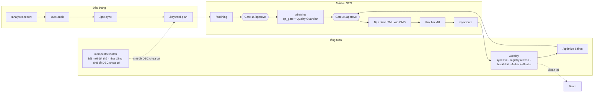

# START HERE — DSC Digital Marketing (SEO là lõi)

Hướng dẫn nhanh cho lần đầu dùng hoặc sau một thời gian không đụng project. Chỉ dẫn đầy đủ: [`AGENTS.md`](AGENTS.md).

**Sau khi clone:** `python scripts/link_agent_dirs.py` (để Claude Code thấy skill qua `.claude/skills`). Codex, Cursor, Antigravity, Gemini CLI đọc `AGENTS.md` + `.agents/skills/` trực tiếp.

---

## Bản đồ skill theo mảng

| Mảng | Skill | Dùng khi |
|---|---|---|
| **0. Nền** | `.agents/context.md` (file, không phải lệnh) | Skill ngoài SEO đọc trước. Sửa khi sản phẩm, kênh hoặc KPI thay đổi |
| | `/setup` | Build Knowledge Base lần đầu (1 lần) |
| **0. Thị trường & đối thủ** | `/competitor-watch` | Tuần này đối thủ đăng gì, nhịp đăng, ai rank top keyword X |
| | `/competitor-profile <domain>` · `/market-research` | Phân tích sâu 1 đối thủ · xu hướng, insight nhà đầu tư (theo quý) |
| **1. SEO — kế hoạch** | `/cluster` → `/keyword-plan [N]` | Chọn bài nên viết |
| | `/gsc-sync`, `/seo-dashboard` | Lấy cơ hội từ GSC |
| **1. SEO — sản xuất** | `/write [kw]` = `/outlining` → `/approve` → `/drafting` → `/approve` | Viết bài mới |
| | `/revise [slug]`, `/qa-qc`, `/image`, `/web-serp` | Sửa, QA, ảnh, SERP |
| **1. SEO — internal link** | `/link` (bài mới · backfill · audit cấu trúc) | Nguồn duy nhất: registry `3-seo/strategy/pages.csv` + `taxonomy.json` |
| **1. SEO — sau publish** | `/weekly`, `/optimize [path]`, `/learn` | Đo, tối ưu bài cũ, học từ feedback |
| **2. Chuyển đổi** | `/cro [slug]` | CTA + banner trong bài SEO |
| | `/copy-landing [trang]` | Copy cả trang đích |
| **3. Social** | `/syndicate [slug]` | Bài SEO → Facebook, LinkedIn, Zalo, Pinterest… |
| **4. Email** | `/email-sequence [welcome\|activate\|nurture\|winback]` | Chuỗi email theo persona |
| **5. Google Ads** | `/ads-audit` | Search term lãng phí, negative keyword, trùng organic |
| | `/ads-copy [ad group]` | Viết RSA, sitelink, callout |
| **6. Đo lường** | `/analytics-report [YYYY-MM]` | Báo cáo tháng SEO + GA4 + Ads |

### Marketing ngoài SEO
Đọc trước: `.agents/core/README.md` (protocol chung) · `.agents/core/rules/compliance-finance.md`.

| Lệnh | Mô tả |
|---|---|
| `/social-plan [YYYY-MM]` | Lịch nội dung tháng Fanpage / Zalo OA / LinkedIn |
| `/social-post <slug\|chủ đề>` | Viết post (≤ 3 biến thể/kênh) + brief hình |
| `/syndicate <slug>` | Pack cho kênh cộng đồng (X, Mastodon, BAND, Pinterest, Medium…) |
| `/ads-brief` · `/meta-ads-copy` | Brief + ad copy Meta (không đẩy lên Meta trừ khi yêu cầu rõ, luôn PAUSED) |
| `/ads-review` · `/ads-learn` | Đọc số Meta (read-only) · rút bài học vào `domains/ads/learnings.md` |
| `/campaign-brief` | Tạo job đa kênh `knowledge/6-campaigns/CMP-YYMMDD-slug/` |
| `/landing` | Copy + HTML 1 trang theo `brand.json` |
| `/campaign-report` · `/mkt-status` | Báo cáo chiến dịch · bảng trạng thái mọi việc |
| `/creative <file copy>` | Dựng ảnh quảng cáo / post / carousel (PNG đúng brand) + QA, duyệt theo version |

QA nhanh cho post / ad / landing: `python scripts/mkt_lint.py <file> --channel facebook|zalo|linkedin|meta-ad|landing`

---

## Workflow



| Nhịp | Làm | Kết quả nằm ở |
|---|---|---|
| Đầu tháng (~1 giờ) | `/analytics-report` → `/ads-audit` → `/gsc-sync` → `/keyword-plan` | `5-analytics/reports/`, `4-channels/ads/`, `3-seo/strategy/`, bài `Planned` trong registry `pages.csv` |
| Mỗi bài | `/write <keyword>` (= `/outlining` → duyệt → `/drafting` → duyệt) → dán CMS → `/link` → `/syndicate` | `3-seo/content/…` → `4-cms/<slug>.html`, `4-channels/social/` |
| Hằng tuần | `/weekly` → `/optimize` cho bài tụt · `/competitor-watch` | `3-seo/links/plans/`, `2-market/competitors/watch/<tuần>.md` |
| Khi có campaign | `/copy-landing` → `/ads-copy` → `/email-sequence` | `4-channels/landing|ads|email/` |
| Hằng quý | `/market-research` · `/competitor-profile` · `/link` audit cấu trúc | `2-market/`, `3-seo/links/` |
| Theo đợt | `/learn` sau đợt duyệt; audit lớn → `3-seo/content/audits/<đợt>/` | `.agents/memory/instincts.md` |

Theo dõi tiến độ: mở `knowledge/0-dashboard/index.html` (chạy `python scripts/build_content_index.py` để cập nhật).

---

## Folder map
Mục đích từng thư mục + ai ghi: [`knowledge/README.md`](knowledge/README.md).

```
AGENTS.md                ← chỉ dẫn chung (CLAUDE.md, GEMINI.md import file này)
.agents/
├── context.md           ← bối cảnh marketing chung
├── skills/<tên>/        ← SKILL.md + references/ + scripts/ (mỗi skill 1 thư mục)
├── rules/               ← seo-formatting, cta-conversion (mở khi cần)
├── core/                ← dùng chung ngoài SEO: protocol, compliance-finance, creative layouts
├── domains/             ← social/ · ads/ (Meta) · campaign/ — README, references, learnings
├── memory/              ← instincts.md, instincts-by-scope/, DECISIONS.md
├── templates/           ← template dùng lại
└── config/              ← API key (gitignored)

knowledge/
├── 0-dashboard/         ← bảng điều hành + tra cứu CMS (sinh tự động)
├── 1-brand/             ← DSC + cách viết: profile, personas, brand-facts, anti-ai-rules, glossary, source-whitelist
├── 2-market/            ← thị trường · research/ · competitors/ (watch/, profiles/)
├── 3-seo/               ← TOÀN BỘ SEO
│   ├── strategy/        ← pages.csv (registry) · taxonomy.json · opportunities · topical-map
│   ├── content/         ← 1-outlines → 2-drafts → 3-finalized → 4-cms · audits/
│   ├── links/           ← plans/ · audit (dashboard.md, link-graph.html) · archive/
│   └── logs/            ← revision-log, qa-*-log, publish-ledger (script ghi)
├── 4-channels/          ← ads/ · email/ · landing/ · social/
├── 5-analytics/         ← kpi-definitions.md, reports/
├── 6-campaigns/         ← job đa kênh CMP-YYMMDD-slug/ (scripts/campaign.py)
└── raw/                 ← dữ liệu thô · live/ (snapshot site) · serp/

scripts/                 ← script Python (mọi script có --help, xem scripts/README.md) · hooks/
```

---

## Files quan trọng nhất

| File | Tác dụng |
|---|---|
| `.agents/context.md` | Bối cảnh chung: sản phẩm, persona, kênh, KPI, ràng buộc |
| `knowledge/1-brand/brand-facts.json` | Nguồn duy nhất cho số liệu DSC (phí, margin, eKYC…) |
| `knowledge/1-brand/anti-ai-rules.md` | Rule văn + blacklist |
| `knowledge/1-brand/glossary.md` | Tên sản phẩm chuẩn + từ cấm |
| `.agents/memory/instincts.md` | Lỗi đã gặp + bài học từ feedback |
| `knowledge/5-analytics/kpi-definitions.md` | Định nghĩa Lead, CPL, CPA… |
