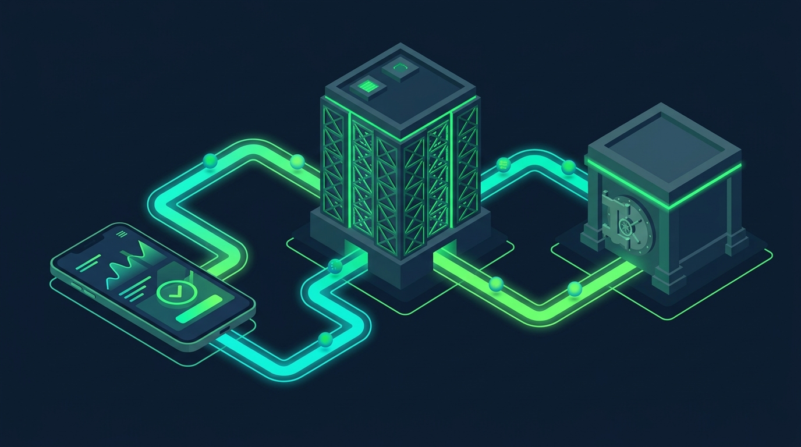

# Cách Chơi Chứng Khoán Cho Người Mới Bắt Đầu: 4 Bước F0

**Cách chơi chứng khoán cho người mới bắt đầu** gồm 4 bước: mở tài khoản, nạp tiền, chọn cổ phiếu và đặt lệnh mua. Điều kiện cần là CCCD gắn chip, một chiếc điện thoại và khoản tiền nhàn rỗi bạn chấp nhận được biến động.

Tháng 8/2026, VSDC ghi nhận hơn 13,58 triệu tài khoản của nhà đầu tư cá nhân trong nước. Trong bài này, Chứng khoán DSC hướng dẫn cách chơi chứng khoán từ A–Z, từ khâu chuẩn bị vốn đến lệnh mua đầu tiên trên App DSC Trading. Bạn sẽ hiểu đúng cách thị trường vận hành và tránh được các sai lầm phổ biến của F0.

Tóm tắt nội dung chính bài viết:

* **Lợi nhuận và rủi ro**: Lợi nhuận đến từ tăng giá cổ phiếu và cổ tức. Đi kèm là 4 rủi ro: thị trường, doanh nghiệp, thanh khoản và vay ký quỹ.
* **Chuẩn bị trước khi giải ngân**: Giữ quỹ dự phòng 3–6 tháng chi tiêu, chỉ dùng tiền nhàn rỗi. Chọn đầu tư chủ động tự chọn mã hoặc bị động qua chứng chỉ quỹ ETF.
* **4 bước giao dịch**: Mở tài khoản eKYC 3 phút tại DSC, nạp tiền qua mã định danh BIDV 963369, chọn cổ phiếu theo 4 tiêu chí rồi đặt lệnh.
* **3 quy định phải nắm**: Giờ giao dịch, biên độ 3 sàn (HOSE ±7%, HNX ±10%, UPCoM ±15%) và chu kỳ thanh toán T+2.
* **Sai lầm và nguyên tắc giữ vốn**: Tránh mua đuổi, làm theo tin mạng và vay ký quỹ sớm. Bắt đầu với 2–5 triệu VNĐ, chia 3–5 mã, cắt lỗ 7–10%.

Chơi chứng khoán chỉ là cách gọi quen miệng. Bản chất đây là đầu tư vào doanh nghiệp thật, cần kế hoạch và kỷ luật. Đọc tiếp để đặt lệnh đầu tiên đúng cách và tránh những khoản lỗ không đáng có.

Cách chơi chứng khoán cho người mới bắt đầu

## Có nên chơi chứng khoán? Lợi ích và rủi ro cho F0

Chứng khoán là kênh tích lũy tài sản dài hạn, nhưng giá biến động mỗi ngày. Bạn cần biết cả hai mặt trước khi giải ngân.

**2 nguồn lợi nhuận cốt lõi của đầu tư cổ phiếu:**

* **Tăng trưởng giá cổ phiếu**: Cổ phiếu là phần sở hữu trong một doanh nghiệp thật. Khi lợi nhuận doanh nghiệp tăng qua nhiều năm, giá cổ phiếu thường phản ánh dần phần tăng trưởng đó.
* **Cổ tức**: Doanh nghiệp có lãi chia cổ tức bằng tiền mặt hoặc cổ phiếu. Khoản này tự động về tài khoản chứng khoán của bạn.

**3 ưu điểm khác của kênh chứng khoán:**

* **Dễ mua bán**: Giá trị khớp lệnh bình quân trên HOSE tháng 6–7/2026 quanh 15.000 tỷ VNĐ/phiên, nên cổ phiếu lớn mua bán được ngay trong giờ giao dịch.
* **Vốn khởi đầu nhỏ**: Một lô 100 cổ phiếu nhóm vốn hóa lớn thường chỉ cần 2–6 triệu VNĐ.
* **Quyền cổ đông**: Bạn được biểu quyết tại Đại hội đồng cổ đông thường niên của doanh nghiệp mình nắm cổ phiếu.

Để hiểu rõ quy trình mua một cổ phiếu ngân hàng cụ thể, bạn có thể tham khảo bài hướng dẫn [**cách mua cổ phiếu VCB**](https://www.dsc.com.vn/kien-thuc/cach-mua-co-phieu-vcb-ngan-hang-vietcombank) của Vietcombank.

**4 rủi ro F0 bắt buộc phải kiểm soát:**

* **Rủi ro thị trường**: Năm 2026, VN-Index đi từ đáy 1.591 điểm (23/03) lên đỉnh 1.928 điểm (18/05), rồi mất mốc 1.700 điểm phiên 15/10. Người mua ở đỉnh tháng 5 đang chịu mức giảm khoảng 11,8% theo chỉ số.
* **Rủi ro doanh nghiệp**: Lợi nhuận suy giảm kéo giá cổ phiếu đi xuống, kể cả khi thị trường chung tăng.
* **Rủi ro thanh khoản**: Cổ phiếu vốn hóa nhỏ, khối lượng giao dịch thấp khiến bạn khó bán khi cần tiền.
* **Rủi ro vay ký quỹ**: Vay thêm tiền mua cổ phiếu khuếch đại cả lãi lẫn lỗ, giảm sâu sẽ bị gọi bổ sung tài sản.

## Chuẩn bị gì trước khi chơi chứng khoán?

Bước 0 quan trọng hơn cả 4 bước phía sau. Phần lớn khoản lỗ của người mới đến từ việc dùng sai tiền, không phải chọn sai mã.

* **Quỹ dự phòng trước**: Giữ riêng 3–6 tháng chi tiêu trong tài khoản tiết kiệm. Khoản này không bao giờ đưa vào chứng khoán.
* **Chỉ dùng tiền nhàn rỗi**: Nếu có 10 triệu VNĐ, hãy hỏi mình có cần số tiền này trong 12 tháng tới không. Câu trả lời là có thì chưa nên giải ngân.
* **Mục tiêu và thời gian nắm giữ**: Tích sản 3–5 năm cần cách chọn mã khác hẳn giao dịch vài tuần. Viết mục tiêu ra giấy trước khi mua mã đầu tiên.
* **Kiến thức tối thiểu**: Biết đọc bảng giá, hiểu lô giao dịch và chu kỳ T+2 là đủ để bắt đầu.

Muốn tập trước mà chưa dùng tiền thật, bạn có thể thử các [**sàn chứng khoán ảo để luyện tập**](https://www.dsc.com.vn/kien-thuc/top-5-san-dau-tu-chung-khoan-ao-uy-tin-tai-viet-nam-luyen-choi-chung-khoan-hieu-qua) trong vài tuần đầu.

## Lựa chọn cách chơi chứng khoán chủ động hay bị động?

Có hai trường phái đầu tư chính, khác nhau ở thời gian bạn bỏ ra và mức tự quyết.

Dưới đây là bảng đối sánh 5 tiêu chí giúp bạn chọn phương thức phù hợp:

| Tiêu chí đối chiếu | Trường phái Đầu tư Chủ động | Trường phái Đầu tư Bị động |
| :--- | :--- | :--- |
| **Mục tiêu lợi nhuận** | Tối ưu hóa hiệu suất, vượt chỉ số VN-Index | Bám sát hiệu suất bình quân thị trường |
| **Thời gian theo dõi** | Cần 1–2 giờ/ngày xem bảng giá & báo cáo | Chỉ cần 1–2 giờ/tháng kiểm tra danh mục |
| **Yêu cầu kiến thức** | Phân tích cơ bản, đọc BCTC & phân tích kỹ thuật | Kiến thức tài chính cơ bản, kiên nhẫn tích sản |
| **Mức độ kiểm soát** | Tự chọn mã cổ phiếu, tự quyết định thời điểm mua bán | Ủy thác cho nhà quản lý quỹ mở hoặc chứng chỉ quỹ ETF |
| **Giải pháp DSC đồng hành** | eKYC 3 phút, App DSC Trading & Môi giới 1:1 | Tư vấn chiến lược phân bổ tài sản từ chuyên gia DSC |

Nếu bạn chỉ có vài giờ mỗi tháng, đi đường bị động qua chứng chỉ quỹ ETF là lựa chọn hợp lý. Chọn chủ động khi bạn sẵn sàng dành thời gian đọc báo cáo doanh nghiệp mỗi quý. Hai cách không loại trừ nhau.

## Chơi chứng khoán như thế nào? 4 bước cho người mới

Cách chơi chứng khoán online năm 2026 gói gọn trong 4 bước dưới đây, làm hoàn toàn trên điện thoại.

### Bước 1: Mở tài khoản chứng khoán eKYC trong 3 phút

Bạn cần một tài khoản chứng khoán cá nhân tại công ty chứng khoán được UBCKNN cấp phép. Chứng khoán DSC mở tài khoản trực tuyến miễn phí qua eKYC. Quá trình mất 3 phút với CCCD gắn chip, ảnh khuôn mặt và mã OTP.

Mở tài khoản chứng khoán

Bạn có thể xem bài hướng dẫn [**cách mở tài khoản chứng khoán**](https://www.dsc.com.vn/kien-thuc/cach-mo-tai-khoan-chung-khoan) để nắm rõ từng thao tác.
Hoặc bạn truy cập trực tiếp trang [**mở tài khoản chứng khoán**](https://www.dsc.com.vn/mo-tai-khoan) chính thức của DSC.

### Tiêu chí chọn công ty chứng khoán cho F0

Công ty chứng khoán chia thành nhiều nhóm: thị phần lớn, trực thuộc ngân hàng, công nghệ phí 0 đồng và ngân hàng đầu tư như DSC. Thay vì so tên, hãy kiểm từng công ty bằng 5 câu hỏi dưới đây.

| Tiêu chí | Câu hỏi cần kiểm tra | Câu trả lời tại DSC |
| :--- | :--- | :--- |
| **Pháp lý** | Công ty có giấy phép của UBCKNN không? | Công ty Cổ phần Chứng khoán DSC được UBCKNN cấp phép |
| **Phí giao dịch** | Phí mỗi lệnh bao nhiêu %, có phí ẩn không? | Từ 0,1% giá trị lệnh |
| **Người hỗ trợ** | Có người để hỏi trước khi đặt lệnh không? | Môi giới 1:1, mỗi khách hàng một chuyên gia |
| **Mở tài khoản** | Có mở online được không, mất bao lâu? | eKYC 3 phút qua App DSC Trading |
| **Nạp rút tiền** | Tiền nạp vào mất bao lâu? | Mã định danh 963369 qua BIDV, ghi nhận sau vài giây |

So sánh chi tiết từng công ty nằm ở bài [**nên mở tài khoản chứng khoán ở đâu**](https://www.dsc.com.vn/kien-thuc/nen-mo-tai-khoan-chung-khoan-o-dau). Bạn cũng có thể kiểm tra [**mở tài khoản chứng khoán có mất phí không**](https://www.dsc.com.vn/kien-thuc/mo-tai-khoan-chung-khoan-co-mat-phi-khong-can-bao-nhieu-tien) và [**mở tài khoản chứng khoán online có an toàn không**](https://www.dsc.com.vn/kien-thuc/mo-tai-khoan-chung-khoan-online-co-an-toan-khong) trước khi đăng ký.

### Bước 2: Nạp vốn đầu tư nhanh qua định danh BIDV

Để bắt đầu mua cổ phiếu, bạn cần nạp tiền vào tài khoản chứng khoán vừa tạo. DSC liên kết trực tiếp với BIDV để cung cấp giải pháp nạp tiền nhanh 24/7 thông qua mã định danh 963369.

Bạn chuyển tiền vào số tài khoản thụ hưởng: **963369** + **6 số cuối số tài khoản** + **số đuôi tiểu khoản**.

* **Tiểu khoản đuôi 1**: Giao dịch thường (không dùng đòn bẩy margin).
* **Tiểu khoản đuôi 6**: Giao dịch ký quỹ (Margin).

Ví dụ: Với tài khoản 024C123456, bạn chuyển vào số **9633691234561** để hệ thống tự động ghi nhận tiền sau vài giây.

### Bước 3: Chọn cổ phiếu đầu tiên theo 4 tiêu chí

Đây là bước người mới mất nhiều thời gian nhất. Một bộ lọc 4 tiêu chí giúp bạn loại bớt phần lớn mã rủi ro trước khi xem kỹ.

* **Doanh nghiệp đầu ngành**: Ưu tiên công ty dẫn đầu ngành, có lợi thế cạnh tranh lâu năm như FPT, VCB, HPG.
* **Lợi nhuận tăng đều**: Lợi nhuận sau thuế tăng trên 15%/năm trong 3 năm liên tiếp.
* **ROE trên 15%**: ROE là lợi nhuận doanh nghiệp tạo ra trên mỗi đồng vốn của cổ đông. Mức trên 15% ổn định nhiều năm là dấu hiệu dùng vốn hiệu quả.
* **Thời điểm mua an toàn**: Giá đi ngang tích lũy và nằm trên đường MA20, tức đường giá trung bình của 20 phiên gần nhất.

Bạn nên kết hợp với phương pháp [**phân tích kỹ thuật**](https://www.dsc.com.vn/kien-thuc/phan-tich-ky-thuat-la-gi) để xác định điểm mua tối ưu.
Đồng thời, bạn xem thêm bài hướng dẫn [**cách mua cổ phiếu**](https://www.dsc.com.vn/kien-thuc/cach-mua-co-phieu-online-cho-nguoi-moi-bat-dau) trực tuyến cho người mới.

### Bước 4: Đặt lệnh mua cổ phiếu trên App DSC Trading

Sau khi nạp tiền, bạn mở App DSC Trading và chọn mã cổ phiếu cần mua. Tiếp theo, chọn loại lệnh, nhập giá cùng khối lượng rồi xác thực bằng mã OTP.

**Quy định lô giao dịch và 4 loại lệnh cơ bản:**

* **Lô giao dịch**: HOSE và HNX áp dụng lô chẵn 100 cổ phiếu. HPG đóng cửa phiên 16/10/2026 ở 20.850 VNĐ, nên 1 lô cần khoảng 2,1 triệu VNĐ chưa tính phí.
* **Lô lẻ**: Chưa đủ tiền mua 100 cổ phiếu, bạn đặt lô lẻ từ 1 đến 99 cổ phiếu theo [**quy định lô chẵn lô lẻ**](https://www.dsc.com.vn/kien-thuc/huong-dan-giao-dich-lo-chan-lo-le).
* **Lệnh giới hạn (LO)**: Bạn tự đặt mức giá mua hoặc bán. Lệnh chỉ khớp khi giá thị trường chạm mức đó.
* **Lệnh thị trường (MP)**: Lệnh khớp ngay tại mức giá tốt nhất đang có trên bảng điện.
* **Lệnh ATO và ATC**: Lệnh mua bán tại giá khớp của phiên mở cửa (ATO) hoặc đóng cửa (ATC).

Bạn có thể xem chi tiết [**cách chơi chứng khoán trên điện thoại**](https://www.dsc.com.vn/kien-thuc/dau-tu-chung-khoan-tren-dien-thoai-huong-dan-chi-tiet) để thao tác dễ dàng.
Khi cần chốt lời, hãy làm theo bài hướng dẫn [**bán cổ phiếu**](https://www.dsc.com.vn/kien-thuc/cach-ban-co-phieu-cho-nguoi-moi) để rút tiền về ngân hàng.

Không cần biết hết mới bắt đầu. Khi mở tài khoản tại DSC, bạn có chuyên gia Môi giới 1:1 để hỏi trước lệnh mua đầu tiên, còn eKYC chỉ mất 3 phút trên App DSC Trading.

  

  

    
Mở tài khoản chứng khoán DSC chỉ với CCCD gắn chip

    
eKYC 3 phút, 100% online • Miễn phí mở tài khoản • Phí giao dịch từ 0,1%

  

  <a href="https://www.dsc.com.vn/mo-tai-khoan" style="background: #2BE841; color: #0D1B2A; padding: 14px 32px; border-radius: 30px; text-decoration: none; font-weight: 700; font-size: 16px; display: inline-block; position: relative; z-index: 1;">Mở tài khoản — 3 phút</a>

## Các quy định giao dịch cốt lõi F0 bắt buộc phải biết

Ba quy định dưới đây chi phối mọi lệnh bạn đặt. Nắm chắc chúng, bạn tránh được phần lớn lỗi đặt lệnh của tuần đầu.

Các kiến thức đầu tư chứng khoán quan trọng

### Thời gian giao dịch và biên độ dao động 3 sàn

Thị trường chứng khoán Việt Nam mở cửa từ thứ Hai đến thứ Sáu, trừ ngày nghỉ lễ Tết.

Dưới đây là bảng thông số giao dịch quy chuẩn của ba sàn:

| Sàn giao dịch | Biên độ dao động | Mở cửa (ATO) | Khớp lệnh liên tục | Đóng cửa (ATC) |
| :--- | :--- | :--- | :--- | :--- |
| **HOSE** | +/- 7% | 09:00 - 09:15 | 09:15 - 11:30 & 13:00 - 14:30 | 14:30 - 14:45 |
| **HNX** | +/- 10% | Không áp dụng | 09:00 - 11:30 & 13:00 - 14:30 | 14:30 - 14:45 |
| **UPCoM** | +/- 15% | Không áp dụng | 09:00 - 11:30 & 13:00 - 15:00 | Không áp dụng |

Để chuẩn bị cho phiên giao dịch, bạn nên tra cụ thể [**giờ giao dịch chứng khoán**](https://www.dsc.com.vn/kien-thuc/gio-giao-dich-chung-khoan-viet-nam) theo quy định của các sàn.
Ngoài ra, bạn có thể tham khảo mức [**phí giao dịch chứng khoán**](https://www.dsc.com.vn/kien-thuc/phi-giao-dich-chung-khoan) để tính chi phí vốn chính xác.

### Cách đọc 3 loại giá trên bảng điện tử

Khi quan sát bảng giá, bạn cần phân biệt rõ ba mức giá cơ bản hiển thị:
* **Giá tham chiếu (Màu vàng)**: Mức giá đóng cửa của ngày giao dịch gần nhất trước đó (đối với HOSE và HNX). Mức giá này dùng làm cơ sở tính giá trần và giá sàn.
* **Giá trần (Màu tím)**: Mức giá cao nhất bạn có thể đặt mua hoặc bán trong ngày giao dịch.
* **Giá sàn (Màu xanh lam)**: Mức giá thấp nhất bạn có thể đặt mua hoặc bán trong ngày giao dịch.

Để làm chủ các thao tác đặt lệnh phức tạp, bạn hãy tìm hiểu thêm về [**lệnh giới hạn và lệnh thị trường**](https://www.dsc.com.vn/kien-thuc/lenh-ato-atc-lo-mp-la-gi) hiển thị trên bảng điện.

### Chu kỳ thanh toán T+2: khi nào cổ phiếu và tiền về tài khoản

Việt Nam áp dụng chu kỳ thanh toán T+2 cho cổ phiếu. Ngày T là ngày lệnh khớp, cổ phiếu về tài khoản vào trưa ngày làm việc thứ hai sau đó.

Ví dụ: Bạn mua HPG khớp lệnh sáng thứ Hai (ngày T). Cổ phiếu về tài khoản trước phiên chiều thứ Tư (ngày T+2), và bạn đặt lệnh bán được ngay trong phiên chiều đó.

Chiều ngược lại cũng theo T+2. Tiền bán cổ phiếu về tài khoản sau 2 ngày làm việc, nhưng bạn có thể ứng trước tiền bán trên App DSC Trading để dùng ngay. Khoản [**phí lưu ký chứng khoán**](https://www.dsc.com.vn/kien-thuc/phi-luu-ky-chung-khoan-la-gi) được khấu trừ tự động theo tháng.

## 3 sai lầm khiến người mới chơi chứng khoán mất tiền

Ba sai lầm dưới đây lặp lại ở gần như mọi chu kỳ thị trường. Tin tức tháng 10/2026 cho thấy chúng vẫn đang xảy ra.

* **Làm theo tin trên mạng xã hội hoặc AI**: Ngày 15/10/2026, UBCKNN xử phạt một TikToker đăng tin sai về cho vay ký quỹ. Cùng ngày, VnExpress đưa tin nhiều người thua lỗ vì đặt lệnh theo gợi ý của AI.
* **Mua đuổi khi thị trường hưng phấn**: VN-Index chạm đỉnh 1.928 điểm ngày 18/05/2026, lúc rất nhiều người mới vào thị trường. Đến 15/10/2026, chỉ số rơi dưới 1.700 điểm, thấp hơn đỉnh khoảng 11,8%.
* **Vay ký quỹ khi chưa có kinh nghiệm**: Vay 1 đồng trên 1 đồng vốn, cổ phiếu giảm 25% là bạn mất một nửa vốn gốc. Đọc kỹ [**call margin là gì**](https://www.dsc.com.vn/kien-thuc/call-margin-la-gi-lam-gi-khi-bi-call-margin) trước khi dùng tiểu khoản đuôi 6.

Điểm chung của cả ba là quyết định không dựa trên dữ liệu của chính bạn. Bốn nguyên tắc dưới đây sinh ra để chặn đúng những tình huống đó.

## 4 nguyên tắc giữ vốn cho người mới chơi chứng khoán

Người mới không cần thắng nhiều. Cần sống sót đủ lâu để học.

Các kỹ năng quan trọng trong đầu tư chứng khoán

### 1. Bắt đầu trải nghiệm với số vốn nhỏ

Nhiều [**nhà đầu tư F0**](https://www.dsc.com.vn/kien-thuc/nha-dau-tu-f0-la-gi) giải ngân toàn bộ tiền tiết kiệm ngay tuần đầu tiên. Đó là cách nhanh nhất để lỗ lớn khi chưa quen nhịp thị trường. Hãy bắt đầu với 2–5 triệu VNĐ, đủ mua 1 lô cổ phiếu vốn hóa lớn.

Bạn nên tham khảo bài viết về [**đầu tư chứng khoán với vốn nhỏ**](https://www.dsc.com.vn/kien-thuc/cach-dau-tu-chung-khoan-voi-so-von-nho) để tích lũy kinh nghiệm thực chiến an toàn.

### 2. Đa dạng hóa danh mục (Không bỏ trứng vào một giỏ)

Không dồn toàn bộ tiền vào một mã hay một ngành. Với 50 triệu VNĐ, bạn có thể chia cho 3–5 mã thuộc các ngành khác nhau như Ngân hàng, Thép, Công nghệ. Một mã giảm sâu khi đó chỉ ảnh hưởng một phần danh sách cổ phiếu đang nắm giữ.

Bạn có thể nghiên cứu thêm [**các chiến lược đầu tư chứng khoán**](https://www.dsc.com.vn/kien-thuc/cac-chien-luoc-dau-tu-chung-khoan-pho-bien-tren-thi-truong) để biết cách phân bổ tỷ trọng vốn hợp lý nhất.

### 3. Tuân thủ kỷ luật cắt lỗ từ 7% đến 10%

Ai cũng có lúc đoán sai xu hướng giá. Bán cắt lỗ khi giá xuống 7–10% so với giá mua giúp bạn giữ phần lớn vốn cho lần sau. Lỗ 10% chỉ cần lãi 11% để hòa vốn, còn lỗ 50% cần lãi 100%.

Kỷ luật cắt lỗ giúp bảo vệ nguồn vốn để tận dụng [**hiệu ứng lãi kép**](https://www.dsc.com.vn/kien-thuc/lai-kep-trong-dau-tu-chung-khoan-la-gi-cach-tan-dung-lai-kep-de-dau-tu-sinh-loi) về dài hạn.

### 4. Đồng hành cùng chuyên gia Môi giới 1:1 của DSC

Câu hỏi khó nhất của người mới thường đến lúc 14h20, khi bảng điện đỏ và chưa biết nên bán hay giữ. Khi mở tài khoản tại DSC, bạn được kết nối với một chuyên gia [**môi giới chứng khoán**](https://www.dsc.com.vn/kien-thuc/moi-gioi-chung-khoan-la-gi-tim-hieu-nghe-nghiep-hap-dan-va-day-tiem-nang) riêng. Chuyên gia hỗ trợ bạn lọc mã, đọc biểu đồ giá và xây danh mục phù hợp với số vốn.

Dịch vụ tư vấn đầu tư Môi giới 1:1 hoàn toàn miễn phí và có sẵn qua chat trên App DSC Trading.

## Các câu hỏi thường gặp về cách chơi chứng khoán (FAQs)

### Chơi chứng khoán là gì?

Chơi chứng khoán là cách gọi quen thuộc của việc mua bán cổ phiếu, chứng chỉ quỹ qua công ty chứng khoán để hưởng chênh lệch giá và cổ tức. Đây là đầu tư có rủi ro, không phải trò may rủi.

### 1 triệu có chơi được chứng khoán không?

Có. Với 1 triệu VNĐ, bạn mua được lô lẻ dưới 100 cổ phiếu, hoặc trọn lô 100 cổ phiếu ở các mã giá dưới 10.000 VNĐ. Chi tiết cách phân bổ có trong bài [**1 triệu có chơi được chứng khoán không**](https://www.dsc.com.vn/kien-thuc/1-trieu-co-choi-duoc-chung-khoan-khong).

### Người mới nên mua cổ phiếu nào đầu tiên?

Người mới nên bắt đầu với cổ phiếu trong rổ VN30, doanh nghiệp đầu ngành và trả cổ tức đều đặn như FPT, VCB, HPG. Nhóm này dễ mua bán và có nhiều thông tin công bố để theo dõi.

### Chơi chứng khoán trên điện thoại có an toàn không?

Có, nếu bạn giao dịch qua app của công ty chứng khoán được UBCKNN cấp phép. App DSC Trading xác thực danh tính bằng eKYC và mã OTP khi đặt lệnh.

### Bán cổ phiếu bao lâu thì rút được tiền?

Tiền bán cổ phiếu về tài khoản sau 2 ngày làm việc theo chu kỳ T+2. Cần tiền sớm hơn, bạn dùng tính năng ứng trước tiền bán trên App DSC Trading rồi rút về ngân hàng liên kết.

## Bắt đầu lệnh đầu tiên của bạn

Việc cần làm ngay là mở tài khoản và nạp trước 2–5 triệu VNĐ. Sau đó đặt lệnh LO cho một mã VN30, theo dõi trọn chu kỳ T+2 trước khi tăng vốn.

Hãy truy cập trang [**mở tài khoản trực tuyến eKYC tại DSC**](https://www.dsc.com.vn/mo-tai-khoan) để kích hoạt tài khoản trong 3 phút. Chuyên gia Môi giới 1:1 sẽ liên hệ để cùng bạn chọn mã cho lệnh đầu tiên.

  

  

    
Đặt lệnh đầu tiên với chuyên gia Môi giới 1:1 bên cạnh

    
Tư vấn danh mục miễn phí • Nạp tiền qua Mã định danh 963369 • Giao dịch trên App DSC Trading

  

  <a href="https://www.dsc.com.vn/mo-tai-khoan" style="background: #2BE841; color: #0D1B2A; padding: 14px 32px; border-radius: 30px; text-decoration: none; font-weight: 700; font-size: 16px; display: inline-block; position: relative; z-index: 1;">Mở tài khoản — 3 phút</a>

> **Tuyên bố miễn trừ trách nhiệm:** Thông tin trong bài viết chỉ mang tính chất tham khảo và chia sẻ kiến thức. Chứng khoán DSC không chịu trách nhiệm đối với bất kỳ kết quả giao dịch nào của bạn từ việc tham khảo bài viết. Đầu tư chứng khoán luôn có rủi ro đi kèm, bạn cần tìm hiểu kỹ trước khi ra quyết định giải ngân vốn.
