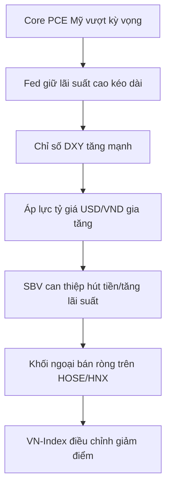

Mỗi phiên công bố chỉ số PCE của Cục Phân tích Kinh tế Mỹ luôn khiến thị trường tài chính biến động mạnh. Dữ liệu vĩ mô này tác động trực tiếp đến lộ trình điều hành lãi suất của Cục Dự trữ Liên bang.

Từ đó, dòng tiền ngoại tệ dịch chuyển liên tục, ảnh hưởng trực tiếp đến thị trường chứng khoán Việt Nam. Nhà giao dịch chủ động cần nắm rõ bản chất của PCE để đưa ra quyết định phân bổ vốn chính xác.

## Chỉ số PCE là gì?

Chỉ số PCE là viết tắt của Personal Consumption Expenditures, đại diện cho chi tiêu tiêu dùng cá nhân tại Mỹ. Chỉ báo vĩ mô này đo lường tổng giá trị hàng hóa và dịch vụ được mua sắm bởi các hộ gia đình. Đây là thước đo cốt lõi do Cục Phân tích Kinh tế Mỹ công bố vào ngày thứ Sáu cuối cùng mỗi tháng.

Chi tiêu tiêu dùng chiếm khoảng $70\%$ quy mô nền kinh tế Mỹ. Do đó, chỉ số này phản ánh chính xác nhất sức mua và niềm tin của người tiêu dùng thực tế. Biến động của chỉ số giúp các chuyên gia đánh giá tốc độ tăng trưởng kinh tế trong ngắn hạn.

Dữ liệu PCE tăng trưởng đều đặn cho thấy các hộ gia đình đang tích cực mở rộng hầu bao. Điều này kích thích các doanh nghiệp mở rộng quy mô sản xuất, thúc đẩy GDP tăng trưởng. Ngược lại, chi tiêu sụt giảm liên tiếp là tín hiệu cảnh báo nền kinh tế có nguy cơ rơi vào suy thoái.

\>> Xem thêm: [Phân tích vĩ mô trong đầu tư chứng khoán là gì](https://www.dsc.com.vn/kien-thuc/phan-tich-vi-mo-trong-dau-tu-chung-khoan-la-gi)

## Phân loại chỉ số PCE: Sự khác biệt cốt lõi giữa PCE và Core PCE

Chỉ số PCE được chia làm hai loại chính gồm PCE tổng thể và Core PCE. Mỗi loại chỉ số phục vụ cho những mục đích phân tích vĩ mô khác nhau của giới đầu tư.

PCE tổng thể theo dõi toàn bộ rổ hàng hóa và dịch vụ tiêu dùng của người dân Mỹ. Chỉ số này phản ánh chi phí sinh hoạt thực tế của các hộ gia đình. Tuy nhiên, PCE tổng thể thường chịu biến động mạnh do giá năng lượng và thực phẩm thay đổi liên tục.

Core PCE là chỉ số chi tiêu tiêu dùng cá nhân lõi, đã loại bỏ thực phẩm và năng lượng. Hai nhóm mặt hàng này thường xuyên chịu tác động bởi thời tiết hoặc xung đột địa chính trị toàn cầu. Cục Dự trữ Liên bang Mỹ sử dụng Core PCE làm thước đo lạm phát ưa thích để điều hành chính sách tiền tệ.

Fed đặt mục tiêu duy trì lạm phát lõi Core PCE dài hạn ổn định ở mức $2,0\%$/năm. Chỉ số này tăng cao vượt mục tiêu buộc Fed phải thắt chặt tiền tệ bằng cách tăng lãi suất. Hành động này nhằm hạ nhiệt nhu cầu tiêu dùng và kiềm chế đà leo thang của giá cả.

## So sánh chi tiết Chỉ số PCE và Chỉ số CPI

Chỉ số PCE và Chỉ số giá tiêu dùng (CPI) đều được dùng để đo lường lạm phát. Tuy nhiên, hai thước đo này có những điểm khác biệt kỹ thuật rất quan trọng dưới đây.

| Tiêu chí so sánh | Chỉ số giá PCE | Chỉ số giá CPI |
| :--- | :--- | :--- |
| **Nguồn dữ liệu gốc** | Khảo sát từ các doanh nghiệp, tổ chức cung cấp dịch vụ và GDP. | Khảo sát trực tiếp từ các hộ gia đình trên toàn nước Mỹ. |
| **Phạm vi đo lường** | Bao phủ rộng, tính cả các khoản chi tiêu do bên thứ ba trả thay. | Chỉ tính các khoản chi tiêu trực tiếp tự chi trả của người dân. |
| **Trọng số & Công thức** | Trọng số thay đổi linh hoạt theo tháng nhờ công thức Fisher-Ideal. | Giỏ hàng hóa cố định, chỉ cập nhật trọng số sau mỗi $1$ đến $2$ năm. |
| **Hiệu ứng thay thế** | Phản ánh lập tức xu hướng chuyển sang hàng hóa rẻ hơn khi lạm phát. | Bỏ qua hiệu ứng thay thế, thường phóng đại mức độ lạm phát thực. |
| **Mức độ ưu tiên của Fed** | Thước đo lạm phát mục tiêu chính thức được Fed chọn từ năm 2000. | Thước đo tham khảo, dùng để điều chỉnh các khoản trợ cấp xã hội. |

Phạm vi bao phủ của PCE rộng hơn CPI đáng kể. Ví dụ, CPI chỉ tính tiền thuốc bạn tự chi trả. PCE tính cả tiền thuốc và phần bảo hiểm y tế do doanh nghiệp đóng thay cho bạn.

Công thức tính toán của PCE linh hoạt hơn nhờ khả năng tự điều chỉnh theo hành vi tiêu dùng. Khi giá thịt bò tăng cao, người dân Mỹ sẽ chuyển sang mua thịt gà có giá rẻ hơn. PCE cập nhật ngay sự thay đổi trọng số này để phản ánh đúng thực tế tiêu dùng.

CPI vẫn giữ nguyên giỏ hàng cũ, dẫn đến việc tính toán mức lạm phát cao hơn thực tế. Điều này tạo ra sai lệch lớn trong việc đo lường lạm phát mục tiêu.

\>> Xem thêm: [CPI là gì? Ý nghĩa, cách tính chỉ số tiêu dùng CPI](https://www.dsc.com.vn/kien-thuc/chi-so-gia-tieu-dung-cpi-la-gi-va-moi-quan-he-voi-thi-truong-chung-khoan)

## Tác động vĩ mô từ PCE Mỹ đến thị trường chứng khoán Việt Nam

Biến động chỉ số Core PCE của Mỹ không chỉ ảnh hưởng đến phố Wall. Chỉ báo này kích hoạt chuỗi tác động liên thị trường phức tạp, ảnh hưởng trực tiếp đến sàn HOSE và HNX.

### Core PCE vượt kỳ vọng và phản ứng của Fed

Khi Core PCE công bố cao hơn mức dự báo, lạm phát Mỹ đang có dấu hiệu cứng đầu. Fed sẽ buộc phải duy trì lãi suất điều hành ở mức cao trong thời gian dài hơn. Kỳ vọng hạ lãi suất của giới đầu tư toàn cầu lập tức bị dập tắt.

### Sức mạnh DXY và áp lực tỷ giá USD/VND

Lãi suất USD neo cao khiến chỉ số sức mạnh đồng đô la Mỹ (DXY) leo dốc. Đồng USD mạnh lên gây áp lực mất giá trực tiếp lên đồng VND. Chênh lệch lãi suất giữa USD và VND nới rộng kích thích dòng vốn rút ra khỏi Việt Nam.

Năm 2024, tỷ giá USD/VND có thời điểm tăng vọt lên mức sát $26.000$ VNĐ. Sự mất giá của nội tệ ảnh hưởng tiêu cực đến chi phí nhập khẩu nguyên liệu của nhiều doanh nghiệp. Tình hình này buộc cơ quan quản lý tiền tệ trong nước phải có hành động can thiệp.

### Động thái ứng phó của Ngân hàng Nhà nước Việt Nam

Để ổn định tỷ giá, Ngân hàng Nhà nước Việt Nam (SBV) sẽ sử dụng các công cụ điều hành. SBV có thể phát hành tín phiếu trên thị trường mở (OMO) để hút bớt lượng VND dư thừa. Biện pháp mạnh hơn là bán USD từ nguồn dự trữ ngoại hối để cân bằng cung cầu ngoại tệ.

Các hoạt động hút tiền này trực tiếp làm giảm lượng thanh khoản VND trong hệ thống ngân hàng. Lãi suất liên ngân hàng bị đẩy lên cao, tạo áp lực tăng lãi suất huy động dân cư. Dòng tiền nhàn rỗi trong nền kinh tế có xu hướng quay lại kênh tiền gửi an toàn.

### Khối ngoại bán ròng và phản ứng của VN-Index

Tỷ giá biến động mạnh khiến các quỹ đầu tư nước ngoài chịu lỗ kép về mặt tỷ giá khi đầu tư tại Việt Nam. Họ nhanh chóng thực hiện chiến lược bán ròng cổ phiếu trên sàn HOSE và HNX để rút vốn về. Áp lực bán ròng liên tục từ khối ngoại là tác nhân chính đẩy chỉ số VN-Index điều chỉnh giảm.

### Sự phân hóa nhóm ngành nhạy cảm trên sàn giao dịch

Dòng tiền co hẹp dưới áp lực tỷ giá sẽ tạo ra sự phân hóa sâu sắc giữa các nhóm ngành. Các nhà giao dịch ngắn hạn cần cơ cấu lại danh mục để phòng thủ.

- **Nhóm Bất động sản**: Chịu ảnh hưởng nặng nề nhất do cấu trúc nợ vay lớn. Lãi suất tăng làm tăng chi phí vốn, đồng thời bào mòn sức mua của người mua nhà dự án.
- **Nhóm Chứng khoán**: Thanh khoản thị trường sụt giảm làm giảm mạnh doanh thu phí giao dịch. Hoạt động cho vay ký quỹ và tự doanh của các công ty chứng khoán cũng gặp khó khăn.
- **Nhóm Ngân hàng**: Biên lãi ròng (NIM) chịu áp lực thu hẹp do lãi suất huy động tăng nhanh hơn lãi suất cho vay. Rủi ro nợ xấu có xu hướng gia tăng khi khách hàng gặp khó khăn về dòng tiền.
- **Nhóm Xuất khẩu**: Các ngành thủy sản, dệt may, gỗ và logistics được hưởng lợi ngắn hạn. Họ nhận doanh thu bằng USD, giúp cải thiện biên lợi nhuận khi quy đổi sang VND.

## FAQs - Các câu hỏi thường gặp về chỉ số PCE

### Lịch công bố chỉ số PCE là khi nào?

Cục Phân tích Kinh tế Mỹ công bố chỉ số PCE định kỳ hàng tháng. Dữ liệu thường được phát hành vào lúc 19h30 hoặc 20h30 (theo giờ Việt Nam) ngày thứ Sáu cuối cùng của tháng kế tiếp. Ví dụ, số liệu chi tiêu tháng 5/2026 sẽ công bố vào ngày thứ Sáu cuối cùng của tháng 6/2026.

### Tại sao số liệu PCE tốt cho kinh tế Mỹ lại có thể là tin xấu cho thị trường chứng khoán?

Thị trường tài chính thường xuất hiện hiện tượng tin tốt là tin xấu. Khi số liệu PCE cho thấy người dân Mỹ chi tiêu mạnh mẽ, nền kinh tế đang rất khỏe. Điều này đồng nghĩa với việc lạm phát có nguy cơ bùng phát trở lại.

Fed sẽ tiếp tục siết chặt chính sách tiền tệ để dập lạm phát. Điều này gây bất lợi trực tiếp cho thị trường chứng khoán toàn cầu.

### Làm thế nào để theo dõi nhanh các tác động vĩ mô liên thị trường?

Nhà đầu tư có thể cập nhật các phân tích vĩ mô thông qua hệ thống báo cáo của Chứng khoán DSC. Nền tảng của chúng tôi cung cấp các nhận định chuyên sâu về tỷ giá, dòng vốn ngoại và xu hướng ngành. Bạn có thể dễ dàng theo dõi các thông tin này ngay trên ứng dụng giao dịch di động.

## Kết luận & Giải pháp chiến lược cùng DSC

Chỉ số PCE của Mỹ là biến số vĩ mô hàng đầu quyết định dòng chảy của dòng vốn toàn cầu. Chính sách thắt chặt từ Fed do lạm phát cứng đầu sẽ gây sóng gió lớn cho tỷ giá và thanh khoản trong nước. Nhà giao dịch chủ động cần hệ thống phân tích sắc bén để chuyển hóa biến động vĩ mô thành cơ hội đầu tư.

Đồng hành cùng Chứng khoán DSC, bạn không còn phải tự bơi giữa biển thông tin vĩ mô hỗn loạn. Gói Môi giới 1:1 của chúng tôi mang lại đặc quyền kết nối trực tiếp với chuyên gia phân tích giàu kinh nghiệm.

Chuyên viên sẽ hỗ trợ bạn giải mã số liệu vĩ mô thời gian thực. Chúng tôi giúp bạn thiết kế chiến lược quản trị rủi ro danh mục và cơ cấu vốn ký quỹ hiệu quả.

Hãy kích hoạt hành trình đầu tư chuyên nghiệp ngay hôm nay. Chỉ mất 3 phút để hoàn thành quy trình mở tài khoản chứng khoán online 100% qua công nghệ định danh eKYC hiện đại.

\>> Xem thêm: [Hướng dẫn cách mở tài khoản chứng khoán online cho người mới (2026)](https://www.dsc.com.vn/kien-thuc/cach-mo-tai-khoan-chung-khoan)
