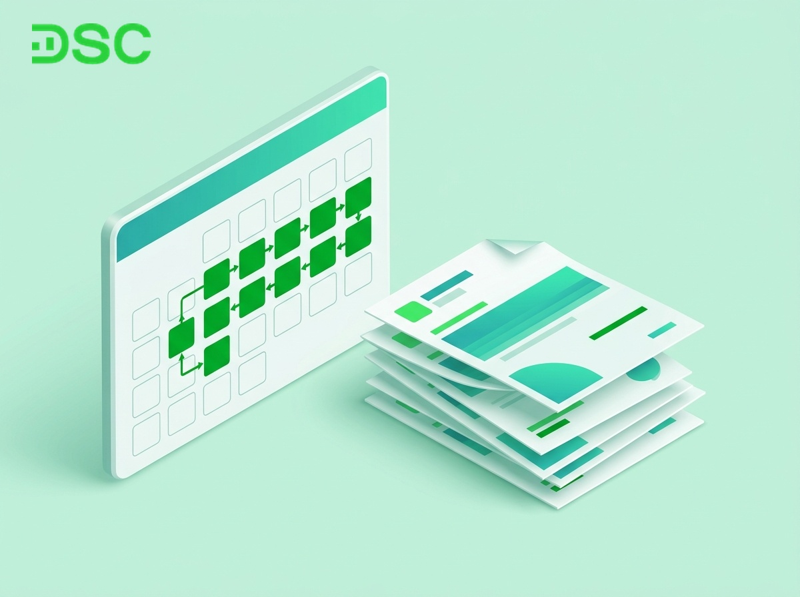

# Ngày Đáo Hạn Phái Sinh Là Gì? Lịch Đáo Hạn 2026 Chi Tiết

Ngày đáo hạn phái sinh là sự kiện quan trọng có tính chu kỳ trên thị trường chứng khoán Việt Nam. Sự kiện này diễn ra định kỳ hàng tháng. Nó thường kéo theo những đợt rung lắc mạnh đối với chỉ số VN30 và thị trường cơ sở.

Hiểu bản chất ngày đáo hạn phái sinh giúp bạn chủ động quản trị danh mục đầu tư. Việc theo dõi lịch đáo hạn năm 2026 giúp bạn bảo vệ nguồn vốn và đón đầu các cơ hội giá tốt.

## Ngày đáo hạn phái sinh là gì?

Ngày đáo hạn phái sinh (Expiration Date) là ngày giao dịch cuối cùng của một [hợp đồng tương lai](https://www.dsc.com.vn/kien-thuc/hop-dong-tuong-lai-la-gi). Sau ngày này, hợp đồng hiện tại sẽ hết hiệu lực và ngừng giao dịch trên bảng điện tử. Hệ thống VSDC sẽ tự động tất toán toàn bộ vị thế mở thành tiền mặt theo giá thanh toán cuối cùng.

Sản phẩm [chứng khoán phái sinh là gì](https://www.dsc.com.vn/kien-thuc/chung-khoan-phai-sinh-la-gi-huong-dan-dau-tu-cho-nguoi-moi-bat-dau) phổ biến nhất tại Việt Nam là hợp đồng tương lai chỉ số VN30. Hợp đồng phái sinh luôn có vòng đời hữu hạn. Nhà đầu tư không nhận cổ phiếu thực tế mà chỉ nhận khoản tiền chênh lệch lãi lỗ.

Sau ngày đáo hạn, bạn không thể tiếp tục đặt lệnh trên mã hợp đồng cũ. Bạn cần chuyển sang giao dịch mã hợp đồng của tháng kế tiếp để duy trì vị thế.

## Phân biệt Ngày đáo hạn và Ngày thanh toán (T+1)

Nhiều nhà đầu tư mới thường nhầm lẫn giữa ngày hết hạn giao dịch và ngày tiền về tài khoản.

| Tiêu chí đối sánh | Ngày đáo hạn (Expiration Date) | Ngày thanh toán (Settlement Date / T+1) |
| :--- | :--- | :--- |
| **Thời gian diễn ra** | Thứ Năm tuần thứ ba của tháng đáo hạn | Ngày làm việc liền sau ngày đáo hạn (sáng Thứ Sáu tuần thứ ba) |
| **Hoạt động trên sàn** | Ngày giao dịch cuối cùng của hợp đồng | Hợp đồng cũ ngừng giao dịch, chỉ giao dịch các hợp đồng tháng mới |
| **Xử lý vị thế mở** | Nhà đầu tư đóng lệnh hoặc hệ thống chốt giá FSP | VSDC hoàn tất chuyển tiền bù trừ giữa các bên |
| **Hạch toán tiền mặt** | Ghi nhận lãi lỗ danh nghĩa cuối phiên ATC | Tiền thực tế được cộng hoặc trừ trực tiếp vào tài khoản khả dụng |

Việc phân định hai mốc thời gian này giúp bạn chủ động quản lý dòng tiền. Bạn không nên vội vã rút tiền khi dòng tiền thực tế chỉ hoàn tất hạch toán vào sáng hôm sau.

## Lịch đáo hạn phái sinh tại Việt Nam cập nhật 2026

Sở Giao dịch Chứng khoán Hà Nội (HNX) quy định ngày đáo hạn là ngày **Thứ Năm tuần thứ ba** của tháng. Nếu ngày này trùng dịp nghỉ lễ hoặc Tết, phiên đáo hạn được dời lên ngày làm việc liền trước.

Sàn HNX luôn duy trì 4 mã hợp đồng tương lai [chỉ số VN30](https://www.dsc.com.vn/kien-thuc/vn-30-la-gi-cach-tinh-y-nghia-va-luu-y-khi-su-dung) lưu hành cùng lúc. Chúng bao gồm: hợp đồng tháng hiện tại, hợp đồng tháng kế tiếp và hợp đồng 2 tháng cuối của hai quý gần nhất.

Dưới đây là bảng lịch đáo hạn phái sinh chỉ số VN30 chi tiết 12 tháng năm 2026 để bạn theo dõi.

| Tháng đáo hạn | Mã hợp đồng tương lai | Ngày đáo hạn (Thứ Năm tuần 3) | Trạng thái cập nhật 2026 | Ghi chú chu kỳ |
| :--- | :--- | :--- | :--- | :--- |
| **Tháng 01/2026** | VN30F2601 | **15/01/2026** | Đã đáo hạn | Hợp đồng tháng mở màn năm 2026 |
| **Tháng 02/2026** | VN30F2602 | **19/02/2026** | Đã đáo hạn | Hợp đồng tháng Tết Nguyên Đán |
| **Tháng 03/2026** | VN30F2603 | **19/03/2026** | Đã đáo hạn | Đáo hạn hợp đồng quý I/2026 |
| **Tháng 04/2026** | VN30F2604 | **16/04/2026** | Đã đáo hạn | Hợp đồng đầu quý II |
| **Tháng 05/2026** | VN30F2605 | **21/05/2026** | Đã đáo hạn | Hợp đồng tháng 5 |
| **Tháng 06/2026** | VN30F2606 | **18/06/2026** | Đã đáo hạn | Đáo hạn hợp đồng quý II/2026 |
| **Tháng 07/2026** | VN30F2607 | **16/07/2026** | Đã đáo hạn | Hợp đồng đầu quý III |
| **Tháng 08/2026** | VN30F2608 | **20/08/2026** | Đã đáo hạn | Hợp đồng tháng 8 |
| **Tháng 09/2026** | VN30F2609 | **17/09/2026** | Đã đáo hạn | Đáo hạn hợp đồng quý III/2026 |
| **Tháng 10/2026** | VN30F2610 | **15/10/2026** | Đang giao dịch (Tháng hiện tại) | Hợp đồng tháng trọng điểm quý IV |
| **Tháng 11/2026** | VN30F2611 | **19/11/2026** | Sắp diễn ra | Hợp đồng tháng kế tiếp |
| **Tháng 12/2026** | VN30F2612 | **17/12/2026** | Sắp diễn ra | Đáo hạn hợp đồng quý IV/2026 |

## Tại sao thị trường thường rung lắc mạnh vào ngày đáo hạn?

Tại [phiên ATC](https://www.dsc.com.vn/kien-thuc/lenh-ato-atc-lo-mp-la-gi) ngày thứ Năm tuần thứ ba, thị trường thường xuất hiện biến động điểm số bất ngờ. Hiện tượng rung lắc này xuất phát từ 3 yếu tố cung cầu chủ đạo dưới đây.

### Hoạt động Arbitrage (Kinh doanh chênh lệch giá)

Nhà đầu tư chuyên nghiệp tận dụng mức lệch giữa giá phái sinh và điểm số VN30 cơ sở (gọi là Basis). Khi khoảng cách Basis lớn, các tổ chức sẽ đồng thời mua cổ phiếu cơ sở và bán hợp đồng tương lai.

Vào phiên ATC ngày đáo hạn, các vị thế đối ứng này bắt buộc phải đóng lại để chốt lãi. Khối lượng cổ phiếu cơ sở lớn được đẩy ra thị trường tạo nên áp lực cung cầu đột biến.

### Sự điều tiết điểm số của các tổ chức lớn

Các quỹ đầu tư lớn thường nắm giữ hàng nghìn hợp đồng tương lai qua đêm. Điểm thanh toán cuối phiên ATC sẽ quyết định trực tiếp khoản lãi lỗ lớn của họ.

Để tối ưu hóa vị thế, các tổ chức có thể mua hoặc bán các mã trụ lớn trong rổ VN30. Các mã như VHM, VIC hay VCB chỉ cần biến động vài bước giá là đủ làm thay đổi điểm số chung.

### Tâm lý đóng vị thế của nhà đầu tư cá nhân

Nhiều nhà đầu tư cá nhân muốn tránh rủi ro biến động giá khó lường qua ngày đáo hạn. Do đó, làn sóng đặt lệnh đóng vị thế thường tăng mạnh vào cuối phiên chiều.

Lượng lệnh đổ vào dồn dập khiến thanh khoản thị trường phái sinh tăng vọt. Sự cạnh tranh khớp lệnh giữa bên mua và bên bán khiến bước giá giật cục bộ.

## Cơ chế xác định Giá thanh toán cuối cùng (FSP) loại trừ nhiễu ngày đáo hạn

Nhằm hạn chế nguy cơ thao túng chỉ số trong phiên ATC, HNX và VSDC áp dụng cách tính FSP chặt chẽ. Cơ chế này giúp đảm bảo sự công bằng cho mọi bên tham gia thị trường.

Giá FSP được tính bằng giá trị bình quân số học của chỉ số VN30 trong 30 phút cuối ngày. Khung giờ này gồm 15 phút khớp lệnh liên tục (14h15 đến 14h30) và 15 phút phiên ATC (14h30 đến 14h45). Công thức này tự động loại bỏ 3 giá trị cao nhất và 3 giá trị thấp nhất.

Quy định loại trừ các mức giá cực đoan mang lại 3 lợi ích thiết thực cho nhà đầu tư:
* **Ngăn chặn bẫy thao túng**: Việc ép giá một vài mã trụ trong vài phút cuối phiên không thể bóp méo mức giá thanh toán chung.
* **Tăng tính minh bạch**: Mức giá FSP phản ánh đúng cung cầu thực của nhóm 30 cổ phiếu đầu ngành.
* **Bảo vệ tài khoản cá nhân**: Nhà đầu tư có căn cứ số liệu xác thực để dự phóng kết quả lãi lỗ thay vì bị động.

## Chiến lược giao dịch thực chiến trong ngày đáo hạn

Tùy theo kinh nghiệm và mức độ chấp nhận rủi ro, bạn có thể chọn chiến lược giao dịch phù hợp.

### Chiến lược an toàn dành cho nhà đầu tư thận trọng

Nếu bạn mới tham gia thị trường, hãy ưu tiên các nguyên tắc phòng thủ sau:
* **Chủ động đóng vị thế sớm**: Bạn nên tất toán hợp đồng trước ngày đáo hạn từ 1 đến 2 ngày. Cách làm này giúp bạn đứng ngoài các đợt rung lắc khó lường trong phiên ATC.
* **Chiến thuật chuyển kỳ hạn (Roll over)**: Khi muốn giữ vị thế theo xu hướng lớn, bạn hãy đóng hợp đồng tháng này. Sau đó, bạn mở ngay vị thế cùng chiều ở mã hợp đồng tháng kế tiếp.

### Chiến lược mạo hiểm dành cho nhà đầu tư chủ động

Các nhà giao dịch ngắn hạn thường tìm kiếm lợi nhuận từ sự co hẹp của biên độ Basis:
* **Giao dịch theo khoảng cách Basis**: Bạn mở vị thế Short nếu giá phái sinh cao hơn nhiều so với VN30. Ngược lại, bạn mở vị thế Long khi giá phái sinh đang thấp hơn chỉ số cơ sở.
* **Kỷ luật kiểm soát khối lượng**: Bạn không nên nhồi lệnh đuổi giá khi biên độ thị trường biến động quá nhanh trong phiên ATC.

Mẹo quản trị rủi ro tự động từ chuyên gia: Thay vì ngồi canh bảng điện căng thẳng, bạn nên đặt sẵn [lệnh Stop-loss](https://www.dsc.com.vn/kien-thuc/stop-loss-la-gi-cach-su-dung-lenh-stop-loss-trong-chung-khoan) và Take-profit. Hệ thống trên App DSC Trading sẽ tự động kích hoạt cắt lỗ để bảo vệ an toàn cho tài khoản của bạn.

## Kết luận & Giải pháp đồng hành từ Chứng khoán DSC

Ngày đáo hạn phái sinh không phải là trở ngại nếu bạn hiểu quy luật vận hành của thị trường. Những nhịp rung lắc của hợp đồng tương lai thường tạo ra cơ hội mua cổ phiếu cơ sở với mức giá tốt.

Để tối ưu hóa hiệu quả đầu tư, bạn nên có sự đồng hành từ chuyên gia tài chính. Chứng khoán DSC cung cấp dịch vụ Môi giới 1:1, hỗ trợ bạn cơ cấu danh mục và quản trị rủi ro hiệu quả.

  

  

    
Mở tài khoản giao dịch chứng khoán DSC trong 3 phút

    
Định danh eKYC 100% online • Phí giao dịch chỉ từ 0,1% • Đồng hành 1:1 cùng chuyên gia phân tích.

  

  <a href="https://www.dsc.com.vn/mo-tai-khoan" style="background: #2BE841; color: #0D1B2A; padding: 14px 32px; border-radius: 30px; text-decoration: none; font-weight: 700; font-size: 16px; display: inline-block; position: relative; z-index: 1;">Mở tài khoản — 3 phút</a>

Bạn có thể [Mở tài khoản chứng khoán DSC trực tuyến](https://www.dsc.com.vn/mo-tai-khoan) bằng công nghệ eKYC trong 3 phút để nhận tư vấn đầu tư chuyên sâu ngay hôm nay!

## FAQs — Các câu hỏi thường gặp về ngày đáo hạn phái sinh

Dưới đây là lời giải đáp cho những thắc mắc phổ biến nhất của nhà đầu tư khi theo dõi ngày đáo hạn.

### Ngày đáo hạn phái sinh là thứ mấy hàng tháng?

Ngày đáo hạn phái sinh tại Việt Nam luôn diễn ra vào ngày Thứ Năm của tuần thứ ba trong tháng đáo hạn. Nếu ngày này trùng dịp nghỉ lễ hoặc Tết, phiên đáo hạn được dời lên ngày làm việc liền trước.

### Điều gì xảy ra nếu quên đóng vị thế vào ngày đáo hạn phái sinh?

Bạn hoàn toàn không bị phạt tiền khi quên đóng vị thế. Hệ thống VSDC sẽ tự động tất toán vị thế của bạn theo giá FSP. Tiền lãi lỗ thực tế được chuyển vào tài khoản vào sáng thứ Sáu.

### Thị trường chứng khoán thường giảm điểm vào ngày đáo hạn phái sinh đúng không?

Thị trường có thể tăng điểm hoặc giảm điểm tùy vào cán cân của phe Long và Short. Tuy nhiên, áp lực chốt lời của các quỹ đầu tư thường tạo ra cảm giác rung lắc giảm giá rõ rệt hơn.

### Giá thanh toán cuối cùng FSP ngày đáo hạn phái sinh được tính như thế nào?

Giá FSP được tính bằng bình quân số học chỉ số VN30 trong 30 phút cuối ngày giao dịch. Công thức này tự động loại bỏ 3 mức giá cao nhất và 3 mức giá thấp nhất nhằm tránh tình trạng thao túng.

Tuyên bố miễn trừ trách nhiệm: Các thông tin và chiến lược phái sinh trên đây chỉ mang tính chất giáo dục phương pháp. Nội dung này không cấu thành lời khuyên đầu tư hay khuyến nghị mua bán hợp đồng tương lai cụ thể trên thị trường.
