# Giờ Giao Dịch Chứng Khoán Việt Nam & Quốc Tế Mới Nhất 2026

Bạn muốn đặt lệnh mua cổ phiếu đầu tiên nhưng lo ngại đặt sai giờ khiến hệ thống từ chối? Hay bạn là nhà đầu tư mới đang cần nắm bắt chính xác thời điểm của phiên ATO, phiên ATC, khớp lệnh sau giờ PLO để tối ưu hóa chiến lược giao dịch?

Bài viết này từ Chứng khoán DSC sẽ cung cấp chi tiết và chuẩn xác khung giờ giao dịch của các sàn HOSE, HNX, UPCoM, thị trường phái sinh Việt Nam, cùng 5 sàn chứng khoán quốc tế lớn giúp bạn chủ động ra quyết định đúng thời điểm.

---

## Sơ đồ tiến trình phiên giao dịch chứng khoán trong ngày

Để giúp bạn có cái nhìn trực quan nhất, dưới đây là sơ đồ lộ trình thời gian của hai sàn giao dịch khớp lệnh chính tại Việt Nam từ lúc mở cửa đến lúc đóng cửa:

```mermaid
gantt
    title Tiến trình phiên giao dịch chứng khoán trong ngày
    dateFormat  HH:mm
    axisFormat  %H:%M
    section Sàn HOSE
    Khớp lệnh định kỳ mở cửa (ATO)   :active, hose_ato, 09:00, 09:15
    Khớp lệnh liên tục (Sáng)          :hose_cont_s, 09:15, 11:30
    Nghỉ trưa                        :milestone, hose_lunch, 11:30, 13:00
    Khớp lệnh liên tục (Chiều)         :hose_cont_c, 13:00, 14:30
    Khớp lệnh định kỳ đóng cửa (ATC) :active, hose_atc, 14:30, 14:45
    Giao dịch thỏa thuận             :hose_agree, 14:45, 15:00
    
    section Sàn HNX
    Khớp lệnh liên tục (Sáng)          :hnx_cont_s, 09:00, 11:30
    Nghỉ trưa                        :milestone, hnx_lunch, 11:30, 13:00
    Khớp lệnh liên tục (Chiều)         :hnx_cont_c, 13:00, 14:30
    Khớp lệnh định kỳ đóng cửa (ATC) :active, hnx_atc, 14:30, 14:45
    Khớp lệnh sau giờ (PLO)          :active, hnx_plo, 14:45, 15:00
```

---

## Lịch và khung giờ giao dịch chứng khoán chung tại Việt Nam

Khung giờ giao dịch của thị trường chứng khoán Việt Nam được vận hành thống nhất từ thứ Hai đến thứ Sáu hàng tuần, loại trừ các ngày nghỉ lễ, Tết theo quy định của Luật Lao động và thông báo từ Ủy ban Chứng khoán Nhà nước. Trong một ngày giao dịch, thị trường mở cửa từ 9h00 sáng đến 15h00 chiều, chia làm hai phiên sáng - chiều và có khoảng thời gian nghỉ trưa kéo dài 1,5 tiếng.

- **Ngày giao dịch**: Từ thứ Hai đến thứ Sáu.
- **Phiên sáng**: 9h00 – 11h30.
- **Nghỉ trưa**: 11h30 – 13h00.
- **Phiên chiều**: 13h00 – 15h00.

---

## Chi tiết khung giờ giao dịch chứng khoán theo từng sàn

Dù nằm chung trong khung thời gian tổng thể của thị trường Việt Nam, mỗi sàn giao dịch (HOSE, HNX, UPCoM) lại có quy chế khớp lệnh và các phiên đặc biệt riêng biệt. Bạn cần nắm chắc các quy chế này để đặt lệnh mua bán thành công.

### Khung giờ giao dịch sàn HOSE

Sàn HOSE (Sở Giao dịch Chứng khoán TP.HCM) là sàn lớn nhất Việt Nam, nơi niêm yết các cổ phiếu có quy mô vốn hóa lớn hàng đầu thị trường (nhóm VN30). Sàn HOSE sử dụng phương thức khớp lệnh định kỳ để xác định giá mở cửa (phiên ATO) và giá đóng cửa (phiên ATC).

| Phiên giao dịch | Khung giờ | Phương thức khớp lệnh | Đặc điểm của phiên |
| --- | --- | --- | --- |
| **Phiên khớp lệnh định kỳ mở cửa (ATO)** | 9h00 - 9h15 | Khớp lệnh định kỳ | Xác định giá mở cửa. Lệnh ATO được ưu tiên hơn lệnh giới hạn (LO). Không được sửa hoặc hủy lệnh trong phiên này. |
| **Phiên khớp lệnh liên tục sáng** | 9h15 - 11h30 | Khớp lệnh liên tục | Lệnh mua hoặc bán được so khớp ngay lập tức khi nhập vào hệ thống nếu có lệnh đối ứng phù hợp. |
| **Nghỉ trưa** | 11h30 - 13h00 | Không khớp lệnh | Hệ thống tạm ngưng nhận lệnh khớp. |
| **Phiên khớp lệnh liên tục chiều** | 13h00 - 14h30 | Khớp lệnh liên tục | Tiếp tục so khớp lệnh ngay lập tức khi có giá đối ứng. |
| **Phiên khớp lệnh định kỳ đóng cửa (ATC)** | 14h30 - 14h45 | Khớp lệnh định kỳ | Xác định giá đóng cửa ngày. Lệnh ATC được ưu tiên hơn lệnh giới hạn (LO). Không được sửa hoặc hủy lệnh trong phiên này. |
| **Phiên giao dịch thỏa thuận** | 9h00 - 15h00 | Thỏa thuận trực tiếp | Các bên tự đàm phán giá và khối lượng (tối thiểu 20.000 cổ phiếu), sau đó nhập kết quả vào hệ thống. Không ảnh hưởng đến giá khớp lệnh chung trên bảng điện. |

*Lưu ý cho bạn:* Lệnh giới hạn (LO) vẫn được phép nhập trong phiên ATO và ATC nhưng sẽ không được khớp ngay, mà phải chờ đến thời điểm so khớp định kỳ cuối phiên để cùng xác định giá mở cửa hoặc đóng cửa.

### Khung giờ giao dịch sàn HNX

Sàn HNX (Sở Giao dịch Chứng khoán Hà Nội) bắt đầu ngày giao dịch trực tiếp bằng phiên khớp lệnh liên tục từ 9h00 mà không có phiên ATO. Tuy nhiên, sàn HNX sở hữu một phiên giao dịch sau giờ đặc biệt (PLO) từ 14h45 đến 15h00.

| Phiên giao dịch | Khung giờ | Phương thức khớp lệnh | Đặc điểm của phiên |
| --- | --- | --- | --- |
| **Phiên khớp lệnh liên tục sáng** | 9h00 - 11h30 | Khớp lệnh liên tục | Khớp lệnh ngay lập tức khi có lệnh đối ứng. Không có phiên xác định giá mở cửa ATO. |
| **Nghỉ trưa** | 11h30 - 13h00 | Không khớp lệnh | Hệ thống tạm ngưng nhận lệnh khớp. |
| **Phiên khớp lệnh liên tục chiều** | 13h00 - 14h30 | Khớp lệnh liên tục | Tiếp tục khớp lệnh liên tục ngay lập tức. |
| **Phiên khớp lệnh định kỳ đóng cửa (ATC)** | 14h30 - 14h45 | Khớp lệnh định kỳ | Xác định giá đóng cửa ngày của cổ phiếu. Không được sửa hoặc hủy lệnh trong phiên. |
| **Phiên khớp lệnh sau giờ (PLO)** | 14h45 - 15h00 | Khớp lệnh sau giờ | Chỉ sử dụng lệnh PLO để mua hoặc bán cổ phiếu tại mức giá đóng cửa vừa xác định trong phiên ATC trước đó. Lệnh khớp ngay nếu có đối ứng. |
| **Phiên giao dịch thỏa thuận** | 9h00 - 15h00 | Thỏa thuận trực tiếp | Các bên tự đàm phán và nhập lệnh thỏa thuận vào hệ thống. Kéo dài liên tục xuyên suốt ngày giao dịch. |

*Lưu ý cho bạn:* Phiên PLO là cơ hội tốt để bạn mua hoặc bán cổ phiếu tại mức giá cố định (chính là giá đóng cửa) nếu bạn chưa kịp giao dịch trong các phiên trước đó, tránh được biến động trượt giá.

### Giờ giao dịch chứng khoán sàn UPCoM

Sàn UPCoM là sàn dành cho các công ty đại chúng chưa niêm yết chính thức. Quy chế giao dịch của sàn này tối giản hơn rất nhiều khi khớp lệnh liên tục diễn ra xuyên suốt cả ngày, không có các phiên khớp lệnh định kỳ ATO hay ATC.

| Phiên giao dịch | Khung giờ | Phương thức khớp lệnh | Đặc điểm của phiên |
| --- | --- | --- | --- |
| **Khớp lệnh liên tục sáng** | 9h00 - 11h30 | Khớp lệnh liên tục | Khớp lệnh trực tiếp ngay khi có lệnh đối ứng phù hợp. |
| **Nghỉ trưa** | 11h30 - 13h00 | Không khớp lệnh | Hệ thống tạm ngưng nhận lệnh khớp. |
| **Khớp lệnh liên tục chiều** | 13h00 - 15h00 | Khớp lệnh liên tục | Giao dịch liên tục kéo dài đến tận 15h00 (trong khi HOSE và HNX đã kết thúc phiên khớp lệnh liên tục từ 14h30). |
| **Giao dịch thỏa thuận** | 9h00 - 15h00 | Thỏa thuận trực tiếp | Thỏa thuận tự đàm phán giữa các nhà đầu tư về giá và khối lượng, sau đó nhập kết quả vào hệ thống. |

## Giờ giao dịch chứng khoán phái sinh tại Việt Nam

Thị trường phái sinh Việt Nam (giao dịch hợp đồng tương lai chỉ số VN30) có khung giờ đặc thù riêng biệt nhằm giúp nhà đầu tư phản ứng trước và điều chỉnh chiến lược so với thị trường chứng khoán cơ sở.

| Phiên giao dịch | Khung giờ | Phương thức khớp lệnh | Đặc điểm của phiên |
| --- | --- | --- | --- |
| **Khớp lệnh định kỳ mở cửa (ATO)** | 8h45 - 9h00 | Định kỳ mở cửa | **Sớm hơn 15 phút** so với chứng khoán cơ sở. Giúp định hình tâm lý và xu hướng giao dịch trước giờ mở cửa chung. |
| **Khớp lệnh liên tục sáng** | 9h00 - 11h30 | Khớp lệnh liên tục | So khớp ngay lập tức khi có lệnh đối ứng phù hợp. |
| **Nghỉ trưa** | 11h30 - 13h00 | Không khớp lệnh | Tạm ngưng khớp lệnh đồng bộ với thị trường cơ sở. |
| **Khớp lệnh liên tục chiều** | 13h00 - 14h30 | Khớp lệnh liên tục | Tiếp tục khớp lệnh liên tục ngay lập tức. |
| **Khớp lệnh định kỳ đóng cửa (ATC)** | 14h30 - 14h45 | Định kỳ đóng cửa | Xác định giá đóng cửa ngày. Diễn ra đồng thời với phiên ATC của thị trường cơ sở. |

---

## Khung giờ giao dịch của các sàn chứng khoán quốc tế lớn

Các biến động múi giờ từ các trung tâm tài chính lớn tại Mỹ hay châu Âu ảnh hưởng trực tiếp đến dòng vốn ngoại và tâm lý giao dịch tại Việt Nam. Bảng dưới đây quy đổi chính xác giờ mở - đóng cửa của 5 sàn giao dịch lớn trên thế giới sang giờ Việt Nam để bạn tiện đối chiếu theo hai mùa (Mùa hè và Mùa đông):

| Sàn chứng khoán | Khung giờ địa phương | Giờ Việt Nam (Mùa hè - thu) | Giờ Việt Nam (Mùa đông - xuân) |
| --- | --- | --- | --- |
| **NYSE (Sàn New York - Mỹ)** | 9h30 - 16h00 | 20h30 – 3h00 sáng hôm sau | 21h30 – 4h00 sáng hôm sau |
| **NASDAQ (Mỹ)** | 9h30 - 16h00 | 20h30 – 3h00 sáng hôm sau | 21h30 – 4h00 sáng hôm sau |
| **TSE (Sàn Tokyo - Nhật Bản)** | 9h00 – 15h30 *(Nghỉ trưa: 11h30 - 12h30)* | 7h00 – 13h30 *(Nghỉ trưa: 9h30 - 10h30)* | Không thay đổi múi giờ theo mùa |
| **LSE (Sàn London - Anh)** | 8h00 - 16h30 | 14h00 – 22h30 | 15h00 – 23h30 |
| **ASX (Sàn Sydney - Úc)** | 10h00 - 16h00 | 7h00 – 13h00 | 6h00 – 12h00 |

*Ghi chú:* Sàn Úc (ASX) có múi giờ mùa hè đi trước giờ Việt Nam 4 tiếng, mùa đông đi trước 3 tiếng. Sàn Mỹ (NYSE, NASDAQ) và sàn Anh (LSE) áp dụng quy chế lùi 1 tiếng vào mùa đông khi quy đổi sang giờ Việt Nam. Sàn Nhật Bản (TSE) không thay đổi múi giờ theo mùa.

---

## Các câu hỏi thường gặp về giờ giao dịch chứng khoán (FAQs)

### Q1: Tôi có thể đặt lệnh mua/bán cổ phiếu ngoài giờ hành chính (ban đêm/cuối tuần) được không?

**Trả lời:** Bạn hoàn toàn **được phép đặt lệnh** ngoài giờ hành chính. Thông qua tính năng **Lệnh đặt trước phiên** (Out-of-Hour Order) trên **App DSC Trading**, bạn có thể đặt lệnh vào ban đêm (ví dụ lúc 21h00 tối) hoặc trong hai ngày nghỉ cuối tuần. Lệnh của bạn sẽ được hệ thống của DSC ghi nhận ở trạng thái chờ gửi trên máy chủ, sau đó tự động đẩy thẳng vào sàn giao dịch khớp lệnh ngay khi phiên ATO (9h00 sáng ngày làm việc tiếp theo) chính thức mở cửa.

### Q2: Cổ phiếu mua thành công khi nào mới có thể bán (chu kỳ thanh toán T+2,5)?

**Trả lời:** Theo quy chế của VSDC, chu kỳ thanh toán cho giao dịch cổ phiếu tại Việt Nam là **T+2,5** (T là ngày mua thành công). Cổ phiếu sẽ được chuyển về tài khoản của bạn vào khoảng từ **11h30 đến 12h00 trưa ngày T+2**. Do đó, bạn có thể thực hiện đặt lệnh bán cổ phiếu này ngay từ **phiên chiều ngày T+2 (bắt đầu lúc 13h00)**. Lưu ý chu kỳ này chỉ tính các ngày làm việc của sàn giao dịch (không tính thứ Bảy, Chủ Nhật và ngày lễ, Tết).

*Ví dụ:* Nếu bạn khớp lệnh mua cổ phiếu vào Thứ Sáu (T), thì Thứ Hai tuần sau mới được tính là T+1, và phải đến 13h00 chiều Thứ Ba tuần sau (T+2,5) bạn mới có thể bán cổ phiếu đó.

---

## Kết luận

Nắm vững khung giờ giao dịch chứng khoán sàn HOSE, HNX, UPCoM và quy tắc chu kỳ thanh toán T+2,5 là những bước đi căn bản nhất giúp bạn làm chủ kế hoạch tài chính, hạn chế các lỗi hủy/sửa lệnh sai giờ và tận dụng tối đa các cơ hội chốt lời hiệu quả.

Nếu bạn là nhà đầu tư mới và còn nhiều băn khoăn về cách đặt lệnh hay chiến lược quản lý danh mục, hãy bắt đầu hành trình cùng Chứng khoán DSC. Chỉ với 3 phút định danh điện tử **eKYC** hoàn toàn trực tuyến, bạn đã sở hữu một tài khoản giao dịch thông minh trên **App DSC Trading**.

Hơn thế nữa, DSC mang lại giá trị cá nhân hóa vượt trội thông qua dịch vụ **Môi giới 1:1**. Mỗi khách hàng sẽ có một chuyên gia tư vấn riêng đồng hành hỗ trợ, giải đáp trực tiếp mọi thắc mắc về thời gian, kỹ thuật đặt lệnh và xây dựng danh mục đầu tư tối ưu nhất cho bạn.

[Mở tài khoản chứng khoán trực tuyến](https://www.dsc.com.vn/mo-tai-khoan) tại DSC ngay hôm nay hoặc liên hệ qua hotline (+84) 24 3880 3456 để nhận tư vấn trực tiếp từ đội ngũ chuyên gia môi giới của chúng tôi.
