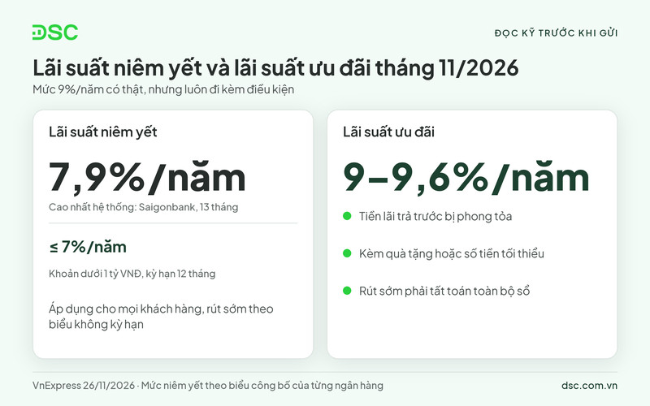

# Lãi suất gửi tiết kiệm ngân hàng nào cao nhất tháng 11/2026?

Theo VnExpress ngày 26/11/2026, mức **lãi suất gửi tiết kiệm ngân hàng nào cao nhất** hiện thuộc về Saigonbank, niêm yết 7,9%/năm cho kỳ hạn 13 tháng. Với khoản dưới 1 tỷ VNĐ kỳ hạn 12 tháng, chưa ngân hàng nào niêm yết quá 7%/năm.

Trong bài viết này, Chứng khoán DSC tổng hợp mặt bằng lãi suất sau đợt giảm tháng 10/2026 và bảng lãi suất đã kiểm theo biểu chính thức. Bài cũng tách lãi niêm yết với ưu đãi 9%/năm. Bạn sẽ thấy vì sao cùng gửi 500 triệu kỳ hạn 12 tháng, tiền lãi chênh 3,5 triệu VNĐ giữa Vikki Bank và VietinBank.

## Lãi suất gửi tiết kiệm ngân hàng nào cao nhất tháng 11/2026

Saigonbank đang niêm yết mức lãi suất tiết kiệm cao nhất hệ thống, 7,9%/năm cho kỳ hạn 13 tháng, theo VnExpress ngày 26/11/2026. Nguồn này chưa nêu điều kiện số tiền và kênh gửi. Với khoản dưới 1 tỷ VNĐ kỳ hạn 12 tháng, chưa ngân hàng nào niêm yết quá 7%/năm. Các mức 9–9,6%/năm đang được chào là ưu đãi có điều kiện, không phải lãi suất niêm yết.

Từ giữa tháng 10/2026, Ngân hàng Nhà nước yêu cầu các ngân hàng giảm lãi suất huy động kỳ hạn từ 6 tháng ít nhất 0,5 điểm %. Phần lớn ngân hàng đã giảm 0,5 điểm % ở các kỳ hạn này. Bảng lãi suất ghi nhận trước tháng 10/2026 vì thế không còn đúng với nhiều ngân hàng.

### Bảng lãi suất đã kiểm theo biểu chính thức

Bảng dưới chưa đủ các ngân hàng và không phải bảng xếp hạng. Chứng khoán DSC chỉ đưa vào những con số đọc được trực tiếp trên trang chính thức của ngân hàng ngày 26/11/2026.

| Ngân hàng | Biểu áp dụng | 1 tháng | 6 tháng | 12 tháng | 13 tháng | 24 tháng |
|---|---|---|---|---|---|---|
| Vikki Bank | Gửi online, lãi cuối kỳ, hiệu lực 02/06/2026 | 4,70 | 6,00 | 6,10 | 6,20 | 6,10 |
| Vikki Bank | Biểu chung, lãi cuối kỳ, hiệu lực 03/11/2026 | 4,70 | 5,90 | 6,00 | 6,10 | 5,80 |
| VietinBank | Biểu tiền gửi trên vietinbank.vn | 2,10 | 3,00 | 5,40 | 5,40 | 5,50 |

Đơn vị trong bảng là %/năm. Vikki có 2 dòng vì công bố riêng biểu gửi online và biểu chung, mỗi biểu có ngày hiệu lực khác nhau. VietinBank không ghi ngày hiệu lực và lưu ý mức áp dụng có thể khác theo địa bàn.

### Tra lãi suất từng ngân hàng

Lãi suất từng ngân hàng được cập nhật trong bài riêng:

| Nhóm | Ngân hàng |
|---|---|
| Big 4 | [Vietcombank](https://www.dsc.com.vn/kien-thuc/lai-suat-gui-tiet-kiem-ngan-hang-vietcombank), [BIDV](https://www.dsc.com.vn/kien-thuc/lai-suat-gui-tiet-kiem-ngan-hang-bidv), [VietinBank](https://www.dsc.com.vn/kien-thuc/lai-suat-gui-tiet-kiem-ngan-hang-vietinbank), [Agribank](https://www.dsc.com.vn/kien-thuc/lai-suat-gui-tiet-kiem-ngan-hang-agribank) |
| Ngân hàng TMCP lớn | [ACB](https://www.dsc.com.vn/kien-thuc/lai-suat-gui-tiet-kiem-ngan-hang-acb), [MB](https://www.dsc.com.vn/kien-thuc/lai-suat-gui-tiet-kiem-ngan-hang-mb-bank), [Sacombank](https://www.dsc.com.vn/kien-thuc/lai-suat-gui-tiet-kiem-ngan-hang-sacombank), [VPBank](https://www.dsc.com.vn/kien-thuc/lai-suat-gui-tiet-kiem-ngan-hang-vpbank), [VIB](https://www.dsc.com.vn/kien-thuc/lai-suat-gui-tiet-kiem-ngan-hang-vib) |
| Ngân hàng TMCP khác | [LPBank](https://www.dsc.com.vn/kien-thuc/lai-suat-gui-tiet-kiem-ngan-hang-lpbank), [HDBank](https://www.dsc.com.vn/kien-thuc/lai-suat-gui-tiet-kiem-ngan-hang-hd-bank), [Bac A Bank](https://www.dsc.com.vn/kien-thuc/lai-suat-gui-tiet-kiem-ngan-hang-bac-a-bank), [Vikki Bank (Đông Á)](https://www.dsc.com.vn/kien-thuc/lai-suat-ngan-hang-dong-a) |

## Lãi suất niêm yết và lãi suất ưu đãi 9%/năm khác nhau thế nào

Lãi suất ưu đãi đang cao hơn niêm yết 1–3 điểm %, theo VnExpress ngày 26/11/2026. Lãi suất niêm yết là mức ngân hàng công bố trên biểu, áp dụng cho mọi khách hàng đủ điều kiện kỳ hạn và số tiền. Lãi suất ưu đãi là chương trình riêng, cao hơn nhưng kèm điều kiện:

| Ngân hàng | Mức ưu đãi | Điều kiện đi kèm |
|---|---|---|
| NCB | 9%/năm | Gửi online từ 1 triệu VNĐ, tiền lãi trả trước bị phong tỏa |
| Vikki Bank | 9%/năm | Nhân viên chào, từ 10 triệu VNĐ, kỳ hạn 6–13 tháng |
| Vikki Bank | Đến 9,6%/năm | Từ 200 triệu VNĐ, sản phẩm lãi kép: nhận lãi đầu kỳ rồi gửi tiếp thành sổ mới |
| PVcomBank | 9,1%/năm | Từ 100 triệu VNĐ, kèm quà tặng |
| MBV (tên cũ OceanBank) | 9,1%/năm | Gửi tại quầy, khoản dưới 3 tỷ VNĐ |
| VPBank | 9%/năm, đã gồm phần cộng thêm 2,2 điểm % | Kỳ hạn 13 tháng, khoản từ 5 triệu VNĐ |

Khác biệt lớn nhất nằm ở việc rút tiền. Các sản phẩm ưu đãi này không cho rút một phần: cần tiền trước hạn thì phải tất toán toàn bộ sổ và chỉ nhận lãi không kỳ hạn. Với sổ niêm yết, cách tính khi rút trước hạn theo quy định riêng của từng ngân hàng.

Mức ưu đãi tại Vikki cho thấy rõ khoảng chênh. Biểu niêm yết 12 tháng của Vikki là 6,00–6,10%/năm, còn mức chào là 9–9,6%/năm. Trước khi nhận, hãy hỏi ngân hàng 3 điều: lãi trả trước hay cuối kỳ, có bị phong tỏa không, và có được rút một phần không.

## Cách chọn ngân hàng gửi tiết kiệm lãi cao và an toàn

An toàn tiền gửi nằm ở hai lớp: bảo hiểm tiền gửi và độ ổn định của ngân hàng. Lãi suất chỉ nên so sau khi hai lớp này đã rõ:

- **Bảo hiểm tiền gửi**: Từ ngày 13/7/2026, [Bảo hiểm tiền gửi Việt Nam](https://div.gov.vn) chi trả tối đa 350 triệu VNĐ, gồm cả gốc và lãi, cho tổng tiền gửi của một người tại một ngân hàng. Mức này theo Thông tư 05/2026/TT-NHNN.
- **Độ ổn định của ngân hàng**: Nhóm Big 4 (Vietcombank, BIDV, VietinBank, Agribank) có Nhà nước sở hữu chi phối và thường trả lãi thấp hơn. Ví dụ minh họa: VietinBank trả 5,40%/năm kỳ hạn 12 tháng, Vikki trả 6,00–6,10%/năm.
- **Biểu áp dụng**: Cùng một ngân hàng có thể có nhiều biểu. Ở Vikki Bank, biểu gửi online (02/06/2026) trả 6,00%/năm kỳ hạn 9 tháng, biểu chung (03/11/2026) trả 5,70%/năm.

Sau hai lớp an toàn, lãi suất mới tạo khác biệt về tiền. Ví dụ, gửi online 500 triệu kỳ hạn 12 tháng tại Vikki (6,10%/năm) nhận 30,5 triệu VNĐ tiền lãi. Cùng số tiền ở VietinBank (5,4%/năm) nhận 27 triệu VNĐ, ít hơn 3.500.000 VNĐ.

Khoản trên 350 triệu nên chia ở nhiều ngân hàng để mỗi nơi nằm trong hạn mức bảo hiểm. Kỳ hạn chọn theo thời điểm cần tiền, vì rút trước hạn thường chỉ được lãi không kỳ hạn (biểu không kỳ hạn của Vikki là 0,50%/năm).

## Có nên gửi tiết kiệm ngân hàng trong năm 2026?

Với mức 5–7%/năm chốt ngay khi gửi, tiết kiệm vẫn đúng cho quỹ dự phòng và tiền cần dùng trong 12 tháng. Hai giới hạn cần biết trước khi gửi toàn bộ tiền nhàn rỗi:

- **Lãi suất thực**: Tiền lãi tăng thêm bao nhiêu sức mua tùy mức lạm phát, vì [lãi suất thực](https://www.dsc.com.vn/kien-thuc/lai-suat-thuc-la-gi) bằng lãi niêm yết trừ lạm phát.
- **Rút trước hạn**: Phần rút sớm thường chỉ được tính lãi không kỳ hạn, tùy quy định từng ngân hàng. Ở Vikki, mức không kỳ hạn là 0,50%/năm.

Gửi hết hay giữ một phần linh hoạt phụ thuộc số tiền và thời gian để tiền. Hai yếu tố này quyết định câu trả lời cho việc [có nên gửi tiết kiệm ngân hàng không](https://www.dsc.com.vn/kien-thuc/co-nen-gui-tiet-kiem-ngan-hang-khong) trong từng trường hợp.

## Phân bổ tiền nhàn rỗi giữa tiết kiệm và chứng khoán

Với khoản dưới 1 tỷ, lãi niêm yết đến 7%/năm đủ cho phần tiền cần chắc chắn. Chứng khoán chỉ hợp với phần tiền bạn để được từ 1 năm trở lên và chấp nhận giá lên xuống theo phiên.

| Tiêu chí | Gửi tiết kiệm | Tài khoản chứng khoán DSC |
|---|---|---|
| Lợi nhuận | Theo mức niêm yết khi gửi | Không cố định, có thể lỗ |
| Rút tiền | Rút trước hạn thường chỉ được lãi không kỳ hạn | Bán cổ phiếu, tiền về theo chu kỳ T+2 |
| Bảo hiểm tiền gửi | Có, tối đa 350 triệu VNĐ mỗi ngân hàng | Không áp dụng |
| Hỗ trợ | Nhân viên ngân hàng | Chuyên gia Môi giới 1:1 |

Chứng khoán DSC không nhận tiền gửi và không cam kết lợi nhuận. DSC mở tài khoản eKYC trên App DSC Trading trong 3 phút, chuyên gia Môi giới 1:1 hướng dẫn sàn, lô và cách đặt lệnh. Cổ phiếu chỉ là một lựa chọn khi bạn cân nhắc [có tiền nên đầu tư gì](https://www.dsc.com.vn/kien-thuc/co-tien-nen-dau-tu-gi-luc-nay), bên cạnh vàng, trái phiếu và chứng chỉ quỹ.

  
Thử cổ phiếu bằng một phần nhỏ tiền nhàn rỗi, có chuyên gia Môi giới 1:1 hướng dẫn từ lệnh đầu tiên

  <a href="https://www.dsc.com.vn/mo-tai-khoan" style="background: #1D4130; color: #ffffff; padding: 11px 24px; border-radius: 24px; text-decoration: none; font-weight: 600; font-size: 15px; display: inline-block;">Tìm hiểu cách mở tài khoản</a>

## Câu hỏi thường gặp (FAQ)

### Lãi suất 9%/năm của ngân hàng có thật không?

Có, nhưng đó là ưu đãi có điều kiện, không phải lãi suất niêm yết. Tháng 11/2026, NCB, Vikki Bank, PVcomBank, MBV và VPBank chào 9–9,6%/năm kèm điều kiện như nhận lãi trước, quà tặng hoặc phải tất toán toàn bộ khi rút sớm.

### Gửi tiết kiệm online hay tại quầy lãi cao hơn?

Tùy ngân hàng và ngày hiệu lực của từng biểu. Vikki Bank không công bố biểu riêng tại quầy; biểu gửi online hiệu lực 02/06/2026 cao hơn biểu chung hiệu lực 03/11/2026 từ 0,1 đến 0,3 điểm % ở các kỳ hạn từ 6 tháng, ví dụ 12 tháng là 6,10% so với 6,00%/năm.

### Gửi trên 350 triệu nên chia sổ thế nào?

Hạn mức 350 triệu VNĐ tính trên tổng tiền gửi, gồm cả gốc và lãi, của một người tại một ngân hàng. Với 600 triệu, gửi 300 triệu ở mỗi ngân hàng tại 2 ngân hàng khác nhau thì cả gốc và lãi đều nằm trong hạn mức.

## Kết luận

Mức 9%/năm luôn kèm điều kiện, nên hãy so lãi suất niêm yết trước, rồi mới cân nhắc ưu đãi. Trước khi gửi, hãy làm 3 việc:

- **So mức niêm yết**: Mở bài lãi suất của 2–3 ngân hàng bạn quan tâm ở bảng phía trên.
- **Đọc điều kiện ưu đãi**: Hỏi rõ lãi trả lúc nào và có được rút một phần không.
- **Chia theo hạn mức**: Giữ tổng tiền gửi tại mỗi ngân hàng, cả gốc và lãi, không quá 350 triệu VNĐ.

Nếu muốn dành một phần nhỏ tiền nhàn rỗi cho cổ phiếu, bạn có thể [mở tài khoản DSC](https://www.dsc.com.vn/mo-tai-khoan) online. Người chưa từng đầu tư nên đọc [cách mở tài khoản chứng khoán](https://www.dsc.com.vn/kien-thuc/cach-mo-tai-khoan-chung-khoan) trước.

*Lãi suất trong bài tổng hợp từ biểu công bố trên trang vikkibank.vn và vietinbank.vn (đọc ngày 26/11/2026) và bài "Ngân hàng vẫn chào lãi suất tiết kiệm tới 9,6% một năm" của VnExpress ngày 26/11/2026; mức Saigonbank và các mức ưu đãi chưa được đối chiếu trên biểu của ngân hàng. Mức áp dụng thực tế theo xác nhận của ngân hàng tại thời điểm gửi.*
