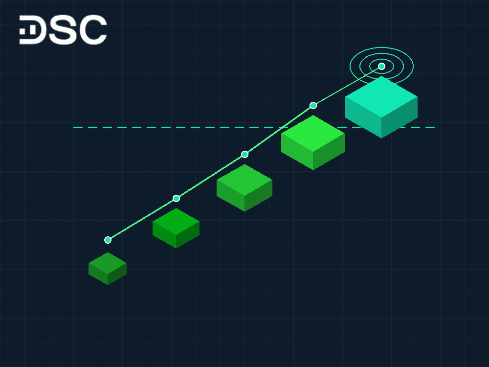

# Target trong chứng khoán là gì? 3 cách tính giá mục tiêu

Thành công trong đầu tư cổ phiếu không chỉ nằm ở việc chọn đúng doanh nghiệp tăng trưởng. Việc xác định đích đến cho dòng vốn đóng vai trò quyết định hiệu quả lợi nhuận.

Khái niệm target trong chứng khoán chính là kim chỉ nam giúp bạn hiện thực hóa lợi nhuận kỷ luật. Công cụ này giúp nhà đầu tư tránh giao dịch theo cảm tính đám đông.

Vậy target trong chứng khoán là gì và làm thế nào để xác định giá mục tiêu chuẩn xác? Hãy cùng Chứng khoán DSC giải mã chi tiết các phương pháp thực chiến ngay sau đây.

## Target trong chứng khoán là gì?

Target trong chứng khoán còn được gọi là giá mục tiêu (Target Price). Đây là mức giá dự kiến một cổ phiếu có thể đạt được trong tương lai. Đây là con số định hướng.

Con số này thường được các bộ phận phân tích tại công ty chứng khoán dự báo. Họ dựa trên mô hình tài chính định lượng và sức khỏe nội tại của doanh nghiệp.

Giá mục tiêu cũng biến động theo xu hướng chung của các [chỉ số chứng khoán](https://www.dsc.com.vn/kien-thuc/chi-so-chung-khoan-la-gi) vĩ mô trên sàn HOSE. Nhà đầu tư dựa vào đây để chủ động chốt lời hoặc cắt lỗ hợp lý.

*Target trong chứng khoán giúp định hình kế hoạch chốt lời kỷ luật cho nhà đầu tư.*

## 3 thành phần cốt lõi cấu thành Target

Để sử dụng hiệu quả, bạn cần nắm vững ba thành phần cơ bản cấu thành giá mục tiêu dưới đây.

### Giá mục tiêu (Target Price)

Đây là giá trị cổ phiếu mà nhà đầu tư mong muốn đạt được trong tương lai. Con số này là kim chỉ nam quyết định các hành động mua hoặc bán của bạn.

### Thời gian mục tiêu (Target Horizon)

Đây là khoảng thời gian dự kiến để giá cổ phiếu chạm mức kỳ vọng. Khung thời gian này thường chia thành ba giai đoạn chính:

* **Ngắn hạn (Vài tuần đến dưới 3 tháng)**: Phù hợp cho chiến lược giao dịch theo sóng dòng tiền.
* **Trung hạn (Từ 3 đến 12 tháng)**: Dành cho các chiến lược đầu tư theo chu kỳ kinh doanh từng quý.
* **Dài hạn (Từ 1 năm trở lên)**: Dành cho doanh nghiệp đầu ngành có tiềm năng mở rộng quy mô lớn.

### Tỷ lệ lợi nhuận kỳ vọng

Mức sinh lời mong muốn được tính dựa trên giá hiện tại và giá mục tiêu. Bạn có thể áp dụng công thức tính toán đơn giản dưới đây:

`Tỷ lệ lợi nhuận = ((Giá mục tiêu - Giá hiện tại) / Giá hiện tại) x 100%`

Ví dụ, bạn mua cổ phiếu ở giá 40.000 VNĐ và đặt giá mục tiêu là 48.000 VNĐ. Tỷ lệ lợi nhuận kỳ vọng của bạn đạt đúng 20%.

## Phân loại Target phổ biến trên thị trường

Tùy theo kỳ vọng biến động giá của từng mã, Target thường được phân chia thành ba nhóm:

* **Target tăng giá**: Nhà đầu tư xác lập mục tiêu này khi dự báo cổ phiếu bước vào chu kỳ tăng trưởng. Đây là loại mục tiêu phổ biến nhất đối với thị trường giao dịch cổ phiếu cơ sở.
* **Target giảm giá**: Mục tiêu này xuất hiện khi bạn dự báo giá cổ phiếu sẽ điều chỉnh giảm sâu. Bạn có thể áp dụng mục tiêu giảm để cơ cấu hạ tỷ trọng hoặc phòng ngừa rủi ro danh mục.
* **Target đi ngang (Sideway)**: Loại mục tiêu này phù hợp khi cổ phiếu dao động tích lũy trong một biên độ hẹp. Nhà đầu tư thường nắm giữ để nhận cổ tức tiền mặt ổn định qua từng năm.

## 3 đặc điểm quan trọng của Target

Hiểu đúng các đặc tính dưới đây sẽ giúp bạn sử dụng giá mục tiêu khách quan hơn:

* **Tính biến động liên tục**: Target không phải là một con số bất di bất dịch. Mức giá này sẽ liên tục thay đổi theo các biến số vĩ mô và kết quả kinh doanh thực tế của doanh nghiệp.
* **Tầm nhìn ngắn và trung hạn**: Hầu hết các báo cáo phân tích uy tín chỉ đưa ra dự báo trong 6 đến 12 tháng. Việc định giá dài hạn từ 3 đến 5 năm thường có độ nhiễu số liệu rất lớn.
* **Giá trị tham khảo khách quan**: Mức giá này được xây dựng dựa trên các mô hình toán học và giả định tài chính. Tuy nhiên, biến động ngắn hạn của thị trường còn chịu ảnh hưởng từ tâm lý đám đông.

## 3 phương pháp xác định Target thông dụng

Tính đến tháng 10/2026, các chuyên gia tài chính thường kết hợp cả phân tích cơ bản và kỹ thuật để định giá cổ phiếu. Dưới đây là ba phương pháp phổ biến nhất.

### Phương pháp so sánh định giá P/E và P/B (FA)

Phương pháp này đối chiếu chỉ số P/E và P/B của doanh nghiệp với mức trung bình ngành. Đây là bước then chốt khi thực hiện [phân tích doanh nghiệp](https://www.dsc.com.vn/kien-thuc/phan-tich-doanh-nghiep-trong-dau-tu-chung-khoan-la-gi) để tìm kiếm cơ hội đầu tư.

Nhà phân tích ước tính lợi nhuận trên mỗi cổ phiếu (EPS) tương lai của doanh nghiệp. Sau đó, họ nhân EPS dự phóng với mức P/E hợp lý để ra giá mục tiêu.

### Phương pháp chiết khấu dòng tiền (DCF)

Nhà phân tích dự phóng toàn bộ dòng tiền thuần mà doanh nghiệp tạo ra trong tương lai. Sau đó, họ chiết khấu dòng tiền này về giá trị hiện tại theo mức lãi suất chiết khấu phù hợp.

Phương pháp DCF phản ánh giá trị nội tại thực của doanh nghiệp. Cách định giá này rất phù hợp với các mã sản xuất hoặc tiện ích có dòng tiền đều đặn.

### Phương pháp phân tích kỹ thuật (TA)

Phương pháp này dựa vào biểu đồ giá, khối lượng và các đường chỉ báo kỹ thuật. Nhà đầu tư sử dụng các [ngưỡng kháng cự](https://www.dsc.com.vn/kien-thuc/duong-ho-tro-va-khang-cu-la-gi) mạnh hoặc dãy Fibonacci thoái lui để xác định điểm chốt lời.

Ưu điểm của phương pháp kỹ thuật là sự linh hoạt. Bạn có thể nhanh chóng xác định điểm ra vào lệnh cho từng con sóng ngắn. Tốc độ phản ứng rất nhanh.

| Phương pháp | Công cụ cốt lõi | Ưu điểm chính | Hạn chế | Mức độ phù hợp với F0 |
| :--- | :--- | :--- | :--- | :--- |
| **So sánh tương đối** | Chỉ số P/E, P/B ngành | Dễ tính toán, trực quan | Phụ thuộc vào định giá chung của ngành | Rất phù hợp, dễ áp dụng |
| **Chiết khấu dòng tiền (DCF)** | Báo cáo lưu chuyển tiền tệ, WACC | Phản ánh chính xác giá trị nội tại | Mô hình phức tạp, nhiều giả định | Phù hợp đọc báo cáo CTCK |
| **Phân tích kỹ thuật (TA)** | Kháng cự, Hỗ trợ, Fibonacci | Xác định điểm mua bán ngắn hạn nhanh | Dễ bị nhiễu bởi tin tức tức thời | Rất phù hợp khi giao dịch ngắn |

## 3 yếu tố quyết định khả năng đạt Target của cổ phiếu

Khả năng đạt được mức giá kỳ vọng phụ thuộc vào ba biến số thị trường quan trọng dưới đây:

* **Xu hướng thị trường chung**: Khi chỉ số VN-Index bước vào sóng giảm mạnh, phần lớn cổ phiếu đều khó chạm được target ban đầu.
* **Sức khỏe tài chính doanh nghiệp**: Tăng trưởng doanh thu và lợi nhuận sau thuế là bệ đỡ vững chắc giúp thị giá bứt phá.
* **Chu kỳ phát triển ngành**: Cổ phiếu thuộc các nhóm ngành được hưởng lợi từ chính sách vĩ mô sẽ chạm đích nhanh hơn.

## Ví dụ minh họa về cách áp dụng Target trong giao dịch thực tế

Chúng ta cùng phân tích tình huống giao dịch thực tế của một nhà đầu tư cá nhân trên sàn HOSE:

* Giả sử bạn mua cổ phiếu cơ bản ở vùng giá 50.000 VNĐ.
* Dựa vào phân tích kỹ thuật, bạn nhận thấy vùng kháng cự đỉnh cũ mạnh nằm tại 60.000 VNĐ. Mức 60.000 VNĐ chính là target chốt lời của bạn.
* Đồng thời, bạn đặt [lệnh cắt lỗ stop loss](https://www.dsc.com.vn/kien-thuc/stop-loss-la-gi-cach-su-dung-lenh-stop-loss-trong-chung-khoan) nghiêm ngặt tại mức 47.000 VNĐ.

Khoảng lợi nhuận kỳ vọng là 10.000 VNĐ/cổ phiếu, trong khi mức rủi ro chấp nhận mất là 3.000 VNĐ/cổ phiếu. Tỷ lệ Risk/Reward đạt mức 1:3,3 cực kỳ chuẩn mực.

Đây là tỷ lệ quản trị vốn tối ưu giúp tài khoản của bạn tăng trưởng an toàn bền vững. Bạn có thể tự tin hành động theo kế hoạch đã lập.

## Cổ phiếu chạm target nên làm gì? 3 nguyên tắc chốt lời kỷ luật

Nhiều nhà đầu tư mới thường bối rối khi bảng điện báo cổ phiếu đã đạt giá mục tiêu. Dưới đây là ba nguyên tắc vàng giúp bạn hiện thực hóa lợi nhuận trọn vẹn.

*Chiến lược chốt lời từng phần khi cổ phiếu chạm target giá mục tiêu giúp bảo toàn vốn an toàn.*

### Quy tắc chốt lời từng phần 50/50

Khi thị giá chạm đúng mức Target 1, bạn nên chủ động bán ra 50% khối lượng cổ phiếu đang nắm giữ. Hành động này giúp bạn khóa chặt một nửa phần lãi vào tài khoản tiền mặt. Lợi nhuận được bảo vệ ngay.

Tâm lý của bạn sẽ trở nên rất nhẹ nhõm. Bạn không còn phải lo lắng về nguy cơ mất trắng lợi nhuận tích lũy.

### Kích hoạt chặn lãi bằng Trailing Stop

Đối với 50% số lượng cổ phiếu còn lại, bạn dời mức cắt lỗ lên đúng điểm giá hòa vốn ban đầu. Nếu dòng tiền lớn tiếp tục đẩy cổ phiếu tăng vọt, bạn tiếp tục gặt hái thêm lợi nhuận. Lãi được thả chạy tối đa.

Ngược lại, nếu giá quay đầu giảm sâu, bạn tự động kích hoạt bán bảo toàn vốn. Bạn tuyệt đối không để vị thế lãi chuyển thành lỗ ngược. Điểm dừng này rất an toàn.

### Tuyệt đối tránh mua đuổi ở vùng kháng cự

Nhiều F0 thấy cổ phiếu tăng vượt target thì nảy sinh tâm lý tiếc nuối và vội vàng mua thêm. Đây là hành vi mang tính đầu cơ cảm xúc rất rủi ro.

Khi thị giá đã chạy xa nền tích lũy, xác suất xuất hiện các nhịp rũ bỏ điều chỉnh là cực cao. Hãy kiên nhẫn chờ đợi các điểm cân bằng mới.

Để không bỏ lỡ điểm chốt lời khi cổ phiếu chạm giá mục tiêu, bạn có thể tận dụng tính năng Cảnh báo giá tự động trên App DSC Trading. Nền tảng giúp bạn theo dõi biến động thị trường và hiện thực hóa lợi nhuận kịp thời mà không cần bám bảng điện liên tục. Đội ngũ chuyên gia Môi giới 1:1 của DSC luôn sẵn sàng đồng hành tư vấn kế hoạch quản trị rủi ro phù hợp cho từng danh mục.

  

  

    
Nhận Danh Mục Định Giá Cổ Phiếu Tiềm Năng Tại DSC

    
Miễn phí mở tài khoản eKYC • Báo cáo target độc quyền • Chuyên gia Môi giới 1:1 đồng hành.

  

  <a href="https://www.dsc.com.vn/mo-tai-khoan" style="background: #2BE841; color: #0D1B2A; padding: 14px 32px; border-radius: 30px; text-decoration: none; font-weight: 700; font-size: 16px; display: inline-block; position: relative; z-index: 1;">Mở tài khoản - 3 phút</a>

## 3 sai lầm kinh điển của F0 khi sử dụng giá mục tiêu (Target)

Nhiều người mới tham gia thị trường chứng khoán thường mắc phải ba sai lầm tâm lý dưới đây:

### Coi target là lời cam kết chắc chắn 100%

Nhiều bạn ngây thơ tin rằng mọi mức giá dự báo trong báo cáo phân tích đều phải xảy ra. Thực tế, thị trường luôn tiềm ẩn các sự kiện bất ngờ ngoài dự liệu.

### Không cập nhật lại giá mục tiêu theo chu kỳ

Khi doanh nghiệp công bố kết quả kinh doanh đột biến, con số định giá cũ sẽ trở nên lạc hậu. Nhà đầu tư cần chủ động điều chỉnh kỳ vọng theo diễn biến từng quý.

### Tham lam gồng lãi dẫn đến rủi ro kẹt vốn

Khi cổ phiếu đạt đỉnh target, việc chần chừ không chịu chốt lời thường biến bạn thành người kẹt hàng. Lòng tham luôn là rào cản lớn nhất của nhà đầu tư.

## Câu hỏi thường gặp về Target trong chứng khoán (FAQs)

### Target trong chứng khoán do ai tính toán?

Target do các chuyên gia phân tích tại công ty chứng khoán hoặc chính nhà đầu tư tính toán. Con số này dựa trên mô hình định lượng tài chính và dữ liệu kỹ thuật.

### Target của một cổ phiếu có bị thay đổi không?

Có, giá mục tiêu liên tục được cập nhật theo kết quả kinh doanh quý và chính sách vĩ mô. Khi doanh nghiệp thay đổi kế hoạch lợi nhuận, target sẽ được điều chỉnh tương ứng.

### Nhà đầu tư F0 nên ưu tiên xác định target theo FA hay TA?

Nhà đầu tư nên kết hợp phân tích cơ bản (FA) để chọn doanh nghiệp tốt và dùng phân tích kỹ thuật (TA) để tìm điểm chốt lời tối ưu. Sự kết hợp này mang lại hiệu quả vượt trội.

### Khi cổ phiếu vượt target có nên mua tiếp không?

Bạn không nên mua đuổi khi cổ phiếu vừa bứt phá xa khỏi mức target ban đầu. Vùng giá này thường chịu áp lực chốt lời lớn từ các nhà đầu tư tổ chức.

## Kết luận

Target trong chứng khoán là công cụ đắc lực giúp bạn duy trì kỷ luật giao dịch và bảo toàn nguồn vốn. Hành trình đầu tư tích lũy tài sản sẽ an tâm hơn khi có sự đồng hành từ chuyên gia tài chính.

Chứng khoán DSC cung cấp nền tảng App DSC Trading tích hợp tính năng cảnh báo giá mục tiêu tự động và báo cáo phân tích định giá định kỳ. Đội ngũ chuyên gia Môi giới 1:1 sẽ luôn sát cánh hỗ trợ bạn xây dựng danh mục đầu tư an toàn.

Hãy tiến hành [mở tài khoản chứng khoán eKYC](https://www.dsc.com.vn/mo-tai-khoan) tại Chứng khoán DSC chỉ trong 3 phút để nhận ngay danh mục cổ phiếu tiềm năng hôm nay!

> **Tuyên bố miễn trừ trách nhiệm**: Các mức giá mục tiêu và nhận định trong bài viết chỉ mang tính chất tham khảo học thuật. Nội dung này không cấu thành lời khuyên đầu tư trực tiếp hay cam kết mức sinh lời cho người đọc.
