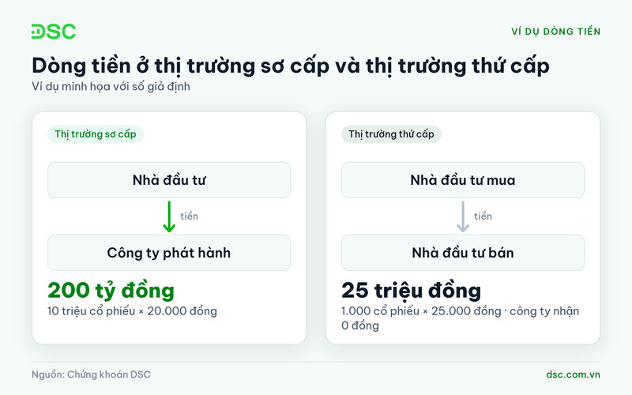

# Thị trường sơ cấp và thứ cấp là gì

Thị trường sơ cấp và thứ cấp là gì? Thị trường sơ cấp là nơi tổ chức phát hành bán chứng khoán mới lần đầu để huy động vốn. Thị trường thứ cấp là nơi nhà đầu tư mua bán lại với nhau, chỉ quyền sở hữu đổi tay. Khi bạn đặt lệnh mua cổ phiếu trên HOSE với biên độ ±7% mỗi phiên, bạn đang ở thị trường thứ cấp.

Trong bài viết này, Chứng khoán DSC tóm tắt những điểm chính bạn cần nắm.

- Thị trường sơ cấp là nơi tổ chức phát hành bán chứng khoán lần đầu, tiền thu được sau chi phí phát hành thuộc về doanh nghiệp.
- Thị trường thứ cấp là nơi nhà đầu tư mua bán lại với nhau trên HOSE, HNX và UPCoM, doanh nghiệp không nhận thêm đồng nào.
- Một đợt phát hành thu 200 tỷ đồng chỉ tăng vốn doanh nghiệp một lần, mọi giao dịch sau đó trên sàn chỉ đổi người sở hữu.
- Mua cổ phiếu trên sàn là giao dịch ở thị trường thứ cấp, với lô chẵn 100 cổ phiếu, biên độ ±7% trên HOSE và thanh toán T+2.

Nếu bạn sắp đặt lệnh mua cổ phiếu đầu tiên, đọc tiếp để biết tiền của mình thực sự đi về đâu.

## Khái niệm thị trường

### Thị trường sơ cấp là gì?

Thị trường sơ cấp (primary market) là nơi mua bán chứng khoán mới phát hành, gồm cả đợt [**chào bán công khai lần đầu**](https://www.dsc.com.vn/kien-thuc/niem-yet-chung-khoan-ipo-la-gi-nhung-dieu-can-biet) (IPO). Thị trường này còn có tên gọi khác là thị trường cấp một hay thị trường phát hành.

[**Luật Chứng khoán số 54/2019/QH14**](https://vanban.chinhphu.vn/default.aspx?pageid=27160&docid=198541) chia việc phát hành thành hai cách. Đó là chào bán chứng khoán ra công chúng và chào bán riêng lẻ cho nhóm nhà đầu tư xác định. Công ty chứng khoán tham gia với vai trò bảo lãnh phát hành, giúp tổ chức phát hành phân phối chứng khoán tới nhà đầu tư.

>> Xem thêm:
- [Sàn chứng khoán NYSE là gì?](https://www.dsc.com.vn/kien-thuc/san-chung-khoan-nyse-la-gi-vai-tro-va-cach-thuc-hoat-dong)
- [Chứng khoán là gì?](https://www.dsc.com.vn/kien-thuc/chung-khoan-la-gi-nhung-dieu-can-biet-truoc-khi-tham-gia-thi-truong-chung-khoan)

### Thị trường thứ cấp là gì?

Thị trường thứ cấp là nơi giao dịch chứng khoán đã phát hành trên thị trường sơ cấp. Giao dịch ở đây chỉ làm thay đổi quyền sở hữu giữa các nhà đầu tư, không làm tăng thêm vốn đầu tư cho nền kinh tế.

Tại Việt Nam, thị trường thứ cấp tập trung trên 3 sàn: HOSE ở TP.HCM, HNX ở Hà Nội và UPCoM do HNX vận hành. Cổ phiếu phải niêm yết hoặc đăng ký giao dịch thì mới mua bán được trên các sàn này.

## Chức năng của thị trường chứng khoán

### Chức năng của thị trường chứng khoán sơ cấp

Chức năng quan trọng nhất của thị trường chứng khoán sơ cấp là huy động vốn cho nền kinh tế. Tổ chức phát hành là bên đi huy động vốn, còn người mua cổ phiếu, trái phiếu là nhà đầu tư.

Chính phủ và chính quyền địa phương phát hành trái phiếu để huy động tiền nhàn rỗi, bù thiếu hụt ngân sách hoặc xây công trình hạ tầng. Doanh nghiệp phát hành cổ phiếu hoặc trái phiếu để có vốn mở rộng kinh doanh. Tiền thu từ đợt phát hành, sau khi trừ chi phí phát hành, thuộc về tổ chức phát hành.

### Chức năng của thị trường chứng khoán thứ cấp

Thị trường chứng khoán thứ cấp tạo thanh khoản cho chứng khoán đã phát hành ở sơ cấp. Nhà đầu tư mua bán tự do tại đây và kiếm lời từ cổ tức, trái tức hoặc chênh lệch giá.

Tiền giao dịch trên sàn đi từ người mua sang người bán, không vào doanh nghiệp. Giá trên sàn vẫn quan trọng với doanh nghiệp. Khi doanh nghiệp phát hành thêm cổ phiếu, nhà đầu tư so giá chào bán với giá trên sàn.

## Đặc điểm của thị trường

Thị trường chứng khoán sơ cấp hoạt động không liên tục. Thị trường này chỉ mở khi có đợt phát hành mới, theo kế hoạch của tổ chức phát hành; đợt chào bán ra công chúng phải đăng ký với Ủy ban Chứng khoán Nhà nước.

Thị trường chứng khoán thứ cấp giao dịch liên tục và cạnh tranh cao. Trên HOSE, mỗi ngày làm việc có phiên giao dịch từ phiên ATO lúc 9h00 đến phiên ATC kết thúc lúc 14h45. Bản chất của giao dịch là chuyển quyền sở hữu, nhà đầu tư kiếm lời từ chênh lệch giá hoặc cổ tức, trái tức.

## Bảng so sánh thị trường sơ cấp và thị trường thứ cấp

Bảng dưới đây phân biệt thị trường sơ cấp và thị trường thứ cấp theo dòng tiền: tiền đi về đâu, ai định giá, bao lâu giao dịch một lần.

| Tiêu chí | Thị trường sơ cấp | Thị trường thứ cấp |
| --- | --- | --- |
| Tiền thu được thuộc về | Tổ chức phát hành (doanh nghiệp, Chính phủ), sau khi trừ chi phí phát hành | Nhà đầu tư bán, tổ chức phát hành không nhận |
| Ai quyết định giá | Tổ chức phát hành ấn định giá chào bán hoặc xác định qua đấu giá | Cung cầu, khớp lệnh mua bán trong từng phiên |
| Tần suất | Theo từng đợt phát hành | Mỗi phiên giao dịch, thứ Hai đến thứ Sáu |
| Nơi diễn ra | Đợt chào bán, IPO, đấu giá cổ phần | HOSE, HNX, UPCoM |
| Người bán | Tổ chức phát hành | Nhà đầu tư đang nắm giữ chứng khoán |
| Người mua | Nhà đầu tư mua lần đầu | Nhà đầu tư mua lại từ nhà đầu tư khác |
| Làm tăng vốn cho doanh nghiệp | Có | Không |

Hàng cuối là cách nhớ nhanh nhất: chỉ thị trường sơ cấp làm tăng vốn cho doanh nghiệp.

## Nguyên tắc hoạt động của thị trường chứng khoán

Thị trường chứng khoán hoạt động theo 3 nguyên tắc: trung gian, đấu giá và công khai. Ba nguyên tắc này chi phối cách nhà đầu tư cá nhân giao dịch hằng ngày ở thị trường thứ cấp.

Nguyên tắc trung gian: mọi giao dịch mua bán chứng khoán trên thị trường thứ cấp phải đi qua công ty chứng khoán (giao dịch qua môi giới). Nhà môi giới tư vấn đầu tư, thực hiện lệnh mua bán và thu phí giao dịch từ nhà đầu tư.

Vì vậy, muốn mua bán cổ phiếu, nhà đầu tư cần [**mở tài khoản giao dịch chứng khoán**](https://www.dsc.com.vn/kien-thuc/cach-mo-tai-khoan-chung-khoan) tại một công ty chứng khoán. Mở tài khoản cũng là bước đầu tiên trong [**cách chơi chứng khoán cho người mới**](https://www.dsc.com.vn/kien-thuc/cach-dau-tu-chung-khoan-cho-nguoi-moi-bat-dau), trước khi nộp tiền và đặt lệnh.

Nguyên tắc đấu giá: giá chứng khoán được xác định thông qua đấu giá giữa các lệnh mua và lệnh bán. Có hai hình thức chủ yếu.

- **Đấu giá trực tiếp**: các nhà môi giới gặp nhau trên sàn và trả giá trực tiếp, hình thức truyền thống nay không còn dùng ở Việt Nam.
- **Đấu giá tự động**: lệnh được nhập vào hệ thống của Sở giao dịch chứng khoán, hệ thống tự tìm mức giá có khối lượng khớp cao nhất.

Đấu giá tự động dùng trong phiên [**khớp lệnh định kỳ**](https://www.dsc.com.vn/kien-thuc/khop-lenh-dinh-ky-va-khop-lenh-lien-tuc) trên HOSE: ATO từ 9h00 đến 9h15 và ATC từ 14h30 đến 14h45. Giữa hai phiên này là khớp lệnh liên tục, nghỉ trưa 11h30–13h00.

Nguyên tắc công khai: mọi hoạt động trên thị trường chứng khoán phải công khai, minh bạch. HOSE và HNX công bố giá, khối lượng khớp của từng mã ngay trong phiên giao dịch. Tổ chức niêm yết công bố thông tin định kỳ theo quy định pháp luật.

Người mới gần như luôn bắt đầu ở thị trường thứ cấp. Bạn mở tài khoản, nộp tiền rồi đặt lệnh mua cổ phiếu niêm yết trên HOSE, HNX hoặc UPCoM. Ba quy tắc cần nhớ trước lệnh đầu tiên như sau.

- **Lô giao dịch**: lô chẵn 100 cổ phiếu trên HOSE, lô lẻ 1–99 cổ phiếu khớp riêng.
- **Biên độ giá**: ±7% mỗi phiên trên HOSE, ±10% trên HNX, ±15% trên UPCoM.
- **Thanh toán T+2**: cổ phiếu mua hôm nay về tài khoản lúc 13h ngày làm việc thứ hai sau đó mới bán được.

Mua ở thị trường sơ cấp, chẳng hạn đăng ký mua trong đợt IPO, diễn ra theo lịch riêng của từng đợt, điều kiện tham gia ghi trong bản cáo bạch của đợt đó.

Ngoài việc biết mình đang ở thị trường thứ cấp, bạn cần có tài khoản và đặt lệnh đúng lô, đúng biên độ. Bạn không cần biết hết mới bắt đầu, vì chuyên gia Môi giới 1:1 của DSC hướng dẫn sàn, lô và cách đặt lệnh khi bạn cần hỏi.

  

  

    
Đặt lệnh đầu tiên trên thị trường thứ cấp với tài khoản mở online

    
eKYC 3 phút • Môi giới 1:1 • Phí giao dịch từ 0,1%

  

  <a href="https://www.dsc.com.vn/mo-tai-khoan" style="background: #2AD03D; color: #272D2B; padding: 14px 32px; border-radius: 30px; text-decoration: none; font-weight: 700; font-size: 16px; display: inline-block; position: relative; z-index: 1;">Mở tài khoản — 3 phút</a>

## Mối quan hệ giữa thị trường sơ cấp và thị trường thứ cấp

Thị trường sơ cấp và thị trường thứ cấp gắn với nhau, không tách rời. Sơ cấp tạo ra chứng khoán, thứ cấp đưa chứng khoán đó lưu thông tới nhà đầu tư tổ chức và cá nhân. Cả hai cùng nằm trong [**thị trường vốn**](https://www.dsc.com.vn/kien-thuc/thi-truong-von-la-gi-cach-tiep-can-cho-nha-dau-tu-ca-nhan), một nhánh của [**thị trường tài chính**](https://www.dsc.com.vn/kien-thuc/thi-truong-tai-chinh-la-gi).

Ví dụ minh họa với số giả định: một công ty chào bán 10 triệu cổ phiếu giá 20.000 đồng và thu 200 tỷ đồng ở thị trường sơ cấp. Sau khi niêm yết, 1.000 cổ phiếu của công ty đổi tay trên sàn ở giá 25.000 đồng. Người bán nhận 25 triệu đồng, công ty nhận 0 đồng.

Hai thị trường phụ thuộc nhau theo đúng dòng tiền đó. Nhà đầu tư chịu bỏ 200 tỷ đồng ở giá phát hành vì biết sau này bán lại được trên sàn. Ngoài thị trường vốn, thị trường tài chính còn có thị trường tiền tệ. Khác biệt giữa [**thị trường tiền tệ và thị trường vốn**](https://www.dsc.com.vn/kien-thuc/phan-biet-thi-truong-tien-te-va-thi-truong-von-huong-dan-chi-tiet-cho-nha-dau-tu) nằm chủ yếu ở kỳ hạn 1 năm.

## Câu hỏi thường gặp

### Hoạt động của thị trường thứ cấp làm thay đổi điều gì?

Hoạt động của thị trường thứ cấp chỉ làm thay đổi quyền sở hữu chứng khoán giữa các nhà đầu tư. Vốn của tổ chức phát hành không tăng thêm đồng nào, dù cổ phiếu đổi tay bao nhiêu lần trong phiên.

### Mua cổ phiếu trên sàn HOSE là thị trường sơ cấp hay thứ cấp?

Mua cổ phiếu trên sàn HOSE là giao dịch ở thị trường thứ cấp. Bạn mua lại từ nhà đầu tư khác theo lô chẵn 100 cổ phiếu, tiền về người bán. Chỉ khi mua trong đợt chào bán lần đầu hoặc đợt phát hành thêm, bạn mới ở thị trường sơ cấp.

### Nhà đầu tư thứ cấp là gì?

Nhà đầu tư thứ cấp là người mua lại chứng khoán từ nhà đầu tư khác, không mua trực tiếp từ tổ chức phát hành. Nhà đầu tư cá nhân mua bán cổ phiếu trên HOSE, HNX và UPCoM đang giao dịch ở thị trường thứ cấp.

### Thị trường sơ cấp hay thứ cấp quan trọng hơn?

Không xếp hạng được, vì mỗi thị trường giải một việc khác. Sơ cấp đưa vốn vào doanh nghiệp, thứ cấp cho người đã mua một lối ra khi muốn bán lại. Đo bằng tiền, sơ cấp quyết định vốn doanh nghiệp, thứ cấp quyết định giá cổ phiếu mỗi ngày.

## Kết luận

Thị trường sơ cấp đưa tiền vào doanh nghiệp một lần lúc phát hành, thị trường thứ cấp cho nhà đầu tư đổi tay chứng khoán mỗi phiên. Ba việc nên làm sau bài này:

1. Khi đọc tin doanh nghiệp phát hành cổ phiếu, xác định đó là đợt chào bán ở sơ cấp và tiền sẽ về doanh nghiệp.
2. Trước lệnh đầu tiên, nhớ 3 quy tắc của thứ cấp trên HOSE: lô 100 cổ phiếu, biên độ ±7%, thanh toán T+2.
3. Muốn mua cổ phiếu IPO, theo dõi lịch chào bán của từng đợt vì thị trường sơ cấp không mở mỗi ngày.

Bạn có thể [**mở tài khoản chứng khoán tại DSC**](https://www.dsc.com.vn/mo-tai-khoan) với eKYC 3 phút, hoàn toàn online, và hỏi chuyên gia Môi giới 1:1 khi cần.
