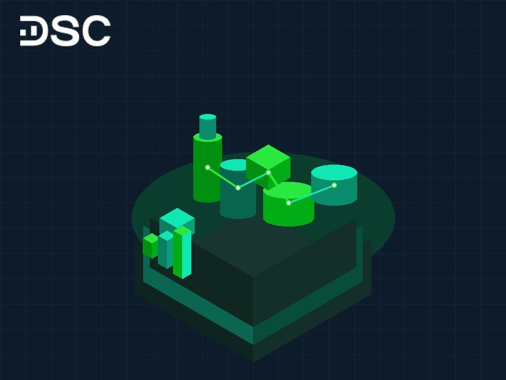

# Cổ phiếu BSR: Phân tích định giá và kết quả kinh doanh 2026

Cổ phiếu BSR là tâm điểm thu hút dòng tiền lớn trên thị trường chứng khoán. Doanh nghiệp nắm giữ vị thế hạt nhân khi vận hành Nhà máy Lọc dầu Dung Quất. Đơn vị cung ứng khoảng 30% nhu cầu xăng dầu nội địa.

Năm 2026, kết quả kinh doanh của BSR bứt phá mạnh mẽ. Động lực chính đến từ biên lọc dầu crack spread duy trì ở mức cao. Bài viết này phân tích chi tiết về định giá, hiệu quả sinh lời và triển vọng cổ phiếu BSR.

## Tổng quan cổ phiếu BSR: Vị thế hạt nhân ngành lọc hóa dầu

Công ty Cổ phần Lọc hóa dầu Bình Sơn quản lý Nhà máy Lọc dầu Dung Quất tại Quảng Ngãi. Dự án có tổng vốn đầu tư hơn 3 tỷ USD. Công suất thiết kế đạt 6,5 triệu tấn dầu thô mỗi năm.

Doanh nghiệp tiêu thụ trên 40% sản lượng dầu thô nội địa, bảo đảm an ninh năng lượng quốc gia. Ngày 17/01/2025, cổ phiếu BSR chính thức niêm yết trên HOSE. Cột mốc này tạo bước ngoặt lớn về thanh khoản thị trường.

Nhà đầu tư có thể xem thêm danh mục [top 6 cổ phiếu dầu khí nên đầu tư](https://www.dsc.com.vn/kien-thuc/top-5-co-phieu-dau-khi-se-huong-loi-trong-nam-2024-khi-gia-dau-tang) để phân bổ vốn hiệu quả.

| Chỉ số thị trường | Giá trị thực tế (Tháng 10/2026) |
| :--- | :--- |
| **Mã cổ phiếu** | BSR |
| **Sàn niêm yết** | HOSE (chuyển sàn từ 17/01/2025) |
| **Ngành** | Dầu khí / Năng lượng |
| **Khối lượng giao dịch bình quân 20 phiên** | 9.816.189 cổ phiếu |
| **Vốn hóa thị trường** | Khoảng 142.450 tỷ đồng |
| **Số lượng cổ phiếu niêm yết** | 5.007.299.686 cổ phiếu |
| **Tỷ lệ sở hữu nước ngoài** | 1,29% |
| **Giá trị sổ sách (BVPS)** | 14.840 VNĐ/cổ phiếu |

### Cơ cấu cổ đông BSR

Tập đoàn Dầu khí Việt Nam (Petrovietnam - PVN) nắm quyền chi phối tuyệt đối tại BSR với 92,13% vốn. Cơ cấu cổ đông cô đặc giúp công ty nhận được nguồn cung dầu thô ổn định.

- Tập đoàn Dầu khí Việt Nam: 92,13%
- KIM Vietnam Growth Equity Fund: 0,53%
- KITMC Worldwide Vietnam RSP Balanced Fund: 0,13%
- KITMC Worldwide Vietnam Fund 2: 0,01%
- Các cổ đông khác: 7,20%

### Mô hình kinh doanh và chuỗi giá trị BSR

Mô hình hoạt động của BSR tập trung vào khâu hạ nguồn trong chuỗi giá trị dầu khí. Nhà máy tiếp nhận dầu thô để lọc tách thành các sản phẩm thương phẩm giá trị cao.

- **Chế biến dầu thô**: Nhà máy Lọc dầu Dung Quất xử lý dầu thô ngọt nhẹ. Sản phẩm chính gồm xăng RON 95, RON 92, dầu diesel, nhiên liệu bay Jet A1 và khí LPG.
- **Sản xuất hóa chất**: Công ty tận dụng phụ phẩm từ quá trình cracking xúc tác. Đơn vị sản xuất hạt nhựa Polypropylene cho ngành công nghiệp phụ trợ.
- **Phân phối thương mại**: BSR xuất bán qua hệ thống đường ống và cảng biển. Khách hàng chính là các đầu mối bán buôn lớn như Petrolimex và PV OIL.

## Định giá cổ phiếu BSR: P/E và P/B năm 2026

Tháng 10/2026, cổ phiếu BSR giao dịch quanh mức 28.450 VNĐ/cổ phiếu. Mức định giá hiện tại thuộc vùng hấp dẫn đối với doanh nghiệp năng lượng đầu ngành.

- Chỉ số P/E trượt dừng ở mức 7,15 lần. Mức này thấp hơn P/E bình quân sàn HOSE là 14,50 lần và P/E trung vị ngành dầu khí là 8,50 lần.
- Chỉ số P/B ghi nhận ở mức 1,89 lần. Con số này phản ánh đúng quy mô tài sản ròng và năng lực sinh tiền mặt lớn của nhà máy.

Nhà đầu tư mới có thể tìm hiểu thêm về [cách mua cổ phiếu online](https://www.dsc.com.vn/kien-thuc/cach-mua-co-phieu-online-cho-nguoi-moi-bat-dau) để mở vị thế an toàn.

## Phân tích kỹ thuật cổ phiếu BSR

Đồ thị kỹ thuật cho thấy thanh khoản cổ phiếu BSR cải thiện mạnh từ khi lên sàn HOSE. Các nhịp rung lắc tích lũy trên vùng hỗ trợ dài hạn tạo điểm mua tốt cho nhà đầu tư chủ động.

## Kết quả kinh doanh cổ phiếu BSR: Đột phá kỷ lục năm 2026

Hoạt động kinh doanh của BSR ghi nhận bước nhảy vọt lớn trong 9 tháng đầu năm 2026. Nhà máy Lọc dầu Dung Quất vận hành vượt công suất thiết kế, đạt hiệu suất 120% đến 125%.

### Cập nhật kết quả kinh doanh 9 tháng đầu năm 2026

Lũy kế 9 tháng đầu năm 2026, tổng sản lượng tiêu thụ sản phẩm của BSR đạt 6,08 triệu tấn. Nhu cầu tiêu thụ xăng dầu nội địa tăng cao giúp công ty tiêu thụ thuận lợi.

- Doanh thu thuần 9 tháng đầu năm 2026: Đạt 164.500 tỷ đồng, tăng 58% so với cùng kỳ.
- Lợi nhuận sau thuế: Đạt kỷ lục 22.900 tỷ đồng, tăng gấp 10,6 lần so với cùng kỳ.
- Quý 3/2026: Doanh thu đạt 59.900 tỷ đồng và lợi nhuận sau thuế đạt khoảng 6.900 tỷ đồng.

### Tăng trưởng doanh thu thuần và lợi nhuận trước thuế

Đà tăng trưởng doanh thu và lợi nhuận trước thuế khẳng định khả năng điều hành linh hoạt của BSR. Ban điều hành đã tận dụng tốt các chu kỳ tăng giá của thị trường nhiên liệu.

BSR chủ động tối ưu cơ cấu sản phẩm. Công ty đẩy mạnh tỷ trọng các mặt hàng có giá trị cao như dầu diesel và nhiên liệu phản lực Jet A1.

### Cơ cấu lợi nhuận và biên lọc dầu crack spread

Lợi nhuận gộp của BSR phụ thuộc trực tiếp vào biến động crack spread. Đây là mức chênh lệch giữa giá sản phẩm lọc tinh chế và giá dầu thô nguyên liệu.

Crack spread của xăng RON 95 và dầu diesel tại châu Á neo cao ở mức 15 đến 22 USD/thùng. Chênh lệch tích cực này đóng góp trên 95% vào tổng cơ cấu lợi nhuận của BSR.

## Hiệu quả sinh lời và biên lợi nhuận của BSR

Chỉ số EPS trượt của BSR đạt 3.930 VNĐ/cổ phiếu. Tỷ suất sinh lời trên vốn chủ sở hữu (ROE) đạt 24,10% và tỷ suất sinh lời trên tổng tài sản (ROA) đạt 16,20%.

Biên lợi nhuận gộp của BSR đạt 18,50%, trong khi biên lợi nhuận trước thuế đạt 17,20%. Lượng tiền mặt dồi dào giúp doanh nghiệp duy trì cấu trúc tài chính an toàn mà không chịu gánh nặng nợ vay.

## Động lực tăng trưởng của cổ phiếu BSR giai đoạn 2026 - 2028

Triển vọng tương lai của cổ phiếu BSR được hỗ trợ bởi ba yếu tố then chốt:

- **Dự án nâng cấp mở rộng Dung Quất**: Vốn đầu tư điều chỉnh 1,26 tỷ USD nâng công suất lên 171.000 thùng/ngày. Công trình vận hành từ cuối năm 2028, đạt chuẩn Euro V và tối ưu chi phí nguyên liệu.
- **Lộ trình thoái vốn Nhà nước**: PVN dự kiến giảm tỷ lệ sở hữu từ 92,13% xuống 65,00%. Kế hoạch này giúp tăng tỷ lệ free-float và thu hút thêm dòng vốn chiến lược ngoại.
- **Lợi thế niêm yết trên sàn HOSE**: Cổ phiếu đủ điều kiện cấp ký quỹ margin toàn diện, đồng thời thu hút dòng vốn ngoại từ các quỹ ETF.

## Câu hỏi thường gặp về cổ phiếu BSR

### Có nên mua cổ phiếu BSR năm 2026 không?
BSR hấp dẫn với P/E chỉ 7,15 lần và lợi nhuận 9 tháng đầu năm 2026 đạt 22.900 tỷ đồng. Nhà đầu tư nên theo dõi biến động crack spread để chọn điểm mua tối ưu.

### Cổ phiếu BSR có chia cổ tức không, tỷ lệ bao nhiêu?
BSR duy trì trả cổ tức tiền mặt đều đặn từ 7% đến 10% mỗi năm nhờ dòng tiền dồi dào. Doanh nghiệp cũng đã chia cổ phiếu thưởng tăng vốn lên hơn 50.000 tỷ đồng để đối ứng vốn mở rộng Dung Quất.

### Động lực tăng trưởng lớn nhất của cổ phiếu BSR giai đoạn 2026 - 2028 là gì?
Động lực lớn nhất là dự án mở rộng Dung Quất 1,26 tỷ USD nâng công suất lên 7,6 triệu tấn/năm và kế hoạch thoái vốn PVN về 65,00%. Những yếu tố này giúp cải thiện biên lợi nhuận dài hạn và tính thanh khoản cổ phiếu.

### Rủi ro lớn nhất khi đầu tư vào cổ phiếu BSR là gì?
Rủi ro lớn nhất là biên crack spread sụt giảm và giá dầu thô đảo chiều làm tăng chi phí trích lập hàng tồn kho. Ngoài ra, các đợt bảo dưỡng nhà máy định kỳ có thể làm giảm sản lượng thương phẩm trong ngắn hạn.

## Báo cáo phân tích và giải pháp đầu tư cổ phiếu BSR cùng DSC

Nhà đầu tư có thể tham khảo thêm phân tích nhóm năng lượng qua bài viết về [cổ phiếu PLX](https://www.dsc.com.vn/kien-thuc/co-phieu-plx-tong-quan-danh-gia-va-cap-nhat-ket-qua-kinh-doanh-moi-nhat) và nhận định [cổ phiếu POW](https://www.dsc.com.vn/kien-thuc/co-nen-mua-co-phieu-pow-hay-khong).

Để nhận khuyến nghị điểm mua bán kịp thời và báo cáo phân tích BSR mới nhất, nhà đầu tư có thể mở tài khoản tại DSC. Đội ngũ chuyên gia Môi giới 1:1 đồng hành hỗ trợ tư vấn danh mục và quản trị rủi ro chuyên nghiệp.

  

  

    
Mở tài khoản DSC trong 3 phút, tối ưu vị thế cổ phiếu BSR

    
Phí chỉ từ 0,1% • eKYC 100% online • Tư vấn danh mục 1:1 từ chuyên gia

  

  <a href="https://www.dsc.com.vn/mo-tai-khoan" style="background: #2BE841; color: #0D1B2A; padding: 14px 32px; border-radius: 30px; text-decoration: none; font-weight: 700; font-size: 16px; display: inline-block; position: relative; z-index: 1;">Mở tài khoản ngay</a>

Hãy đăng ký [mở tài khoản chứng khoán](https://www.dsc.com.vn/mo-tai-khoan) để trải nghiệm giao dịch phí chỉ từ 0,1% trên nền tảng DSC Trading.
