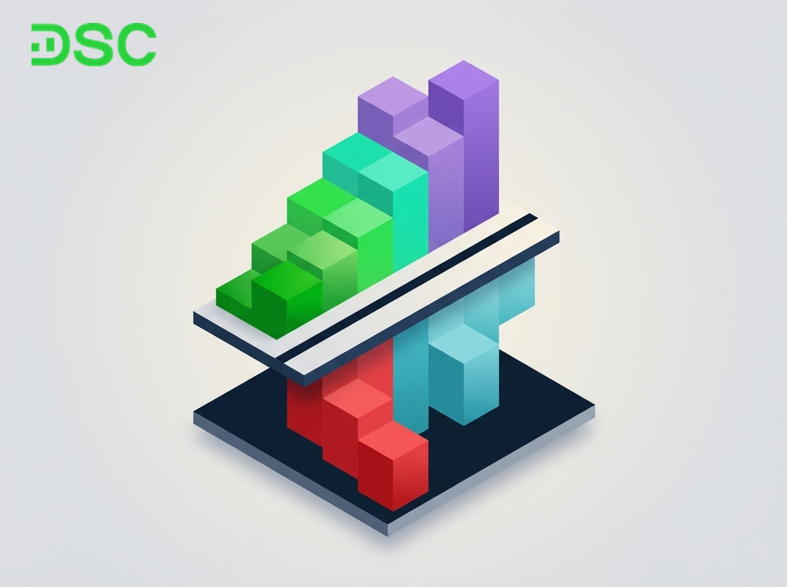
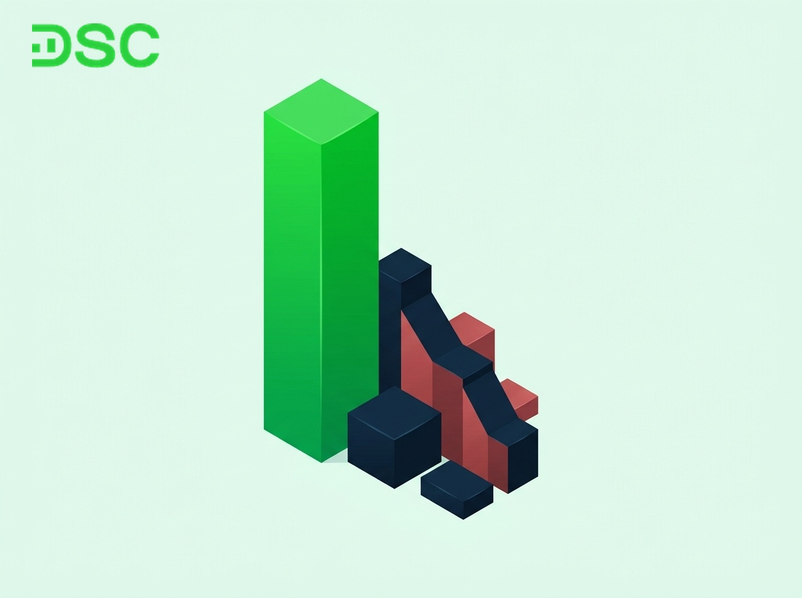

# Ý nghĩa các màu trong chứng khoán: Cách đọc bảng giá cho F0

Khi mới bước chân vào thị trường, **các màu trong chứng khoán** trên bảng điện tử thường khiến nhà đầu tư mới cảm thấy bối rối. Bảng giá nhảy số liên tục với sắc xanh lá, đỏ, vàng, tím và xanh lơ.

Thực chất, mỗi màu sắc là một quy ước trực quan phản ánh cung cầu và biên độ giá cổ phiếu trong phiên giao dịch. Hiểu rõ ý nghĩa các gam màu giúp bạn đọc vị diễn biến thị trường và đưa ra quyết định giao dịch chuẩn xác.

## Ý nghĩa của các màu sắc trong chứng khoán

Bảng giá chứng khoán tại Việt Nam sử dụng 6 màu sắc tiêu chuẩn để biểu thị các trạng thái giá khác nhau. Dưới đây là bảng tổng hợp giúp bạn tra cứu nhanh chóng.

| Màu sắc | Tên gọi chuẩn | Trạng thái giá | Biên độ quy định | Ý nghĩa thị trường |
| :--- | :--- | :--- | :--- | :--- |
| **Vàng** | Giá tham chiếu | Đứng giá | Mốc chuẩn 0% | Cung cầu cân bằng tại mức giá đóng cửa hôm trước |
| **Xanh lá** | Giá tăng | Cao hơn tham chiếu | Nằm giữa tham chiếu và giá trần | Phe mua chiếm ưu thế đẩy giá tăng |
| **Đỏ** | Giá giảm | Thấp hơn tham chiếu | Nằm giữa tham chiếu và giá sàn | Phe bán áp đảo kéo giá sụt giảm |
| **Tím** | Giá trần | Tăng kịch trần | HOSE +7%, HNX +10%, UPCoM +15% | Lực cầu cực mạnh, bên mua chấp nhận mức giá cao nhất |
| **Xanh lơ** | Giá sàn | Giảm kịch sàn | HOSE -7%, HNX -10%, UPCoM -15% | Áp lực bán tháo lớn, bên bán chấp nhận mức giá thấp nhất |
| **Trắng** | Chưa khớp / Trắng bảng | Không có giao dịch hoặc trắng bên mua/bán | - | Thể hiện tình trạng thanh khoản đóng băng tạm thời |

### Màu vàng – Giá tham chiếu của cổ phiếu

Màu vàng đại diện cho giá tham chiếu của cổ phiếu hoặc chỉ số thị trường. Đây là mức giá làm cột mốc cơ sở để tính toán biên độ dao động trong ngày.

Tại sàn HOSE và HNX, giá tham chiếu chính là giá đóng cửa của phiên giao dịch liền trước. Riêng sàn UPCoM, giá tham chiếu được tính bằng giá bình quân gia quyền của các giao dịch khớp lệnh liên tục trong phiên gần nhất.

Khi giá khớp lệnh hiển thị màu vàng, điều đó chứng tỏ cổ phiếu đang đứng giá và chưa có sự chênh lệch so với phiên trước. Đây là căn cứ quan trọng để xác định [giá trần, giá sàn và giá tham chiếu](https://www.dsc.com.vn/kien-thuc/gia-tran-gia-san-la-gi) cho từng mã cổ phiếu.

### Màu xanh lá cây – Giá cổ phiếu đang tăng

Màu xanh lá cây xuất hiện khi giá khớp lệnh hiện tại cao hơn giá tham chiếu nhưng chưa chạm mức giá trần. Sắc xanh biểu thị tâm lý lạc quan của thị trường.

Lúc này, lực cầu đang chiếm ưu thế so với lực cung. Người mua sẵn sàng trả mức giá cao hơn để sở hữu cổ phiếu, phản ánh dòng tiền đang chủ động tham gia mua gom.

### Màu đỏ – Giá cổ phiếu đang giảm

Màu đỏ xuất hiện khi giá khớp lệnh hiện tại thấp hơn giá tham chiếu nhưng chưa chạm mức giá sàn. Sắc đỏ cảnh báo áp lực cung đang đè nặng lên cổ phiếu.

Khi màu đỏ chiếm ưu thế, tâm lý bên bán đang chiếm quyền kiểm soát. Nhà đầu tư sẵn sàng hạ giá bán để thu tiền về, khiến thị giá cổ phiếu liên tục sụt giảm.

### Màu tím – Giá trần trong phiên giao dịch

Màu tím thể hiện mức giá trần của cổ phiếu, tức mức giá kịch kim cao nhất mà một mã có thể đạt được trong phiên. Bạn không thể đặt lệnh mua ở mức giá cao hơn màu tím.

Mức tăng kịch trần khác nhau tùy thuộc vào từng [sàn giao dịch chứng khoán](https://www.dsc.com.vn/kien-thuc/san-giao-dich-chung-khoan-la-gi). Sàn HOSE áp dụng mức trần tối đa +7% so với giá tham chiếu. Sàn HNX áp dụng mức +10%, trong khi sàn UPCoM cho phép biên độ lên đến +15%.

Khi cổ phiếu đạt sắc tím, lực cầu mua vào thường áp đảo hoàn toàn lượng hàng bán ra. Nhiều mã rơi vào trạng thái dư mua giá trần hàng triệu đơn vị.

### Màu xanh lơ – Giá sàn trong phiên giao dịch

Màu xanh lơ (xanh dương nhạt) đại diện cho mức giá sàn của cổ phiếu. Đây là mức giá thấp nhất mà nhà đầu tư được phép giao dịch trong phiên.

Tương tự giá trần, biên độ giá sàn cũng được kiểm soát chặt chẽ theo quy định của từng sàn. Cổ phiếu sàn HOSE giảm tối đa 7% so với giá tham chiếu. Mức giảm tối đa tại sàn HNX là 10% và sàn UPCoM là 15%.

Khi cổ phiếu xuất hiện màu xanh lơ, thị trường đang chứng kiến sự hoảng loạn của bên bán. Lượng dư bán sàn tăng vọt trong khi bên mua gần như rút lui hoàn toàn.

### Màu trắng – Cổ phiếu chưa khớp lệnh hoặc trắng bảng

Màu trắng trên bảng điện tử thường xuất hiện ở hai trường hợp cụ thể. Bạn cần phân định cẩn thận để tránh hiểu nhầm về trạng thái giao dịch.

Trường hợp đầu tiên là cổ phiếu chưa phát sinh giao dịch khớp lệnh trong phiên. Các cột khớp lệnh sẽ để trống hoặc hiển thị ký tự màu trắng.

Trường hợp thứ hai là hiện tượng trắng bên mua hoặc trắng bên bán ở các cột giá chào. Khi cổ phiếu giảm sàn không có người mua, cột dư mua sẽ hoàn toàn trống trắng (múa bên trăng). Ngược lại, khi cổ phiếu tăng trần không ai bán, cột dư bán sẽ rơi vào trạng thái trắng tinh.

## Cơ chế đổi màu trên bảng điện tử: Mối quan hệ giữa giá khớp lệnh và giá tham chiếu

Bảng giá chứng khoán cập nhật liên tục từng giây theo cơ chế khớp lệnh tự động. Mỗi khi có lệnh mua và lệnh bán gặp nhau tại một mức giá, hệ thống sẽ xác định lại màu sắc hiển thị.

Cơ chế đổi màu tuân thủ nghiêm ngặt theo các điều kiện so sánh sau:

* **Màu vàng**. Kích hoạt khi Giá khớp lệnh bằng Giá tham chiếu.
* **Màu xanh lá**. Kích hoạt khi Giá tham chiếu < Giá khớp lệnh < Giá trần.
* **Màu tím**. Kích hoạt khi Giá khớp lệnh bằng Giá trần (Giá tham chiếu + Biên độ tối đa).
* **Màu đỏ**. Kích hoạt khi Giá sàn < Giá khớp lệnh < Giá tham chiếu.
* **Màu xanh lơ**. Kích hoạt khi Giá khớp lệnh bằng Giá sàn (Giá tham chiếu - Biên độ tối đa).

Giả sử cổ phiếu ABC có giá tham chiếu đầu ngày là 50.000 VNĐ. Mức giá trần và giá sàn tương ứng với từng sàn được tính toán như sau:

| Sàn giao dịch | Biên độ ngày thường | Giá trần (Tím) | Giá sàn (Xanh lơ) |
| :--- | :--- | :--- | :--- |
| **Sàn HOSE** | ±7% | 53.500 VNĐ | 46.500 VNĐ |
| **Sàn HNX** | ±10% | 55.000 VNĐ | 45.000 VNĐ |
| **Sàn UPCoM** | ±15% | 57.500 VNĐ | 42.500 VNĐ |

Mỗi sàn giao dịch áp dụng một quy định riêng về [biên độ dao động giá cổ phiếu](https://www.dsc.com.vn/kien-thuc/bien-do-giao-dong-gia-co-phieu-la-gi). Nhờ nắm vững quy tắc này, bạn sẽ chủ động dự phóng được mức giá tối đa và tối thiểu của cổ phiếu trong ngày.

Tính đến tháng 10/2026, ứng dụng DSC Trading cung cấp giao diện bảng giá trực quan với tốc độ cập nhật dữ liệu real-time vượt trội. Nhà đầu tư mới có thể dễ dàng theo dõi biến động từng mã và nhận khuyến nghị đầu tư hữu ích từ chuyên gia.

  

  

    
Làm chủ bảng điện tử cùng chuyên gia Môi giới 1:1 DSC

    
Mở tài khoản eKYC chỉ trong 3 phút. Nhận tư vấn trực tiếp từ chuyên gia để đọc bảng giá và bắt nhịp thị trường chuẩn xác.

  

  <a href="https://www.dsc.com.vn/mo-tai-khoan" style="background: #2BE841; color: #0D1B2A; padding: 14px 32px; border-radius: 30px; text-decoration: none; font-weight: 700; font-size: 16px; display: inline-block; position: relative; z-index: 1;">Mở tài khoản eKYC ngay</a>

## Hiện tượng Xanh vỏ đỏ lòng và Đỏ vỏ xanh lòng trên thị trường

Khi quan sát bảng điện tử, nhiều nhà đầu tư mới ngạc nhiên khi thấy chỉ số VN-Index tăng điểm xanh mướt. Tuy nhiên, danh mục cổ phiếu của mình lại chìm trong sắc đỏ. Đây là hiện tượng phổ biến phản ánh sự lệch pha giữa chỉ số chung và độ rộng thực tế của thị trường.

### Hiện tượng Xanh vỏ đỏ lòng

Hiện tượng này diễn ra khi chỉ số thị trường hiển thị màu xanh lá cây. Dù vậy, số lượng mã giảm giá lại áp đảo hoàn toàn số lượng mã tăng giá. Nguyên nhân bắt nguồn từ cơ chế tính điểm của chỉ số chứng khoán.

Các cổ phiếu có vốn hóa lớn (nhóm cổ phiếu trụ như VN30) chiếm tỷ trọng rất cao trong công thức tính chỉ số VN-Index. Khi dòng tiền lớn tập trung kéo giá một vài mã trụ tăng trần, chỉ số chung sẽ được cộng điểm đáng kể.

Tuy nhiên, phần lớn các cổ phiếu tầm trung và nhỏ trên thị trường lại chịu áp lực bán đỏ rực. Người cầm cổ phiếu lúc này vẫn chịu thua lỗ dù thị trường chung trông có vẻ rất tích cực.

### Hiện tượng Đỏ vỏ xanh lòng

Hiện tượng này xuất hiện khi chỉ số VN-Index mang sắc đỏ giảm điểm. Trái lại, số lượng mã tăng giá lại chiếm ưu thế áp đảo trên toàn thị trường.

Tình huống này xảy ra khi một vài mã cổ phiếu vốn hóa lớn bị bán chốt lời hoặc điều chỉnh mạnh, kéo điểm số chung sụt giảm. Tuy nhiên, dòng tiền lại phân bổ đều và lan tỏa tích cực sang các nhóm ngành sản xuất, bán lẻ hoặc xuất khẩu.

Để nhận diện đúng bản chất thị trường, bạn không nên chỉ nhìn vào sắc xanh đỏ của chỉ số chung. Hãy quan sát chỉ số độ rộng thị trường (tỷ lệ mã tăng so với mã giảm) và giá trị thanh khoản trên bảng điện tử.

## 3 bẫy tâm lý F0 thường gặp theo màu sắc và cách kiểm soát

Màu sắc trên bảng điện tử có sức ảnh hưởng rất lớn đến hệ thống thần kinh của nhà đầu tư. F0 thường dễ bị cuốn vào vòng xoáy cảm xúc nếu chưa trang bị nền tảng kỷ luật vững vàng.

### Bẫy FOMO mua đuổi giá tím

Khi thấy hàng loạt cổ phiếu tăng trần màu tím, tâm lý sợ bỏ lỡ cơ hội sẽ thôi thúc bạn nhảy vào mua bất chấp mức giá. Nhiều người vội vã đặt lệnh ở mức giá trần cao nhất trong phiên.

Mua đuổi khi cổ phiếu đã tăng nóng tiềm ẩn nguy cơ đu đỉnh rất cao. Khi dòng tiền đầu cơ rút đi, cổ phiếu có thể đảo chiều giảm đột ngột trước khi hàng về tài khoản sau chu kỳ T+2,5.

### Bẫy hoảng loạn bán tháo giá sàn

Trái ngược với FOMO, cảm giác hoảng loạn sẽ xuất hiện khi bảng điện tử ngập tràn sắc xanh lơ. Nhìn tài khoản bốc hơi nhanh chóng, F0 có xu hướng bán tống bán tháo bằng mọi giá.

Hành động bán tháo trong hoảng loạn thường khiến bạn cắt lỗ ngay tại đáy ngắn hạn của cổ phiếu. Sau các nhịp rũ bỏ mạnh, dòng tiền lớn thường quay lại gom hàng giúp thị giá phục hồi nhanh chóng.

### Bẫy tê liệt hành động khi thị trường giằng co

Khi thị trường rơi vào giai đoạn đi ngang với sắc vàng và đỏ đan xen, nhiều nhà đầu tư dễ rơi vào trạng thái chán nản. Việc thiếu hành động dứt khoát có thể khiến vốn liếng bị chôn vùi lâu ngày.

Để vượt qua các bẫy cảm xúc này, bạn nên tham khảo cẩm nang [cách chơi chứng khoán cho người mới bắt đầu](https://www.dsc.com.vn/kien-thuc/cach-dau-tu-chung-khoan-cho-nguoi-moi-bat-dau). Bộ nguyên tắc giao dịch khoa học sẽ giúp bạn giữ vững kỷ luật đầu tư.

Đội ngũ chuyên gia Môi giới 1:1 tại Chứng khoán DSC luôn sẵn sàng đồng hành cùng bạn. Chuyên gia sẽ hỗ trợ bạn thiết lập kỷ luật cắt lỗ từ 7% đến 8% để bảo vệ nguồn vốn hiệu quả.

## Câu hỏi thường gặp về các màu trong chứng khoán

Dưới đây là lời giải đáp chi tiết cho những câu hỏi thường gặp của nhà đầu tư mới. Nội dung tập trung làm rõ ý nghĩa các gam màu trên bảng điện tử.

* **Màu vàng trong chứng khoán có ý nghĩa gì?** Màu vàng thể hiện giá tham chiếu năm 2026, là mức giá đóng cửa phiên trước dùng để tính giá trần và giá sàn.
* **Làm cách nào để biết cổ phiếu đang tăng hay giảm?** Bạn chỉ cần so sánh giá khớp lệnh với mốc tham chiếu màu vàng, nếu hiển thị sắc xanh lá là giá tăng và sắc đỏ là giá giảm.
* **Trong chứng khoán màu tím là gì?** Màu tím biểu thị mức giá trần năm 2026 với biên độ tối đa là +7% trên sàn HOSE, +10% trên sàn HNX và +15% trên sàn UPCoM.
* **Màu xanh dương trong chứng khoán có ý nghĩa gì?** Màu xanh dương hay xanh lơ thể hiện mức giá sàn với biên độ giảm tối đa là -7% trên sàn HOSE, -10% trên HNX và -15% trên UPCoM.
* **Cổ phiếu màu tím có nên mua đuổi không?** Bạn không nên mua đuổi cổ phiếu giá tím khi chưa hiểu rõ thanh khoản, nhằm tránh rủi ro sụt giảm khi lực mua suy yếu.

## Kết luận: Làm chủ màu sắc bảng điện tử để đầu tư bền vững

Màu sắc trên bảng giá chứng khoán là phương tiện trực quan tuyệt vời giúp bạn nắm bắt nhịp đập giao dịch từng giây của thị trường. Tuy nhiên, đằng sau mỗi sắc xanh, đỏ hay tím luôn là cuộc chiến cung cầu khốc liệt của dòng tiền lớn.

Thay vì để cảm xúc bị chi phối bởi các gam màu nhấp nháy, bạn hãy xây dựng tư duy đầu tư thực chứng. Hãy luôn dựa vào số liệu tài chính và tuân thủ chiến lược quản trị rủi ro nghiêm ngặt. Hãy để DSC trở thành người đồng hành tin cậy, giúp bạn làm chủ bảng điện tử và tối ưu hóa hiệu quả đầu tư trên hành trình tài chính.

  
Đầu tư chứng khoán thông minh cùng Chứng khoán DSC

  
Trải nghiệm nền tảng DSC Trading mượt mà với mức phí giao dịch chỉ từ 0,1%. Đội ngũ chuyên gia Môi giới 1:1 luôn sẵn sàng hỗ trợ bạn.

  <a href="https://www.dsc.com.vn/mo-tai-khoan" style="background: #2BE841; color: #0D1B2A; padding: 15px 38px; border-radius: 30px; text-decoration: none; font-weight: 700; font-size: 16px; display: inline-block;">Mở tài khoản DSC miễn phí</a>

