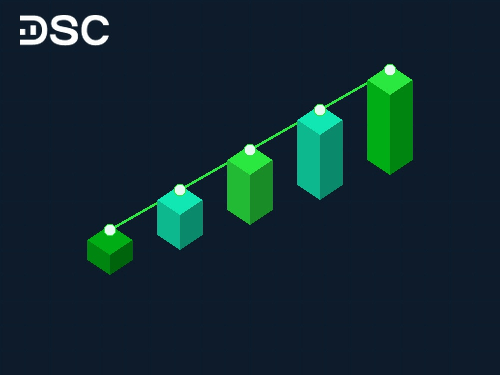
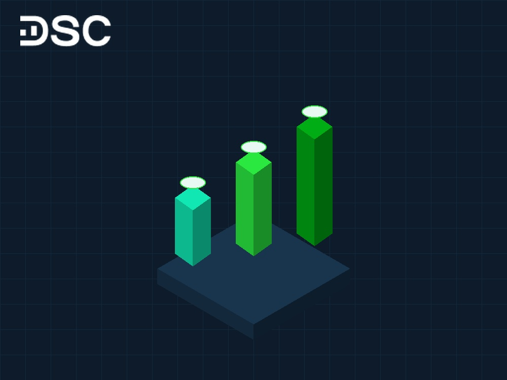

# Cách mua cổ phiếu online: Hướng dẫn 5 bước chuẩn cho F0

Cách mua cổ phiếu online gồm 5 bước: mở tài khoản eKYC, nạp tiền, chọn mã cổ phiếu, đặt lệnh và quản lý danh mục. Để bắt đầu, bạn chỉ cần chuẩn bị căn cước công dân gắn chip cùng tài khoản ngân hàng chính chủ.

Năm 2026, các công ty chứng khoán đã số hóa toàn bộ quy trình giao dịch trên điện thoại thông minh. Bài viết này hướng dẫn chi tiết từng thao tác thực hành giúp nhà đầu tư mới tự tin giải ngân an toàn.

## Hướng dẫn 5 bước mua cổ phiếu online chi tiết cho người mới

Quy trình giao dịch trên thị trường chứng khoán Việt Nam được chuẩn hóa nhằm bảo vệ quyền lợi hợp pháp của nhà đầu tư. Bạn có thể hoàn thành toàn bộ thao tác mua cổ phiếu online theo lộ trình 5 bước sau:

- **Bước 1**: Mở tài khoản giao dịch chứng khoán trực tuyến qua công nghệ eKYC.
- **Bước 2**: Nạp tiền vào tài khoản chứng khoán qua mã định danh ngân hàng.
- **Bước 3**: Lựa chọn mã cổ phiếu tiềm năng và xác định quy mô vốn giải ngân.
- **Bước 4**: Đặt lệnh mua cổ phiếu trên ứng dụng giao dịch theo đúng khung giờ.
- **Bước 5**: Theo dõi trạng thái khớp lệnh và quản lý danh mục theo chu kỳ T+2.

### Bước 1: Mở tài khoản giao dịch chứng khoán

Để sở hữu cổ phiếu niêm yết, bạn bắt buộc phải có tài khoản chứng khoán chính chủ. Tài khoản này đóng vai trò như ví lưu ký tài sản tài chính. Cơ chế lưu ký được quản lý bởi Tổng công ty Lưu ký và Bù trừ chứng khoán Việt Nam (VSDC).

#### Chuẩn bị hồ sơ

Nhà đầu tư cá nhân tại Việt Nam chỉ cần chuẩn bị hai yếu tố cơ bản trước khi đăng ký:

- **Căn cước công dân (CCCD)**: Bản gốc gắn chip còn thời hạn sử dụng, rõ số và không bị mờ ảnh chân dung.
- **Tài khoản ngân hàng cá nhân**: Đứng tên chính chủ để liên kết phục vụ việc nộp và rút tiền đầu tư.

Quy trình [mở tài khoản chứng khoán](https://www.dsc.com.vn/kien-thuc/cach-mo-tai-khoan-chung-khoan) diễn ra hoàn toàn trên môi trường số. Thao tác này rất nhanh. Bạn không cần chuẩn bị bản công chứng hay ký hợp đồng giấy phức tạp.

#### Lựa chọn công ty chứng khoán phù hợp

Người mới bắt đầu thường băn khoăn [nên mở tài khoản chứng khoán ở đâu](https://www.dsc.com.vn/kien-thuc/nen-mo-tai-khoan-chung-khoan-o-dau) giữa hàng chục định chế tài chính. Bạn nên cân nhắc ba tiêu chí cốt lõi: uy tín thương hiệu, hạ tầng công nghệ ứng dụng và chất lượng tư vấn hỗ trợ.

Công ty Cổ phần Chứng khoán DSC là định chế tài chính hiện đại định vị theo mô hình Ngân hàng Đầu tư và Quản lý tài sản số. DSC cung cấp nền tảng giao dịch vượt trội cùng dịch vụ chuyên gia tư vấn đồng hành sát sao cho từng khách hàng cá nhân.

#### Thao tác mở tài khoản trực tuyến

Hình thức mở tài khoản online qua công nghệ định danh điện tử (eKYC) giúp tiết kiệm tối đa thời gian di chuyển. Quy trình mở tài khoản gồm 4 bước đơn giản:

1. Tải ứng dụng giao dịch chứng khoán về điện thoại di động (iOS hoặc Android).
2. Nhập số điện thoại, địa chỉ email và xác thực mã OTP gửi về tin nhắn.
3. Chụp ảnh hai mặt CCCD gắn chip và quét khuôn mặt theo chỉ dẫn tự động.
4. Kiểm tra thông tin cá nhân và ký hợp đồng điện tử trực tiếp trên màn hình.

Hệ thống sẽ cấp mã số tài khoản giao dịch ngay sau khi dữ liệu eKYC được xác thực thành công. Bạn cũng có thể đến trực tiếp phòng giao dịch nếu muốn nhận hợp đồng bản cứng và trao đổi trực tiếp với nhân viên tư vấn.

### Bước 2: Nạp tiền vào tài khoản giao dịch

Sau khi tài khoản được kích hoạt, bạn cần nạp tiền vào để bắt đầu mua bán cổ phiếu. Hệ thống tài chính hiện đại cho phép dòng tiền được ghi nhận tức thì vào tài khoản chứng khoán 24/7.

#### Nạp tiền nhanh qua mã định danh tự động

Phương thức tối ưu nhất hiện nay là chuyển khoản ngân hàng thông qua mã định danh tài khoản chuyên dụng. Cách thức này loại bỏ hoàn toàn rủi ro sai sót nội dung chuyển tiền hoặc treo lệnh ngoài giờ hành chính.

Tại Chứng khoán DSC, khách hàng nạp tiền trực tiếp qua ngân hàng đối tác BIDV bằng công thức tài khoản ảo thông minh:

- **Ngân hàng thụ hưởng**: BIDV (Ngân hàng TMCP Đầu tư và Phát triển Việt Nam).
- **Số tài khoản thụ hưởng**: Cú pháp `963369` + 6 số cuối số tài khoản chứng khoán + số tiểu khoản.
- **Tên người thụ hưởng**: Họ và tên chính chủ tài khoản chứng khoán hiển thị tự động.

Ví dụ: Tài khoản chứng khoán của bạn là `024C123456`, muốn nạp vào tiểu khoản thường (đuôi 1), số tài khoản thụ hưởng sẽ là `9633691234561`. Tiền sẽ được cộng vào sức mua của bạn chỉ sau vài giây.

#### Chuyển khoản qua các ngân hàng liên kết

Ngoài mã định danh, bạn có thể nạp tiền từ ứng dụng ngân hàng số của Vietcombank, Techcombank, VPBank hoặc MB Bank. Hãy chọn tính năng chuyển tiền chứng khoán hoặc chuyển khoản nhanh 24/7 Napas vào số tài khoản tổng của công ty chứng khoán theo đúng cú pháp hướng dẫn.

### Bước 3: Chọn cổ phiếu tiềm năng để mua

Lựa chọn đúng doanh nghiệp quyết định trực tiếp đến sự an toàn của dòng vốn. Đây là bước then chốt. Nhà đầu tư mới không nên mua theo tin đồn trên mạng xã hội mà cần dựa trên những tiêu chí phân tích cơ bản khách quan.

#### Tiêu chí đánh giá cổ phiếu cho người mới

Bạn có thể áp dụng ba bộ lọc cơ bản để tìm kiếm [cách chọn cổ phiếu tốt](https://www.dsc.com.vn/kien-thuc/3-cach-chon-co-phieu-tot-va-co-tiem-nang-tang-gia-de-dau-tu) cho danh mục khởi đầu:

- **Sức khỏe tài chính lành mạnh**: Doanh nghiệp duy trì doanh thu và lợi nhuận sau thuế tăng trưởng đều đặn qua các năm. Tỷ lệ nợ vay ở mức an toàn và ban lãnh đạo có năng lực quản trị minh bạch.
- **Định giá hợp lý**: Giá thị trường của cổ phiếu không vượt quá xa giá trị thực tế của công ty. Bạn nên so sánh [chỉ số P/E](https://www.dsc.com.vn/kien-thuc/chi-so-p-e-la-gi-cach-ap-dung-de-tim-co-phieu-tot) và chỉ số P/B của mã đó với mức trung bình của toàn ngành.
- **Thanh khoản thị trường cao**: Ưu tiên cổ phiếu có khối lượng khớp lệnh hàng ngày từ vài trăm nghìn đến hàng triệu đơn vị. Yếu tố [thanh khoản thị trường](https://www.dsc.com.vn/kien-thuc/thanh-khoan-la-gi) giúp bạn dễ dàng bán ra để thu hồi tiền mặt khi cần thiết mà không bị trượt giá.

#### Cần bao nhiêu tiền để mua một lô cổ phiếu?

Thị trường chứng khoán Việt Nam áp dụng quy định giao dịch theo lô chẵn 100 cổ phiếu trên cả ba sàn HOSE, HNX và UPCoM. Điều này có nghĩa là số lượng đặt mua tối thiểu cho một lần đặt lệnh là 100 cổ phiếu.

Dưới đây là bảng tính số vốn tối thiểu thực tế để sở hữu 1 lô 100 cổ phiếu của các doanh nghiệp đầu ngành:

| Mã cổ phiếu | Doanh nghiệp | Thị giá tham khảo (VNĐ/cp) | Vốn tối thiểu 1 lô (100 cp) | Phí giao dịch DSC (0,1%) |
| :--- | :--- | :---: | :---: | :---: |
| **MBB** | Ngân hàng Quân Đội | 24.500 | 2.450.000 VNĐ | 2.450 VNĐ |
| **HPG** | Tập đoàn Hòa Phát | 28.000 | 2.800.000 VNĐ | 2.800 VNĐ |
| **TCB** | Ngân hàng Techcombank | 23.500 | 2.350.000 VNĐ | 2.350 VNĐ |
| **VNM** | Sữa Việt Nam (Vinamilk) | 65.000 | 6.500.000 VNĐ | 6.500 VNĐ |
| **FPT** | Tập đoàn FPT | 135.000 | 13.500.000 VNĐ | 13.500 VNĐ |

Nhà đầu tư mới hoàn toàn có thể bắt đầu hành trình đầu tư chứng khoán với số vốn chỉ từ 2 đến 3 triệu đồng. Việc trải nghiệm giao dịch thực tế với số vốn nhỏ giúp bạn rèn luyện tâm lý vững vàng trước khi gia tăng quy mô tài sản.

### Bước 4: Đặt lệnh mua cổ phiếu trên ứng dụng giao dịch

Sau khi lựa chọn được mã cổ phiếu mục tiêu, bạn tiến hành nhập lệnh mua trực tiếp trên nền tảng số của công ty chứng khoán. Nắm rõ cơ chế lệnh và quy tắc giao dịch giúp lệnh mua khớp thành công với mức giá tối ưu nhất.

#### Phân biệt hai loại lệnh cơ bản cho F0

Thị trường có nhiều công cụ giao dịch phức tạp. Tuy nhiên, nhà đầu tư mới chỉ cần nắm vững hai lệnh cơ bản trong hệ thống [các loại lệnh trong chứng khoán](https://www.dsc.com.vn/kien-thuc/lenh-ato-atc-lo-mp-la-gi):

- **Lệnh giới hạn (LO)**: Lệnh mua với mức giá cụ thể do bạn tự ấn định. Lệnh chỉ khớp khi thị trường có người bán với mức giá bằng hoặc thấp hơn giá này.
- **Lệnh thị trường (MP)**: Lệnh mua lập tức tại mức giá bán thấp nhất hiện có trên sàn. Lệnh MP giúp khớp lệnh ngay nhưng phụ thuộc vào mức giá chào bán thực tế.

#### Siêu bảng thông số kỹ thuật và biên độ 3 sàn chứng khoán

Mỗi sàn giao dịch tại Việt Nam có quy định riêng biệt về biên độ giá và cơ chế khớp lệnh:

| Tiêu chí | Sàn HOSE (TP.HCM) | Sàn HNX (Hà Nội) | Sàn UPCoM |
| :--- | :---: | :---: | :---: |
| **Biên độ dao động ngày** | **±7%** | **±10%** | **±15%** |
| **Đơn vị lô giao dịch chẵn** | 100 cổ phiếu | 100 cổ phiếu | 100 cổ phiếu |
| **Lệnh phiên mở cửa (ATO)** | Có (9h00 – 9h15) | Không áp dụng | Không áp dụng |
| **Lệnh phiên đóng cửa (ATC)** | Có (14h30 – 14h45) | Có (14h30 – 14h45) | Không áp dụng |
| **Lệnh thị trường** | Lệnh MP | Lệnh MAK, MOK, MTL | Không áp dụng |
| **Giao dịch thỏa thuận** | Từ 20.000 cổ phiếu | Từ 5.000 cổ phiếu | Từ 10.000 cổ phiếu |

#### Các bước thao tác đặt lệnh mua thực tế

Trên ứng dụng giao dịch, bạn thực hiện đặt lệnh theo trình tự sau:

1. Đăng nhập vào ứng dụng và truy cập mục Giao dịch lệnh.
2. Nhập mã chứng khoán bạn muốn mua (ví dụ: HPG, MBB).
3. Chọn loại lệnh phù hợp (ưu tiên lệnh LO cho người mới).
4. Nhập khối lượng mua (bội số của 100 cổ phiếu) và mức giá kỳ vọng.
5. Kiểm tra lại tổng giá trị giải ngân và nhấn nút Mua, sau đó xác thực bằng mã PIN hoặc Smart OTP.

Lệnh giao dịch chỉ có hiệu lực trong [giờ giao dịch chứng khoán](https://www.dsc.com.vn/kien-thuc/gio-giao-dich-chung-khoan-viet-nam) chính thức từ 9h00 đến 11h30 và từ 13h00 đến 15h00 từ thứ Hai đến thứ Sáu. Nếu bạn đặt lệnh ngoài khung giờ này, lệnh sẽ được hệ thống lưu ở trạng thái chờ và gửi lên sàn vào phiên tiếp theo.

### Bước 5: Theo dõi và quản lý danh mục đầu tư

Mua xong cổ phiếu không đồng nghĩa với việc kết thúc quá trình đầu tư. Quản trị danh mục và kiểm soát rủi ro bài bản là yếu tố giúp bảo vệ dòng vốn và tối ưu hóa lợi nhuận bền vững.

#### Quy định chu kỳ thanh toán T+2

Theo quy định của VSDC, thị trường chứng khoán Việt Nam vận hành theo chu kỳ thanh toán T+2. Khi bạn đặt lệnh mua khớp thành công vào ngày T (ví dụ thứ Hai), tiền sẽ được khấu trừ ngay lập tức.

Tuy nhiên, quyền sở hữu cổ phiếu sẽ về tài khoản vào lúc 13h00 ngày làm việc thứ hai (ngày T+2). Bạn chỉ có thể thực hiện lệnh bán kể từ chiều ngày T+2 trở đi.

#### Nguyên tắc quản trị danh mục cho nhà đầu tư F0

Để danh mục đầu tư tăng trưởng an toàn, bạn nên tuân thủ các nguyên tắc kỷ luật sau:

- **Phân bổ vốn hợp lý**: Không bao giờ dồn toàn bộ số tiền vào một mã duy nhất. Bạn nên chia nguồn vốn cho 3 đến 5 mã cổ phiếu thuộc các nhóm ngành khác nhau để phân tán rủi ro.
- **Thiết lập mức cắt lỗ kỷ luật**: Luôn xác định ngưỡng chịu lỗ tối đa trước khi mở vị thế. Nếu giá cổ phiếu vi phạm ngưỡng giảm 7% đến 8%, bạn nên chủ động bán ra để bảo vệ vốn.
- **Tránh tâm lý FOMO mua đuổi**: Hạn chế mua vào những cổ phiếu đã tăng trần liên tiếp nhiều phiên mà không có nền tảng cơ bản hỗ trợ.

Khởi đầu đầu tư có thể khiến bạn bối rối trước hàng trăm biến số thị trường và các thao tác kỹ thuật mới lạ. Sự hỗ trợ từ chuyên gia tư vấn giàu kinh nghiệm giúp người mới bắt đầu chọn đúng cổ phiếu tiềm năng và tránh các sai lầm tốn kém.

  

  

    
Mở tài khoản chứng khoán DSC chỉ với CCCD gắn chip

    
eKYC 3 phút • Phí giao dịch chỉ từ 0,1% • Chuyên gia Môi giới 1:1 đồng hành

  

  <a href="https://www.dsc.com.vn/mo-tai-khoan" style="background: #2BE841; color: #0D1B2A; padding: 14px 32px; border-radius: 30px; text-decoration: none; font-weight: 700; font-size: 16px; display: inline-block; position: relative; z-index: 1;">Mở tài khoản — 3 phút</a>

## Lợi thế khi giao dịch cổ phiếu online tại Chứng khoán DSC

Chứng khoán DSC tập trung xây dựng hệ sinh thái số hiện đại nhằm tối ưu trải nghiệm cho khách hàng cá nhân. Nền tảng giao dịch App DSC Trading tích hợp tốc độ khớp lệnh hàng đầu cùng giao diện trực quan thân thiện.

Đặc biệt, DSC giải quyết triệt để nỗi lo thiếu kinh nghiệm của nhà đầu tư mới thông qua dịch vụ Môi giới 1:1. Mỗi khách hàng được kết nối trực tiếp với một chuyên viên tư vấn riêng biệt. Chuyên viên sẽ hỗ trợ giải đáp thắc mắc, cập nhật khuyến nghị và đồng hành cùng bạn.

Biểu phí giao dịch tại DSC cạnh tranh hàng đầu thị trường, chỉ từ 0,1% giá trị giao dịch. Hệ thống nạp rút tiền tức thì qua mã định danh ngân hàng giúp bạn chủ động giao dịch. Dòng vốn luân chuyển nhanh chóng mà không gặp bất kỳ rào cản kỹ thuật nào.

## Câu hỏi thường gặp khi mua cổ phiếu online

Dưới đây là phần giải đáp các thắc mắc phổ biến nhất của nhà đầu tư khi chuẩn bị tham gia thị trường chứng khoán:

### Muốn mua cổ phiếu thì mua ở đâu uy tín?

Nhà đầu tư cá nhân mua cổ phiếu qua tài khoản tại các công ty chứng khoán được UBCKNN cấp phép, như Chứng khoán DSC. Bạn không thể mua trực tiếp tại Sở giao dịch HOSE hay HNX. Tuyệt đối không giao dịch trao tay ngoài sàn vì thiếu hành lang pháp lý bảo hộ.

### Cần bao nhiêu tiền để bắt đầu mua cổ phiếu online?

Thị trường chứng khoán Việt Nam không quy định số vốn tối thiểu. Bạn chỉ cần đủ tiền mua 1 lô chẵn tối thiểu 100 cổ phiếu theo quy định của sàn. Mức vốn này tương đương từ vài trăm nghìn đến vài triệu đồng tùy từng mã.

### Mua cổ phiếu online bao lâu thì được bán?

Theo quy định của VSDC, cổ phiếu mua ngày T sẽ về tài khoản lúc 13h00 ngày làm việc thứ hai (T+2). Nhà đầu tư có thể đặt lệnh bán ngay trong phiên chiều hôm đó.

### Người mới bắt đầu nên chọn mua cổ phiếu nào?

Nhà đầu tư mới nên ưu tiên cổ phiếu rổ VN30 có nền tảng tài chính tốt và thanh khoản dồi dào. Bạn có thể liên hệ chuyên gia Môi giới 1:1 của DSC để nhận danh mục khuyến nghị phù hợp.

## Lời kết

Nắm vững quy trình mua cổ phiếu online giúp bạn làm chủ kế hoạch tài chính cá nhân. Thực hiện bài bản 5 bước từ mở tài khoản eKYC đến đặt lệnh sẽ giúp bạn tự tin giao dịch.

Thành công trong đầu tư luôn bắt đầu từ những bước đi bài bản và sự đồng hành của một định chế tài chính đáng tin cậy. Hãy tải ứng dụng DSC Trading để bắt đầu đầu tư và nhận đặc quyền tư vấn từ chuyên gia hàng đầu.

  
Bắt đầu giao dịch cổ phiếu online ngay hôm nay

  
Đăng ký eKYC 100% online trong 3 phút, giao dịch với chi phí tối ưu và nhận tư vấn chiến lược 1:1 từ chuyên viên DSC.

  <a href="https://www.dsc.com.vn/mo-tai-khoan" style="background: #2BE841; color: #0D1B2A; padding: 15px 38px; border-radius: 30px; text-decoration: none; font-weight: 700; font-size: 16px; display: inline-block;">Mở tài khoản — 3 phút</a>

