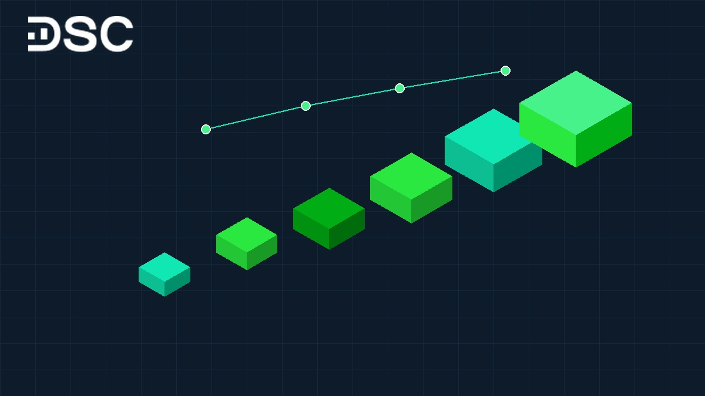
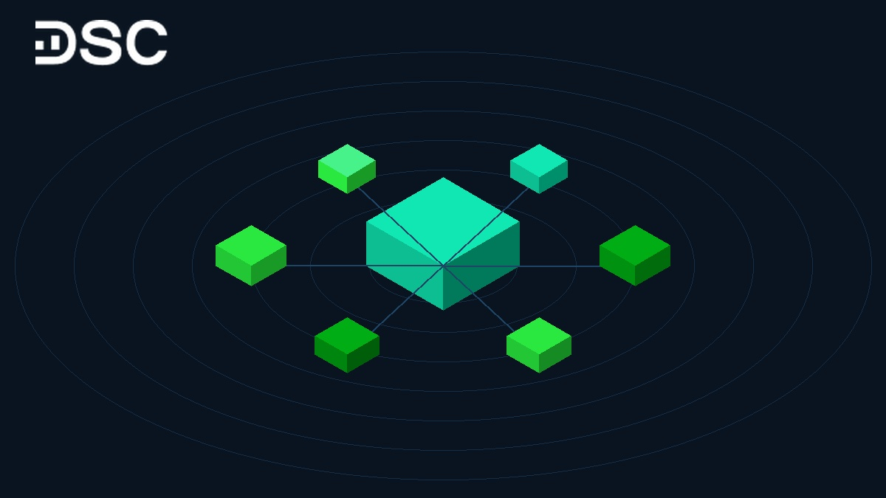

# Chỉ số DXY là gì? Tác động đến tỷ giá USD/VND và VN-Index

Chỉ số DXY (USD Index) là thước đo sức mạnh của đồng Đô la Mỹ so với rổ 6 ngoại tệ lớn. Biến động của chỉ số này tác động trực tiếp đến dòng vốn ngoại, tỷ giá USD/VND và thị trường chứng khoán Việt Nam. Bài viết này giúp nhà đầu tư nắm rõ bản chất chỉ số DXY và cập nhật diễn biến vĩ mô mới nhất.

## 1. Chỉ số DXY là gì?

Chỉ số DXY (viết tắt của US Dollar Index hay USD Index) đo lường giá trị của đồng Đô la Mỹ. Chỉ số này so sánh USD với một rổ gồm 6 loại tiền tệ lớn của các đối tác thương mại hàng đầu của Hoa Kỳ.

Chỉ số DXY được tính toán và giao dịch liên tục trên Sở Giao dịch Liên lục địa (ICE). DXY hoạt động như một nhiệt kế đo lường sức mạnh của đồng bạc xanh trên thị trường quốc tế. Đây là chỉ báo rất nhạy.

* **Khi DXY tăng**: Đồng USD đang mạnh lên so với các ngoại tệ khác trong rổ tham chiếu.
* **Khi DXY giảm**: Đồng USD đang suy yếu và giảm giá so với rổ tiền tệ.

Giá trị cơ sở của DXY được thiết lập ở mức 100 điểm vào thời điểm ra mắt năm 1973. Nếu DXY đạt 102 điểm, đồng USD đã tăng giá 2% so với mốc gốc ban đầu.

Ngược lại, khi DXY ở mức 98 điểm, đồng USD đã giảm giá 2%. Quy tắc này áp dụng nhất quán.

>> Xem thêm: [**Chỉ số DAX là gì?**](https://www.dsc.com.vn/kien-thuc/chi-so-dax-la-gi)

## 2. Lịch sử hình thành chỉ số DXY

Cục Dự trữ Liên bang Mỹ (Fed) giới thiệu chỉ số DXY lần đầu vào năm 1973. Sự ra đời của chỉ số này gắn liền với sự sụp đổ của hệ thống tiền tệ Bretton Woods.

### Bối cảnh ra đời sau hệ thống Bretton Woods

Trước năm 1971, hệ thống tài chính toàn cầu vận hành theo cơ chế Bretton Woods. Các đồng tiền trên thế giới được neo giá cố định vào USD. Đồng thời, đồng USD được neo vào vàng với mức giá 35 USD/ounce.

Vào tháng 8/1971, Tổng thống Mỹ Richard Nixon tuyên bố ngừng chuyển đổi USD ra vàng. Động thái này chấm dứt kỷ nguyên Bretton Woods. Kể từ thời điểm đó, các đồng tiền lớn bắt đầu cơ chế tỷ giá thả nổi theo cung cầu thị trường.

### Nhu cầu cấp thiết về thước đo giá trị USD

Sự tan rã của cơ chế neo giá tạo ra nhu cầu về một công cụ định lượng giá trị đồng bạc xanh. Fed xây dựng chỉ số DXY nhằm đáp ứng 3 mục tiêu:

* Theo dõi sức mua và biến động của USD trên thị trường quốc tế.
* Cung cấp cơ sở dữ liệu vĩ mô cho các cơ quan hoạch định chính sách kinh tế.
* Hỗ trợ nhà đầu tư toàn cầu nhận diện xu hướng luân chuyển của dòng vốn tài chính.

### Lần điều chỉnh duy nhất vào năm 1999

Từ khi ra đời đến nay, rổ cấu tạo của DXY chỉ trải qua đúng một lần điều chỉnh vào năm 1999. Khi đồng Euro chính thức xuất hiện, đồng tiền chung châu Âu đã thay thế các đồng tiền riêng lẻ trong rổ tính toán. Các đồng tiền bị thay thế bao gồm đồng Mark Đức, Franc Pháp và Lira Ý.

## 3. Các thành phần cấu tạo chỉ số DXY

Rổ tham chiếu của DXY gồm 6 đồng tiền của các nền kinh tế phát triển với tỷ trọng xác định:

* Euro (mã EUR): 57,6% rổ tiền tệ
* Yên Nhật (mã JPY): 13,6% rổ tiền tệ
* Bảng Anh (mã GBP): 11,9% rổ tiền tệ
* Đô la Canada (mã CAD): 9,1% rổ tiền tệ
* Krona Thụy Điển (mã SEK): 4,2% rổ tiền tệ
* Franc Thụy Sĩ (mã CHF): 3,6% rổ tiền tệ

| Đồng tiền tham chiếu | Ký hiệu ngoại tệ | Tỷ trọng trong rổ (%) | Nền kinh tế đại diện |
| :--- | :---: | :---: | :--- |
| Euro | EUR | 57,6% | Liên minh Châu Âu (EU) |
| Yên Nhật | JPY | 13,6% | Nhật Bản |
| Bảng Anh | GBP | 11,9% | Vương quốc Anh |
| Đô la Canada | CAD | 9,1% | Canada |
| Krona Thụy Điển | SEK | 4,2% | Thụy Điển |
| Franc Thụy Sĩ | CHF | 3,6% | Thụy Sĩ |

### Tỷ trọng áp đảo của đồng Euro

Đồng Euro chiếm tỷ trọng áp đảo lên tới 57,6% trong rổ tính toán DXY. Do đó, chính sách từ Ngân hàng Trung ương Châu Âu (viết tắt ECB) tác động đảo chiều rất mạnh đến DXY. Khi ECB thắt chặt tiền tệ và đồng Euro tăng giá, DXY thường giảm điểm ngay cả khi các ngoại tệ khác giữ nguyên giá trị.

### Hạn chế cấu trúc của chỉ số DXY hiện đại

Cấu trúc rổ tiền tệ của DXY vẫn giữ nguyên từ năm 1999 đến nay. Rổ tính toán này chưa phản ánh các đối tác thương mại lớn mới nổi như Trung Quốc hay Hàn Quốc. Vì vậy, DXY phản ánh chủ yếu tương quan giữa USD với nhóm các nền kinh tế phát triển.

## 4. Những yếu tố tác động đến chỉ số DXY

Biến động của chỉ số DXY được định hình bởi 4 nhóm động lực kinh tế và địa chính trị cốt lõi:

* **Chính sách tiền tệ của Fed**: Khi Fed thắt chặt tiền tệ, lợi suất trái phiếu Mỹ tăng cao. Dòng vốn toàn cầu tìm về nắm giữ USD để hưởng lợi tức hấp dẫn, kéo DXY tăng.
* **Dữ liệu kinh tế vĩ mô Hoa Kỳ**: Báo cáo GDP vượt dự báo hay chỉ số [**lạm phát CPI**](https://www.dsc.com.vn/kien-thuc/chi-so-gia-tieu-dung-cpi-la-gi-va-moi-quan-he-voi-thi-truong-chung-khoan) ở mức cao sẽ củng cố vị thế USD. Lúc này, chỉ số DXY thường được hỗ trợ đi lên.
* **Chênh lệch chính sách giữa các ngân hàng trung ương**: DXY mang tính so sánh tương đối. Nếu ECB thắt chặt mạnh hơn Fed, đồng EUR sẽ tăng giá so với USD, đẩy DXY giảm xuống.
* **Bất ổn địa chính trị toàn cầu**: Khi nảy sinh xung đột quân sự, đồng USD giữ vai trò tài sản an toàn. Nhu cầu tích trữ USD tăng vọt sẽ đẩy chỉ số DXY lên mức cao.

## 5. Diễn biến chỉ số DXY gần đây và bối cảnh vĩ mô 2025 – 2026

Giai đoạn 2025 – 2026 ghi nhận những nhịp biến động đáng chú ý của chỉ số DXY trước các bước ngoặt vĩ mô toàn cầu.

### Nhịp hạ nhiệt cuối năm 2025

Trong năm 2025, chỉ số DXY chịu áp lực điều chỉnh khi lạm phát Mỹ hạ nhiệt. Fed chính thức bước vào chu kỳ nới lỏng tiền tệ bằng các đợt cắt giảm chi phí vay vốn liên tiếp. Xu hướng này khiến chỉ số DXY khép lại năm 2025 lui về vùng đáy 97 – 98 điểm.

### Sự phục hồi vượt mốc 102 điểm trong năm 2026

Bước sang năm 2026, chỉ số DXY nhanh chóng đảo chiều đi lên. Thị trường lao động Mỹ duy trì ổn định cùng căng thẳng địa chính trị tại Trung Đông đã kích hoạt nhu cầu phòng thủ bằng USD. Đến tháng 10/2026, DXY đã phục hồi mạnh mẽ và vượt mốc 102 điểm.

### Tác động tới tỷ giá USD/VND trong nước

Mặc dù DXY thế giới tăng vượt 102 điểm trong năm 2026, tỷ giá USD/VND trong nước lại duy trì trạng thái ổn định:

* Giá bán USD tại các ngân hàng thương mại lớn như Vietcombank duy trì quanh mức 26.050 – 26.150 VND/USD trong tháng 10/2026.
* Thị trường tự do hạ nhiệt và thu hẹp khoảng cách chênh lệch so với giá ngân hàng.
* Nguồn cung ngoại tệ dồi dào từ dòng vốn đầu tư trực tiếp nước ngoài (FDI) giải ngân và thặng dư thương mại là điểm tựa lớn.
* Ngân hàng Nhà nước linh hoạt sử dụng công cụ thị trường mở (OMO) và tỷ giá trung tâm để ổn định thị trường ngoại tệ.

## 6. Chỉ số DXY ảnh hưởng đến thị trường chứng khoán Việt Nam như thế nào?

Chỉ số DXY biến động tác động đến chỉ số [**VN-Index**](https://www.dsc.com.vn/kien-thuc/chi-so-vn-index-va-y-nghia-quan-trong-trong-thi-truong-chung-khoan-viet-nam) thông qua 3 kênh truyền dẫn chính:

### Kênh dòng vốn ngoại gián tiếp (FII)

Khi DXY tăng mạnh, việc nắm giữ các tài sản bằng USD trở nên hấp dẫn hơn. Các quỹ ngoại thường có xu hướng bán ròng cổ phiếu trên các thị trường mới nổi để chuyển dịch dòng vốn về tài sản định danh bằng USD.

Áp lực bán ròng liên tục từ khối ngoại tạo tâm lý thận trọng cho thị trường cơ sở và làm chậm đà tăng điểm của VN-Index.

### Kênh tỷ giá và thanh khoản tiền tệ

Khi DXY tăng, tỷ giá USD/VND chịu áp lực tăng theo. Để duy trì ổn định tỷ giá và kiểm soát lạm phát, Ngân hàng Nhà nước có thể áp dụng các giải pháp:

* Phát hành tín phiếu để hút bớt lượng tiền đồng dư thừa trong hệ thống ngân hàng.
* Bán ngoại tệ can thiệp từ quỹ dự trữ ngoại hối quốc gia.
* Điều tiết thanh khoản liên ngân hàng hoặc điều chỉnh [**lãi suất điều hành**](https://www.dsc.com.vn/kien-thuc/lai-suat-dieu-hanh-la-gi).

Khi thanh khoản tiền đồng trong hệ thống ngân hàng bị thu hẹp, mặt bằng chi phí vốn nhích nhẹ. Dòng tiền nhàn rỗi chảy vào thị trường chứng khoán vì thế có xu hướng thận trọng hơn.

### Phân hóa tác động đến các nhóm ngành niêm yết

Biến động của USD không tác động tiêu cực đồng đều lên toàn bộ thị trường mà tạo ra sự phân hóa ngành rõ nét:

| Nhóm ngành hưởng lợi khi USD tăng | Cơ chế hưởng lợi cụ thể | Doanh nghiệp tiêu biểu |
| :--- | :--- | :--- |
| Xuất khẩu thủy sản | Doanh thu thu bằng USD, chi phí sản xuất phần lớn bằng VND | VHC, ANV, FMC |
| Dệt may và da giày | Hưởng lợi từ chênh lệch tỷ giá khi xuất khẩu sang Mỹ và EU | TNG, MSH, STK |
| Cao su và hóa chất | Giá bán xuất khẩu niêm yết theo USD trên thị trường thế giới | DPR, PHR, GVR |
| Cảng biển và logistics | Giá cước xếp dỡ và dịch vụ quốc tế neo theo đồng USD | GMD, HAH |

Trái lại, một số nhóm ngành sẽ đối mặt với chi phí gia tăng khi DXY và tỷ giá USD neo ở mức cao:

| Nhóm ngành chịu áp lực khi USD tăng | Nguyên nhân chịu tác động bất lợi | Doanh nghiệp tiêu biểu |
| :--- | :--- | :--- |
| Vận tải hàng không | Chi phí thuê mua máy bay và nhiên liệu thanh toán bằng USD | VJC, HVN |
| Doanh nghiệp có nợ vay ngoại tệ | Gánh nặng chi phí tài chính và lỗ chênh lệch tỷ giá | POW, PC1, VIC |
| Nhập khẩu nguyên vật liệu | Giá vốn nhập khẩu hạt nhựa và sắt thép đội lên | HPG, NTP, BAF |

## 7. Chiến lược đầu tư chứng khoán khi chỉ số DXY biến động mạnh

Để bảo vệ vốn trước biến động quốc tế, nhà đầu tư nên áp dụng 3 nguyên tắc thực chiến sau:

1. **Quan sát sớm tín hiệu tỷ giá**: Nhà đầu tư nên theo dõi diễn biến DXY cùng tỷ giá USD/VND tại các ngân hàng. Khi DXY tăng mạnh, việc hạ tỷ trọng margin là bước đi thận trọng.
2. **Cơ cấu danh mục sang nhóm phòng thủ**: Chủ động ưu tiên các doanh nghiệp xuất khẩu có nguồn thu ngoại tệ lớn. Đồng thời, hạn chế nhóm cổ phiếu có dư nợ vay USD cao.
3. **Đồng hành cùng đơn vị tư vấn chuyên nghiệp**: Diễn biến vĩ mô quốc tế luôn thay đổi nhanh. Việc tiếp cận báo cáo chiến lược định kỳ giúp nhà đầu tư nhìn nhận đúng bản chất từng nhịp sóng.

## 8. Các câu hỏi thường gặp về chỉ số DXY (FAQ)

### Tại sao USD được coi là đồng tiền mạnh trên thế giới?

Đồng USD giữ vai trò ngoại tệ dự trữ toàn cầu nhờ quy mô kinh tế Mỹ. Phần lớn giao dịch thương mại và dầu mỏ đều thanh toán bằng USD.

### USD có nghĩa là gì?

USD là ký hiệu viết tắt của United States Dollar, đơn vị tiền tệ chính thức của Hợp chúng quốc Hoa Kỳ. Ký hiệu phổ biến của đồng tiền này là ký tự $.

### Chỉ số DXY cao nhất và thấp nhất trong lịch sử là bao nhiêu?

Chỉ số DXY từng chạm mức kỷ lục 164,72 điểm vào tháng 2/1985 khi kinh tế Mỹ thắt chặt tiền tệ. Mức thấp nhất lịch sử của DXY ghi nhận quanh 70,69 điểm vào tháng 3/2008.

### Chỉ số DXY tăng có đồng nghĩa với việc VN-Index luôn giảm không?

DXY tăng thường tạo áp lực rút vốn ngoại trong ngắn hạn. Tuy nhiên, xu hướng dài hạn của VN-Index vẫn phụ thuộc vào tăng trưởng lợi nhuận doanh nghiệp và dòng tiền nội địa.

## 9. Theo dõi biến động vĩ mô và đầu tư cùng Chứng khoán DSC

Theo dõi DXY giúp nhà đầu tư chủ động quản trị rủi ro danh mục cổ phiếu. Việc nắm vững vĩ mô giúp bạn tự tin ra quyết định đầu tư an toàn.

Tại Chứng khoán DSC, khách hàng luôn nhận được sự đồng hành sát sao từ đội ngũ chuyên gia tư vấn:

* **Tư vấn Môi giới 1:1**: Chuyên gia riêng đồng hành cùng bạn. Chuyên gia cập nhật vĩ mô và hỗ trợ chọn nhóm cổ phiếu phù hợp khẩu vị rủi ro.
* **Hệ thống báo cáo chuyên sâu**: Cung cấp liên tục các báo cáo phân tích chiến lược thị trường và khuyến nghị định giá cổ phiếu độc quyền.
* **Phí giao dịch ưu đãi**: Biểu phí cạnh tranh chỉ từ 0,1% giúp tối ưu hóa chi phí vốn cho nhà đầu tư.

Đội ngũ chuyên gia tại Chứng khoán DSC sẵn sàng hỗ trợ 1:1. Chúng tôi giúp bạn xây dựng danh mục cổ phiếu vững vàng trước mọi biến động tỷ giá.

  

  

    
Mở tài khoản DSC trong 3 phút, chủ động đón đầu sóng vĩ mô

    
Phí chỉ từ 0,1% • eKYC 100% online • Tư vấn danh mục 1:1 từ chuyên gia

  

  <a href="https://www.dsc.com.vn/mo-tai-khoan" style="background: #2BE841; color: #0D1B2A; padding: 14px 32px; border-radius: 30px; text-decoration: none; font-weight: 700; font-size: 16px; display: inline-block; position: relative; z-index: 1;">Mở tài khoản ngay</a>

Hãy đăng ký [mở tài khoản chứng khoán online](https://www.dsc.com.vn/mo-tai-khoan) ngay hôm nay để nhận báo cáo phân tích chiến lược vĩ mô mới nhất từ Chứng khoán DSC.

