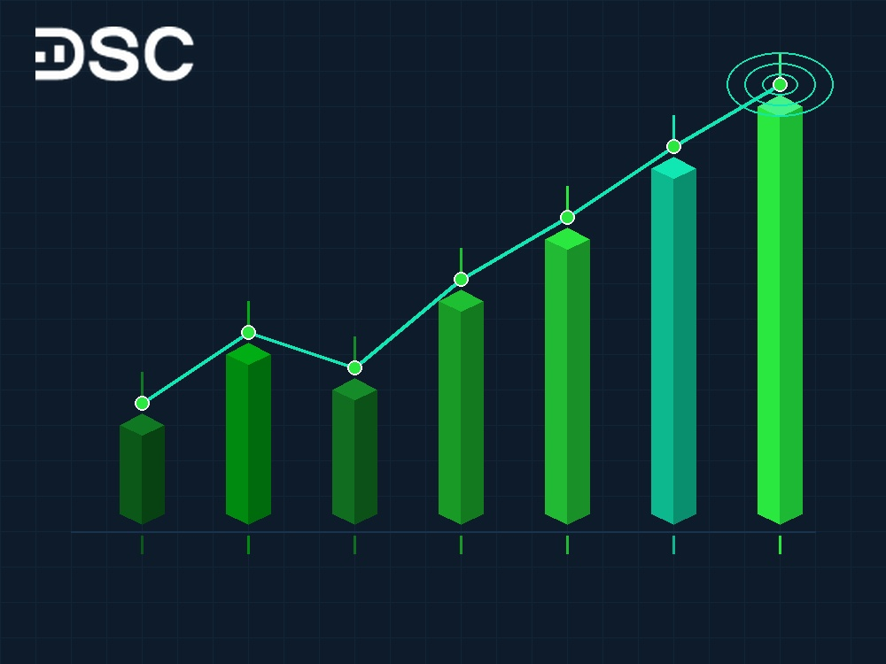

# Chỉ số VN-Index là gì? Ý nghĩa, cách tính và biểu đồ

VN-Index là thước đo sức khỏe quan trọng của thị trường chứng khoán Việt Nam. Chỉ số này đại diện cho toàn bộ các mã cổ phiếu niêm yết tại sàn HOSE.

Hiểu rõ biến động của chỉ số giúp nhà đầu tư mới định vị xu hướng chung. Từ đó, bạn có thể đưa ra quyết định giao dịch an toàn và hiệu quả hơn.

Tháng 10/2026, thị trường ghi nhận nhịp bứt phá ấn tượng. VN-Index vượt qua mốc kháng cự 1.700 điểm để tiến lên vùng 1.738,67 điểm. Thanh khoản sàn HOSE duy trì mức cao, vượt 20.000 tỷ đồng mỗi phiên.

## Chỉ số VN-Index là gì?

Chỉ số VN-Index là thước đo mức độ biến động giá của toàn bộ cổ phiếu trên sàn HOSE. Chỉ số so sánh tổng giá trị vốn hóa hiện tại với vốn hóa tại ngày cơ sở ban đầu.

Thị trường chứng khoán Việt Nam khai trương phiên đầu tiên vào ngày 28/07/2000. Ngày này được chọn làm mốc thời gian cơ sở với giá trị quy ước là 100 điểm. Tại phiên giao dịch lịch sử đó, sàn HOSE chỉ có 2 mã cổ phiếu là REE và SAM.

Khi VN-Index tăng điểm, giá trị vốn hóa của các doanh nghiệp đang mở rộng. Ngược lại, điểm số giảm cho thấy giá trị thị trường của đa số cổ phiếu đang sụt giảm. Đây là dữ liệu nền tảng khi tìm hiểu về [chỉ số chứng khoán](https://www.dsc.com.vn/kien-thuc/chi-so-chung-khoan-la-gi).

## Diễn biến điểm số VN-Index gần đây và các mốc lịch sử quan trọng

Tháng 10/2026 ghi nhận diễn biến thị trường rất sôi động. Sau nhịp điều chỉnh về vùng 1.680 điểm, VN-Index đã bật tăng gần 47 điểm trong một phiên. Lực cầu lan tỏa giúp chỉ số xác lập mặt bằng giá mới trên 1.738 điểm.

Sự bứt phá này gắn liền với kỳ vọng nâng hạng thị trường từ FTSE Russell. Thanh khoản toàn thị trường duy trì ổn định quanh mức 18.000 đến 22.000 tỷ đồng mỗi phiên.

Trong hơn hai thập kỷ qua, chỉ số đã trải qua nhiều chu kỳ kinh tế lớn. Bảng dưới đây tổng hợp các cột mốc phát triển tiêu biểu nhất của VN-Index:

| Thời điểm | Mức điểm VN-Index | Bối cảnh kinh tế và thị trường tiêu biểu |
| :--- | :--- | :--- |
| **28/07/2000** | **100,00 điểm** | Ngày mở cửa sàn HOSE với 2 cổ phiếu đầu tiên là REE và SAM. |
| **12/03/2007** | **1.170,67 điểm** | Cơn sốt bùng nổ của thị trường sau khi Việt Nam gia nhập WTO. |
| **24/02/2009** | **235,48 điểm** | Đáy suy thoái sâu do ảnh hưởng từ khủng hoảng tài chính toàn cầu. |
| **09/04/2018** | **1.204,33 điểm** | Đỉnh chu kỳ kinh tế mới sau 10 năm tái cơ cấu tài chính. |
| **06/01/2022** | **1.528,57 điểm** | Đỉnh lịch sử thời kỳ lãi suất thấp và làn sóng nhà đầu tư mới. |
| **Tháng 10/2026** | **1.738,67 điểm** | Chu kỳ tăng trưởng mới hướng tới mục tiêu nâng hạng thị trường. |

So với mốc 100 điểm ban đầu, điểm số hiện nay đã tăng gấp hơn 17 lần. Sự mở rộng này đi cùng quy mô vốn hóa hàng trăm tỷ USD của thị trường.

## 4 ý nghĩa quan trọng của chỉ số VN-Index đối với nhà đầu tư

Theo dõi chỉ số VN-Index giúp nhà đầu tư nắm bắt bức tranh toàn cảnh của thị trường. Chỉ số này mang lại 4 giá trị quan trọng:

- **Thước đo sức khỏe sàn HOSE**: VN-Index đại diện cho các doanh nghiệp có quy mô vốn hóa lớn nhất cả nước. Khi chỉ số tăng, phần lớn nhóm ngành trên thị trường đều có diễn biến thuận lợi.
- **Phản chiếu chu kỳ kinh tế**: Doanh nghiệp niêm yết phản ánh sức khỏe của nền kinh tế thực. Khi kinh tế vĩ mô ổn định và lợi nhuận doanh nghiệp tăng, chỉ số sẽ đi lên bền vững.
- **Đo lường tâm lý đám đông**: Điểm số thể hiện sự lạc quan hay lo âu của cộng đồng nhà đầu tư. Các phiên tăng mạnh liên tiếp tạo tâm lý hưng phấn, trong khi nhịp giảm sâu gây áp lực thận trọng.
- **Thước đo hiệu suất danh mục**: Các quỹ và nhà đầu tư cá nhân dùng VN-Index làm mức chuẩn so sánh. Danh mục của bạn có mức sinh lời cao hơn chỉ số chứng tỏ phương pháp đầu tư đang phát huy hiệu quả.

## Cách tính chỉ số VN-Index

Chỉ số VN-Index được tính theo phương pháp bình quân gia quyền giá trị vốn hóa. Công thức so sánh giá trị thị trường hiện tại (CMV) với giá trị cơ sở ban đầu:

> **VN-Index = (Giá trị vốn hóa thị trường hiện tại / Giá trị vốn hóa thị trường cơ sở) x 100**

Trong đó, tổng giá trị vốn hóa thị trường hiện tại (CMV) được tính như sau:

> **CMV = Tổng (P x S x F x C)**

Ý nghĩa cụ thể của các biến số cấu thành:

- **Biến số P**: Mức thị giá của từng mã cổ phiếu tại thời điểm tính toán.
- **Biến số S**: Tổng khối lượng cổ phiếu đang lưu hành của từng mã doanh nghiệp.
- **Hệ số F**: Tỷ lệ cổ phiếu tự do chuyển nhượng trên thị trường (tỷ lệ free-float).
- **Hệ số C**: Tỷ lệ giới hạn tỷ trọng vốn hóa để ngăn một mã chi phối điểm số quá mức.
- **Vốn hóa cơ sở**: Tổng giá trị thị trường của các cổ phiếu tại ngày cơ sở 28/07/2000.

Để loại bỏ sai lệch khi doanh nghiệp chia tách cổ phiếu hoặc chia cổ tức, sàn HOSE áp dụng hệ số chia Divisor. Hệ số này giúp điểm số duy trì tính liên tục và phản ánh đúng biến động giá thực.

## Tác động của nhóm cổ phiếu vốn hóa lớn đến chỉ số VN-Index

Do tính theo giá trị vốn hóa, các doanh nghiệp đầu ngành sẽ chiếm tỷ trọng điểm số rất lớn. Nhóm cổ phiếu ngân hàng và bất động sản lớn thường chi phối phần lớn mức tăng giảm của chỉ số.

Thực tế này tạo ra hiện tượng lệch pha giữa chỉ số chung và danh mục cá nhân. Có những phiên VN-Index tăng hơn 20 điểm nhưng nhiều cổ phiếu vừa và nhỏ vẫn giảm giá. Nguyên nhân do dòng tiền chỉ tập trung kéo mạnh một số ít mã vốn hóa khổng lồ.

Ngược lại, khi nhóm cổ phiếu lớn bị khối ngoại bán ròng, chỉ số có thể giảm sâu dù nhiều nhóm ngành khác vẫn giữ sắc xanh. Dưới đây là 2 nguyên tắc nhà đầu tư mới cần ghi nhớ:

- **Quan sát dòng tiền từng nhóm ngành**: Đánh giá sức mạnh của từng phân lớp cổ phiếu thay vì chỉ nhìn điểm số danh nghĩa của VN-Index.
- **Tránh mua đuổi theo điểm số chung**: Hạn chế giải ngân hưng phấn khi điểm số tăng vọt chỉ nhờ lực kéo từ một vài mã cổ phiếu lớn.

Nắm bắt quy luật của VN-Index giúp bạn nhận diện nhịp sóng thị trường chuẩn xác. Để chuyển hóa kiến thức thành lợi nhuận, bạn cần công cụ theo dõi nhạy bén và kỷ luật quản trị vốn.

Công ty Cổ phần Chứng khoán DSC mang đến nền tảng App DSC Trading với bảng giá cập nhật tức thì. Đội ngũ Môi giới 1:1 sẵn sàng đồng hành tư vấn danh mục và quản trị rủi ro cho bạn.

  

  

    
Đồng Hành Cùng Chuyên Gia Môi Giới 1:1 DSC

    
Mở tài khoản eKYC trong 3 phút • Nhận báo cáo phân tích thị trường độc quyền • Tư vấn danh mục chuẩn xác.

  

  <a href="https://www.dsc.com.vn/mo-tai-khoan" style="background: #2BE841; color: #0D1B2A; padding: 14px 32px; border-radius: 30px; text-decoration: none; font-weight: 700; font-size: 16px; display: inline-block; position: relative; z-index: 1;">Mở tài khoản — 3 phút</a>

## Hướng dẫn chi tiết cách đọc biểu đồ VN-Index

Biểu đồ VN-Index phản ánh trực quan cung cầu trên thị trường chứng khoán. Khi theo dõi biểu đồ kỹ thuật trên bảng giá, nhà đầu tư nên quan sát 3 thông số chính:

- **Thân nến và màu sắc nến**: Nến xanh thể hiện bên mua chiếm ưu thế, trong khi nến đỏ phản ánh áp lực bán chủ đạo. Bạn có thể kết hợp [các mô hình giá](https://www.dsc.com.vn/kien-thuc/cac-mo-hinh-gia-trong-chung-khoan) để nhận diện xu hướng sớm.
- **Khối lượng giao dịch (Volume)**: Cột khối lượng bên dưới biểu đồ thể hiện thanh khoản của phiên giao dịch. Phiên tăng điểm kèm thanh khoản bùng nổ xác nhận dòng tiền lớn, trong khi thanh khoản cạn kiệt cảnh báo đà tăng yếu ớt.
- **Độ rộng thị trường**: Hãy theo dõi tỷ lệ số mã tăng và số mã giảm. Nếu chỉ số tăng mạnh nhưng mã giảm áp đảo, đà tăng đang thiếu sự đồng thuận và dễ xảy ra rung lắc.

## Các yếu tố chính ảnh hưởng đến chỉ số VN-Index

Chỉ số VN-Index chịu tác động tổng hòa từ nhiều yếu tố kinh tế và tài chính:

- **Kết quả kinh doanh của doanh nghiệp**: Lợi nhuận của các công ty niêm yết là gốc rễ của giá cổ phiếu. Khi doanh nghiệp tăng trưởng tốt, định giá thị trường sẽ trở nên hấp dẫn hơn.
- **Mặt bằng lãi suất và chính sách tiền tệ**: Lãi suất ngân hàng duy trì ở mức thấp sẽ thúc đẩy dòng tiền chảy vào kênh cổ phiếu. Ngược lại, lãi suất tăng cao thường khiến định giá thị trường chịu áp lực điều chỉnh.
- **Dòng tiền của các khối nhà đầu tư**: Giao dịch của khối ngoại, tự doanh và cá nhân chi phối cung cầu trực tiếp. Khi khối ngoại quay lại mua ròng, thị trường thường có thêm lực đỡ vững chắc.

## Câu hỏi thường gặp về chỉ số VN-Index

### Điểm số ban đầu của VN-Index là bao nhiêu?
Ngày 28/07/2000, sàn HOSE chính thức hoạt động với mức điểm quy ước ban đầu là 100 điểm. Phiên giao dịch đầu tiên có hai cổ phiếu niêm yết là REE và SAM.

### VN-Index khác gì so với chỉ số VN30?
VN-Index đại diện cho toàn bộ cổ phiếu trên sàn HOSE. Trong khi đó, [chỉ số VN30](https://www.dsc.com.vn/kien-thuc/vn-30-la-gi-cach-tinh-y-nghia-va-luu-y-khi-su-dung) chỉ đại diện cho 30 cổ phiếu dẫn đầu về vốn hóa và thanh khoản lớn nhất.

### Xem biểu đồ và diễn biến VN-Index theo thời gian thực ở đâu chính xác nhất?
Bạn có thể theo dõi biểu đồ và điểm số thời gian thực trên App DSC Trading hoặc cổng thông tin của sàn HOSE.

Chỉ số VN-Index là tấm gương phản chiếu bức tranh kinh tế và dòng tiền tại Việt Nam. Nắm vững bản chất cách tính và cách đọc biểu đồ giúp bạn làm chủ kế hoạch đầu tư.

Hãy chủ động [mở tài khoản chứng khoán](https://www.dsc.com.vn/mo-tai-khoan) tại Chứng khoán DSC để theo dõi bảng giá hiện đại cùng chuyên gia tư vấn.

> **Tuyên bố miễn trừ trách nhiệm**: Các thông tin phân tích và số liệu điểm số trong bài viết chỉ mang tính chất tham khảo kiến thức tài chính. Nội dung không cấu thành lời khuyên đầu tư trực tiếp hay cam kết mức sinh lời cho người đọc.
