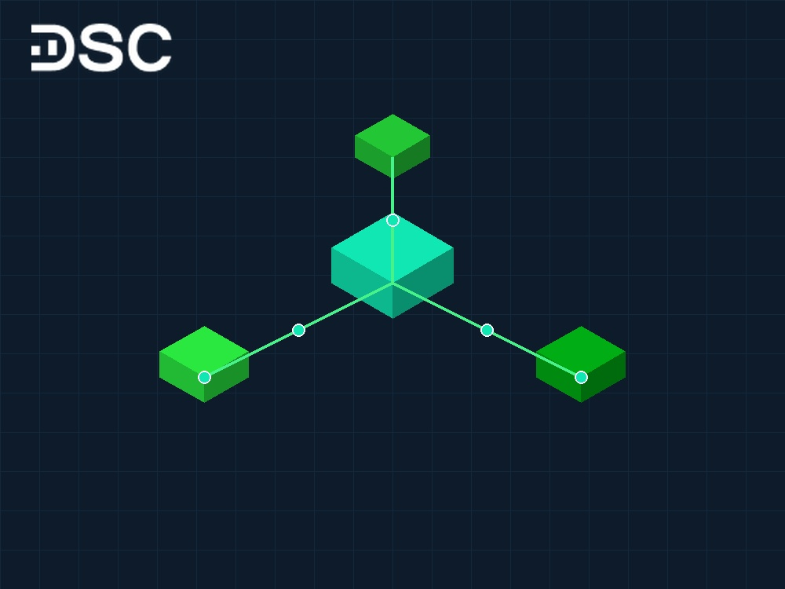
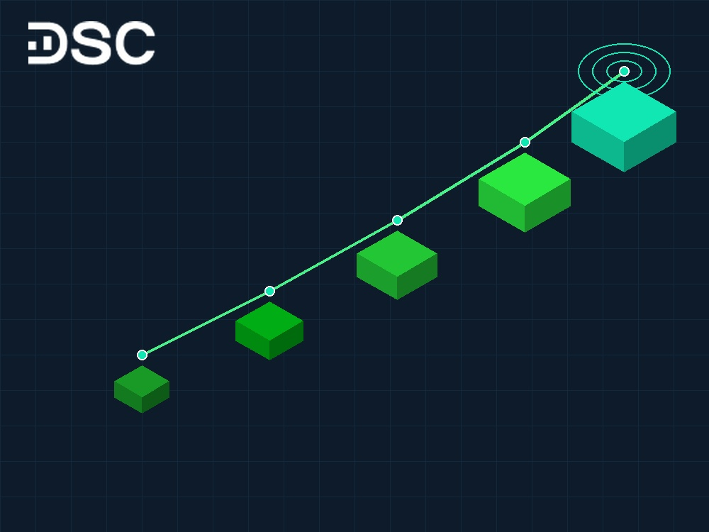

# Cổ phiếu DXG: Triển vọng và kết quả kinh doanh quý 3/2026

Cổ phiếu DXG là mã chứng khoán bất động sản thu hút dòng tiền mạnh trên sàn HOSE. Tập đoàn Đất Xanh sở hữu hệ sinh thái khép kín từ phát triển quỹ đất đến dịch vụ môi giới.

Bước sang năm 2026, thị trường bất động sản phía Nam dần hồi phục. Việc theo sát kết quả kinh doanh quý 3/2026 và tiến độ pháp lý dự án sẽ giúp nhà đầu tư giao dịch hiệu quả.

## 1. Tổng quan về mã cổ phiếu DXG và vị thế tập đoàn Đất Xanh

Tập đoàn Đất Xanh thành lập năm 2003, tiền thân là Công ty TNHH Địa ốc Đất Xanh. Sau hơn hai thập kỷ, doanh nghiệp đã khẳng định vị thế chủ đầu tư và nhà phân phối bất động sản hàng đầu miền Nam.

Mã cổ phiếu DXG chính thức niêm yết trên Sở Giao dịch Chứng khoán TP.HCM (HOSE) từ năm 2009. Thanh khoản luôn dồi dào. Cổ phiếu thường nằm trong nhóm sôi động bậc nhất phân khúc bất động sản mid-cap.

>> Xem thêm: **Top 5** [**cổ phiếu bất động sản đáng đầu tư**](https://www.dsc.com.vn/kien-thuc/top-5-co-phieu-bat-dong-san-co-the-buoc-vao-song-tang-giai-doan-cuoi-nam) **nhất**

| Chỉ tiêu | Thông số kỹ thuật |
| :--- | :--- |
| **Mã chứng khoán** | DXG |
| **Sàn niêm yết** | HOSE |
| **Ngành** | Bất động sản dân cư |
| **Vốn hóa thị trường** | 10.767 tỷ đồng |
| **Số lượng cổ phiếu lưu hành** | 1.020.631.675 cổ phiếu |
| **Khối lượng giao dịch bình quân 20 phiên** | 9.855.806 cổ phiếu/phiên |
| **Tỷ lệ sở hữu nước ngoài** | 26,63% |
| **Giá trị sổ sách (BVPS)** | 12.255 VNĐ/cổ phiếu |

*\*Số liệu cập nhật thị trường tháng 10/2026.*

### Cơ cấu cổ đông DXG

Cơ cấu cổ đông của Đất Xanh có sự kết hợp giữa ban lãnh đạo sáng lập và các định chế tài chính quốc tế:

- Lương Trí Thìn (Chủ tịch Hội đồng Chiến lược): 16,95%
- Vietnam Enterprise Investments Ltd (VEIL - Dragon Capital): 4,65%
- CTCP Đầu tư NAV: 4,49%
- Norges Bank: 3,17%
- Cổ đông khác: 70,74%

Tỷ lệ cổ phiếu trôi nổi tự do (free-float) của DXG ở mức hơn 70%. Tỷ lệ này tạo điều kiện cho dòng tiền thị trường luân chuyển nhanh và mang lại thanh khoản dồi dào cho các nhà đầu tư chủ động.

## 2. Hệ sinh thái kinh doanh: Mũi nhọn phát triển dự án và dịch vụ môi giới DXS

Mô hình hoạt động của Đất Xanh tạo nên sự khác biệt nhờ chuỗi giá trị hoàn chỉnh. Đây là lợi thế lớn. Doanh nghiệp tự chủ từ khâu tìm kiếm quỹ đất, xây dựng đến mạng lưới bán hàng trực tiếp.

### Phát triển dự án bất động sản nhà ở

Tập đoàn tập trung phát triển các dự án căn hộ và khu đô thị vừa túi tiền phục vụ nhu cầu ở thực. Các địa bàn trọng điểm bao gồm TP.HCM, Bình Dương và Đồng Nai:

* **Gem Sky World (Đồng Nai)**: Khu đô thị quy mô 92,2 ha tại Long Thành với tổng số hơn 4.000 sản phẩm đất nền và nhà phố. Đây là dự án đóng vai trò hạt nhân mang lại dòng tiền lớn cho tập đoàn khi hoàn thiện các thủ tục pháp lý nghiệm thu hạ tầng.
* **Opal Luxury (Bình Dương)**: Dự án tổ hợp căn hộ cao cấp nhắm vào làn sóng giãn dân từ TP.HCM sang các đô thị vệ tinh công nghiệp.
* **Quỹ đất dự trữ**: Doanh nghiệp nắm giữ quỹ đất sạch hàng trăm hecta. Các vị trí này đón đầu dự án Vành đai 3 và Sân bay Long Thành.

### Dịch vụ bất động sản toàn diện (Dat Xanh Services - DXS)

Công ty Cổ phần Dịch vụ Bất động sản Đất Xanh (mã CK: DXS) là đơn vị thành viên then chốt của tập đoàn. DXS hiện nắm giữ hơn 30% thị phần môi giới sơ cấp tại Việt Nam.

Hệ thống phân phối của DXS giúp Đất Xanh chủ động đầu ra cho chính các dự án do tập đoàn phát triển. Đồng thời, nguồn thu từ phí môi giới bán hàng cho các chủ đầu tư đối tác mang lại dòng tiền kinh doanh đều đặn qua các quý.

## 3. Cập nhật kết quả kinh doanh cổ phiếu DXG quý 3/2026

Báo cáo tài chính quý 3/2026 ghi nhận mảng môi giới hồi phục rõ nét. Dòng tiền từ dịch vụ phân phối giúp cải thiện thanh khoản của Đất Xanh.

Dưới đây là các chỉ tiêu tài chính hợp nhất trọng yếu quý 3/2026 của DXG:

- **Doanh thu thuần**: 1.088 tỷ đồng
- **Giá vốn hàng bán**: 470 tỷ đồng
- **Lợi nhuận gộp**: 599 tỷ đồng
- **Chi phí bán hàng**: 244 tỷ đồng
- **Chi phí quản lý doanh nghiệp**: 122 tỷ đồng
- **Lợi nhuận từ hoạt động kinh doanh**: 232 tỷ đồng
- **Doanh thu tài chính thuần**: 21 tỷ đồng
- **Lợi nhuận khác**: 15 tỷ đồng
- **Lợi nhuận trước thuế**: 196 tỷ đồng

>> Xem thêm: Hướng dẫn đọc hiểu [**các chỉ số phân tích báo cáo tài chính**](https://www.dsc.com.vn/kien-thuc/cac-chi-so-phan-tich-bao-cao-tai-chinh) chi tiết nhất

Doanh thu thuần quý 3 duy trì ở mức trên 1.000 tỷ đồng, nâng tổng doanh thu 9 tháng đầu năm 2026 lên mức gần 3.800 tỷ đồng. Mảng môi giới bất động sản từ công ty con DXS tiếp tục là điểm sáng lớn với mức tăng trưởng tích cực về số lượng giao dịch thành công.

### Cơ cấu lợi nhuận cốt lõi

Cơ cấu lợi nhuận quý 3/2026 cho thấy 100% lợi nhuận của tập đoàn đến từ hoạt động kinh doanh cốt lõi. Doanh nghiệp không phải phụ thuộc vào các khoản thu nhập tài chính bất thường hay thoái vốn đột ngột.

Khoản mục người mua trả tiền trước ngắn hạn đạt trên 2.900 tỷ đồng. Đây là chỉ báo quan trọng bảo chứng cho doanh thu bàn giao nhà sẽ được ghi nhận dần trong giai đoạn cuối năm 2026 và đầu năm 2027.

## 4. Hiệu quả sinh lời và sức khỏe tài chính

Hiệu quả sinh lời của DXG duy trì xu hướng cải thiện sau giai đoạn tái cơ cấu quyết liệt cơ cấu nợ và tinh gọn bộ máy:

- **Lợi nhuận trên mỗi cổ phiếu (EPS)**: 401 VNĐ/cổ phiếu
- **Tỷ suất sinh lời trên vốn chủ sở hữu (ROE)**: 4,11%
- **Tỷ suất sinh lời trên tổng tài sản (ROA)**: 2,21%

Biên [lợi nhuận gộp](https://www.dsc.com.vn/kien-thuc/bien-loi-nhuan-gop-la-gi-y-nghia-cua-bien-loi-nhuan-gop-khi-lua-chon-co-phieu) đạt 55,05% và biên lợi nhuận trước thuế đạt 18,33%. Sự gia tăng của biên lợi nhuận gộp bắt nguồn từ sự đóng góp vượt trội của mảng dịch vụ tư vấn môi giới có biên lãi cao.

Về đòn bẩy tài chính, tập đoàn đã tất toán các lô trái phiếu lớn. Dư nợ vay trên vốn chủ sở hữu hạ về mức an toàn dưới 0,5 lần. Cơ cấu này giúp giảm áp lực chi phí lãi vay.

## 5. Định giá cổ phiếu DXG: Vùng giá nào phản ánh đúng giá trị chu kỳ?

Định giá cổ phiếu bất động sản dân cư thường biến động theo chu kỳ dự án và mặt bằng lãi suất tín dụng:

- **Chỉ số P/B hiện tại**: Đạt 1,1 - 1,2 lần. Mức này thấp hơn trung bình ngành (2,45 lần) và nằm sát vùng đáy 5 năm (1,27 lần).
- **Chỉ số P/E dự phóng**: Nằm quanh vùng 14 - 16 lần khi các khoản lợi nhuận bàn giao dự án lớn chưa bước vào điểm rơi cao điểm.

Định giá theo giá trị tài sản ròng (RNAV) cho thấy quỹ đất sạch của DXG có giá trị cao. Thị giá hiện tại chiết khấu sâu. Cơ hội lớn đang mở ra.

## 6. Phân tích kỹ thuật cổ phiếu DXG và xu hướng dòng tiền

Trên khung đồ thị kỹ thuật sàn HOSE, cổ phiếu DXG đang trong quá trình tích lũy tạo nền giá sau nhịp điều chỉnh:

| Tiêu chí | Chỉ báo kỹ thuật | Trạng thái đánh giá |
| :--- | :--- | :--- |
| **Xu hướng trung hạn** | MACD | Đang thu hẹp phân kỳ âm, chuẩn bị phát tín hiệu giao cắt tăng |
| **Sức mạnh dòng tiền** | RSI | Vận động ở vùng trung tính 48 - 52, sẵn sàng bứt phá |
| **Biên độ dao động** | Bollinger Bands | Dải băng thắt hẹp, báo hiệu sắp có biến động giá lớn |
| **Động lượng ngắn hạn** | Stochastic | Bắt đầu rời khỏi vùng quá bán đi lên |

Thị giá DXG đang dao động quanh vùng 10.550 đồng/cổ phiếu. Ngưỡng hỗ trợ mạnh của cổ phiếu nằm tại vùng 9.300 - 10.000 đồng/cổ phiếu, trong khi ngưỡng kháng cự ngắn hạn nằm tại vùng 12.150 - 13.000 đồng/cổ phiếu.

## 7. Cơ hội và rủi ro khi đầu tư cổ phiếu DXG năm 2026

Nhà đầu tư chủ động cần nhìn nhận đa chiều về tiềm năng sinh lời và rủi ro. Thận trọng là cần thiết.

### Cơ hội tăng trưởng

* **Hồi phục thị trường bất động sản phía Nam**: Nhu cầu căn hộ thực tế tại TP.HCM và Bình Dương rất cao. Nguồn cung dự án mới vẫn trong tình trạng khan hiếm.
* **Gỡ vướng pháp lý Gem Sky World**: Việc nghiệm thu hạ tầng xã hội và cấp sổ hồng từng phần sẽ khai thông dòng tiền thanh toán từ khách hàng.
* **Sự bứt phá của DXS**: Thị trường phân phối khởi sắc giúp doanh thu môi giới tăng tốc nhanh hơn mảng tự phát triển dự án.

### Rủi ro cần theo dõi

* **Tiến độ cấp phép dự án mới**: Thủ tục đất đai kéo dài có thể làm chậm kế hoạch mở bán các phân khu mới.
* **Áp lực dòng tiền ngắn hạn**: Doanh nghiệp vẫn cần đảm bảo vốn lưu động để vừa hoàn thiện công trình vừa tìm kiếm quỹ đất mới.

## 8. Các câu hỏi thường gặp về cổ phiếu DXG (FAQ)

Dưới đây là phần giải đáp ngắn gọn những thắc mắc phổ biến nhất từ cộng đồng nhà đầu tư:

### Cổ phiếu DXG có tiềm năng tăng trưởng trong năm 2026 không?

Cổ phiếu DXG có tiềm năng hồi phục lớn nhờ vị thế dẫn đầu mảng môi giới bất động sản và quỹ đất lớn tại Long Thành, Bình Dương. Điểm rơi lợi nhuận từ bàn giao dự án dự kiến sẽ bùng nổ mạnh mẽ trong giai đoạn 2026–2027.

### Định giá cổ phiếu DXG hiện nay đắt hay rẻ so với nhóm ngành?

Với P/B quanh 1,1 - 1,2 lần, DXG đang giao dịch dưới giá trị sổ sách 12.255 đồng/cổ phiếu và thấp hơn mức trung bình ngành 2,45 lần. Đây là vùng định giá chiết khấu sâu, mở ra cơ hội tích lũy hấp dẫn cho nhà đầu tư trung và dài hạn.

### Dự án Gem Sky World hiện đang ở tình trạng pháp lý nào?

Gem Sky World đã hoàn thành hạ tầng và công trình công cộng. Dự án được chính quyền địa phương chấp thuận cho phép chuyển nhượng trở lại. Việc bàn giao nhà phố tiếp theo sẽ mang lại nguồn tiền mặt lớn cho Đất Xanh.

### Nhà đầu tư mới nên giải ngân cổ phiếu DXG theo chiến lược nào?

Cổ phiếu bất động sản thường có biên độ dao động lớn. Nhà đầu tư nên chia nhỏ vốn mua từng phần ở vùng hỗ trợ. Trước khi giải ngân, bạn có thể xem hướng dẫn [cách mua cổ phiếu online](https://www.dsc.com.vn/kien-thuc/cach-mua-co-phieu-online-cho-nguoi-moi-bat-dau) chuẩn xác.

## 9. Đồng hành đầu tư cổ phiếu DXG cùng Chứng khoán DSC

Cổ phiếu bất động sản đòi hỏi nhà đầu tư nhạy bén với chu kỳ giao dịch T+2 trên sàn HOSE. Đồng hành cùng định chế tài chính uy tín giúp bạn quản trị rủi ro hiệu quả.

Công ty Cổ phần Chứng khoán DSC đồng hành cùng nhà đầu tư với các lợi thế vượt trội:

* **Tư vấn Môi giới 1:1**: Chuyên gia phân tích sâu chu kỳ dòng tiền bất động sản, hỗ trợ điểm mua bán chi tiết.
* **Báo cáo phân tích doanh nghiệp độc quyền**: Cung cấp bức tranh tài chính trung thực và đánh giá độc lập về các dự án của Đất Xanh.
* **Biểu phí giao dịch tối ưu**: Mức phí cạnh tranh chỉ từ **0,1%** trên nền tảng giao dịch trực tuyến App DSC Trading.
* **Gói vay ký quỹ Margin linh hoạt**: Lãi suất ưu đãi chỉ từ **10% - 13,5%/năm**, mang lại nguồn lực đòn bẩy kịp thời đón đầu các nhịp sóng ngành.

Nhà đầu tư có thể dễ dàng đăng ký [mở tài khoản chứng khoán DSC](https://www.dsc.com.vn/mo-tai-khoan) chỉ trong vài phút thông qua quy trình định danh điện tử eKYC.

  

  

    
Tối ưu chiến lược đầu tư cổ phiếu DXG cùng DSC

    
Mở tài khoản eKYC trong 3 phút • Phí giao dịch chỉ từ 0,1% • Gói Margin ưu đãi từ 10%/năm • Chuyên gia tư vấn 1:1.

  

  <a href="https://www.dsc.com.vn/mo-tai-khoan" style="background: #2BE841; color: #0D1B2A; padding: 14px 32px; border-radius: 30px; text-decoration: none; font-weight: 700; font-size: 16px; display: inline-block; position: relative; z-index: 1;">Mở tài khoản ngay</a>

