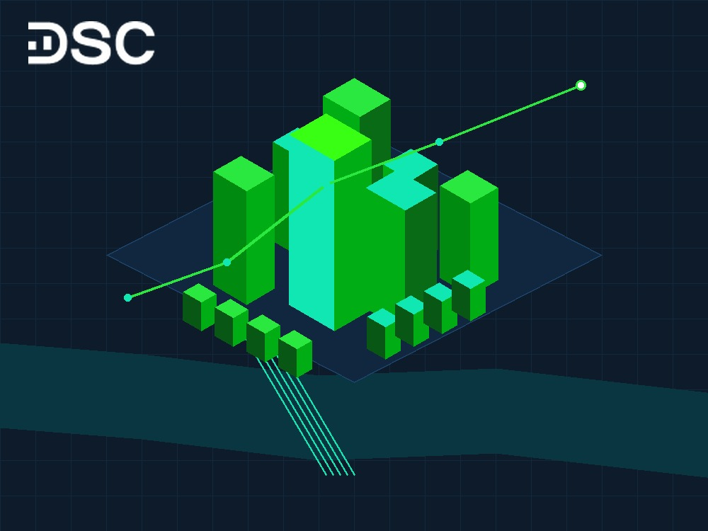

# Cổ phiếu TCH: Phân tích định giá và kết quả kinh doanh 2026

Cổ phiếu TCH là mã chứng khoán thu hút dòng tiền giao dịch tích cực của nhóm bất động sản. Doanh nghiệp nắm giữ quỹ đất sạch quy mô lớn tại Hải Phòng cùng nền tảng tài chính an toàn.

Năm tài chính 2026 mở ra chu kỳ bứt phá mới cho TCH. Động lực chính đến từ điểm rơi bàn giao các đại đô thị vệ tinh tại Thủy Nguyên. Cơ hội đang mở ra.

## Tổng quan doanh nghiệp và thông số cổ phiếu TCH

Công ty Cổ phần Đầu tư Dịch vụ Tài chính Hoàng Huy thành lập từ năm 1995. Khởi đầu từ lĩnh vực ô tô tải, công ty đã mở rộng thành công sang mảng bất động sản nhà ở.

Năm 2016, cổ phiếu TCH chính thức niêm yết trên sàn HOSE. Doanh nghiệp xây dựng vị thế vững chắc nhờ mạng lưới phân phối xe đầu kéo Navistar International độc quyền.

Nhà đầu tư có thể xem thêm [cách chọn cổ phiếu tốt](https://www.dsc.com.vn/kien-thuc/3-cach-chon-co-phieu-tot-va-co-tiem-nang-tang-gia-de-dau-tu) để hoàn thiện phương pháp sàng lọc doanh nghiệp.

| Chỉ số thị trường | Giá trị thực tế (Cập nhật năm 2026) |
| :--- | :--- |
| **Mã cổ phiếu** | TCH |
| **Sàn niêm yết** | HOSE |
| **Ngành** | Bất động sản |
| **Khối lượng giao dịch bình quân 20 phiên** | 6.250.000 cổ phiếu |
| **Vốn hóa thị trường** | Khoảng 10.350 tỷ đồng |
| **Số lượng cổ phiếu niêm yết** | 868.680.595 cổ phiếu |
| **Tỷ lệ sở hữu nước ngoài** | 10,99% |
| **Giá trị sổ sách (BVPS)** | 13.500 VNĐ/cổ phiếu |

### Cơ cấu cổ đông TCH

Chủ tịch Hội đồng Quản trị Đỗ Hữu Hạ cùng gia đình nắm giữ tỷ lệ chi phối lớn tại TCH. Đồng thời, các quỹ đầu tư tài chính quốc tế tiếp tục duy trì tỷ lệ sở hữu ổn định:

- Đỗ Hữu Hạ: 39,23%
- Nguyễn Thị Hà: 3,76%
- Value System Protect Optimus Private Investment Fund: 2,81%
- Shinhan - Core Trend Global Fund 1: 2,60%
- Các cổ đông khác: 51,60%

### Mô hình kinh doanh hai trụ cột của TCH

Mô hình hoạt động của Hoàng Huy vận hành theo cơ chế tập đoàn đa ngành, tập trung vào hai trụ cột chính:

- **Kinh doanh ô tô đầu kéo**: TCH là đại diện ủy quyền phân phối xe đầu kéo Mỹ International duy nhất tại Việt Nam. Mảng kinh doanh này mang lại dòng tiền đều đặn, không chịu rủi ro chôn vốn tồn kho kéo dài.
- **Phát triển bất động sản**: Doanh nghiệp mở rộng quỹ đất thông qua các dự án BT và đấu giá công khai. Các công trình tiêu biểu gồm Golden Land Building và Gold Tower tại Hà Nội.

Tại Hải Phòng, TCH đang dồn lực triển khai các đại dự án quy mô lớn. Định hướng phát triển này tạo bước đệm doanh thu vững chắc cho nhiều năm tới.

## Định giá cổ phiếu TCH: P/B và chất lượng tài sản thực tế

Cổ phiếu TCH giao dịch quanh vùng thị giá 11.500 đến 12.000 VNĐ/cổ phiếu. Mức định giá hiện tại phản ánh mức chiết khấu đáng kể so với giá trị tài sản ròng của doanh nghiệp:

- Chỉ số P/B hiện tại của TCH dao động quanh 1,20 đến 1,35 lần. Mức này thấp hơn chỉ số P/B trung vị ngành bất động sản dân cư là 2,10 lần.
- Chỉ số P/B trung bình 5 năm của TCH đạt 1,23 lần, cho thấy vùng giá hiện tại đang ở mức hợp lý để tích lũy dài hạn.

Bảng cân đối kế toán của TCH thể hiện sức khỏe tài chính rất lành mạnh. Công ty sở hữu hơn 4.500 tỷ đồng tiền mặt và tiền gửi ngân hàng ngắn hạn.

Doanh nghiệp duy trì tỷ lệ nợ vay gần như bằng 0. Áp lực nợ vay không đáng kể. Điểm tựa tài chính này giúp TCH không phải chịu áp lực chi phí lãi vay trong môi trường kinh doanh nhiều biến động.

Nhà đầu tư có thể đọc thêm bài viết về [cổ phiếu DXG](https://www.dsc.com.vn/kien-thuc/co-phieu-dxg-tong-quan-danh-gia-va-cap-nhat-ket-qua-kinh-doanh-moi-nhat) để so sánh đòn bẩy tài chính doanh nghiệp.

## Phân tích kỹ thuật cổ phiếu TCH

Đồ thị kỹ thuật của cổ phiếu TCH ghi nhận nhịp tích lũy chặt chẽ sau các đợt điều chỉnh sâu. Thanh khoản giao dịch duy trì ở mức khá, phản ánh sự chủ động gom hàng của dòng tiền trung dài hạn.

| Tiêu chí kỹ thuật | Chỉ báo | Đánh giá xu hướng |
| :--- | :--- | :--- |
| **Xu hướng dòng tiền** | MACD | Phân kỳ dương tích lũy |
| **Sức mạnh giá** | RSI | Dao động vùng trung tính |
| **Độ biến động giá** | Bollinger Bands | Thu hẹp chuẩn bị tạo sóng mới |
| **Khả năng bứt phá** | Stochastic | Tạo đáy ngắn hạn thành công |

Nhà đầu tư có thể tham khảo thêm bài viết về [phân kỳ ẩn RSI](https://www.dsc.com.vn/kien-thuc/phan-ky-an-rsi-la-gi) để nhận diện sớm tín hiệu đảo chiều.

## Kết quả kinh doanh cổ phiếu TCH: Chuyển dịch chu kỳ mới

Niên độ tài chính của TCH bắt đầu từ ngày 01/04 năm này đến ngày 31/03 năm kế tiếp. Đây là đặc thù kế toán quan trọng mà nhà đầu tư cần nắm rõ khi đọc báo cáo tài chính.

### Cập nhật kết quả kinh doanh năm tài chính 2025 và quý 1 năm tài chính 2026

Năm tài chính 2025 kết thúc ngày 31/03/2026 là giai đoạn trũng về lợi nhuận của TCH. Doanh thu thuần đạt 1.447 tỷ đồng và lợi nhuận sau thuế đạt 256 tỷ đồng do các dự án cũ đã bàn giao hoàn tất.

Lượng tiền người mua trả trước ngắn hạn của TCH đã tăng vọt lên mức kỷ lục hơn 6.125 tỷ đồng. Đây là khoản tiền đặt cọc mua nhà của khách hàng tại các dự án Thủy Nguyên:

- Doanh thu thuần quý 1 niên độ tài chính 2026: Đạt 451 tỷ đồng, tăng 15,50% so với cùng kỳ.
- Lợi nhuận sau thuế quý 1 niên độ tài chính 2026: Đạt 164 tỷ đồng, tăng vọt 191% nhờ bàn giao một phần sản phẩm thấp tầng.
- Kế hoạch cả năm tài chính 2026: Doanh thu mục tiêu đạt 5.000 tỷ đồng và lợi nhuận sau thuế đạt 2.000 tỷ đồng.

### Tăng trưởng doanh thu thuần và lợi nhuận trước thuế

Đà tăng trưởng doanh thu thuần và lợi nhuận trước thuế của TCH đang bước vào giai đoạn dốc đứng. Lợi thế sở hữu quỹ đất giá vốn rẻ giúp doanh nghiệp duy trì biên lợi nhuận cao. Đây là lợi thế lớn.

Biên lợi nhuận gộp của mảng bất động sản TCH thường đạt trên 30,00%. Lợi thế này giúp công ty tạo bước đệm lợi nhuận vượt trội khi hạch toán các phân khu cao tầng.

### Cơ cấu lợi nhuận của TCH

Cơ cấu lợi nhuận của TCH có sự phân bổ cân bằng giữa hoạt động kinh doanh cốt lõi và doanh thu tài chính:

- Lợi nhuận từ hoạt động kinh doanh: 40,28%
- Lợi nhuận tài chính: 55,56%
- Lợi nhuận khác: 4,17%

Khoản doanh thu tài chính dồi dào đến từ lãi suất tiền gửi ngân hàng với số dư hơn 4.500 tỷ đồng. Khoản tiền này đem lại nguồn lợi nhuận ổn định trong lúc chờ bàn giao các dự án lớn.

## Hiệu quả sinh lời và biên lợi nhuận của TCH

Trong giai đoạn trũng của chu kỳ kinh doanh, các chỉ số sinh lời tạm thời thu hẹp trước khi bứt phá trở lại:

- Chỉ số EPS trượt của TCH đạt 853 VNĐ/cổ phiếu.
- Tỷ suất sinh lời trên vốn chủ sở hữu (ROE) ghi nhận mức 5,63%.
- Tỷ suất sinh lời trên tổng tài sản (ROA) đạt 4,64%.

Biên lợi nhuận gộp đạt 25,86%, trong khi biên lợi nhuận trước thuế đạt 21,01%. Các chỉ số này dự kiến sẽ tăng tốc mạnh khi TCH bước vào đỉnh điểm bàn giao dự án trong năm 2026 và 2027.

## Động lực tăng trưởng 2026 - 2027: Quỹ đất vàng Thủy Nguyên, Hải Phòng

Động lực bứt phá của cổ phiếu TCH gắn liền với tốc độ phát triển đô thị thần tốc của thành phố Hải Phòng. Doanh nghiệp nắm giữ danh mục dự án trọng điểm với tổng mức đầu tư hàng chục nghìn tỷ đồng:

- **Hoàng Huy New City (Giai đoạn 2)**: Nằm tại trung tâm hành chính mới Bắc Sông Cấm, dự án gồm nhà thấp tầng và chung cư cao cấp. Phân khu thấp tầng đã cất nóc và bàn giao từ giữa năm 2026.
- **Hoàng Huy Green River**: Quy mô hơn 1.250 sản phẩm nhà ở thấp tầng và căn hộ tại Thủy Nguyên. Dự án đã hoàn thiện hạ tầng kỹ thuật và ghi nhận tỷ lệ hấp thụ tích cực.
- **Hoàng Huy Commerce (Tòa H2)**: Tổ hợp thương mại dịch vụ và căn hộ cao cấp tại quận Lê Chân. Công trình tiếp tục đóng góp dòng tiền ổn định vào cơ cấu doanh thu chung.

Việc quy hoạch Thủy Nguyên lên thành phố tạo cú hích lớn về thanh khoản và mặt bằng giá đất. Dư địa tăng trưởng rất rõ. Khoản tiền đặt cọc gần 6.500 tỷ đồng của khách hàng là minh chứng rõ nét cho sức hút của các dự án này.

## Chiến lược đầu tư và quản trị rủi ro cổ phiếu TCH

Khi giao dịch cổ phiếu TCH, nhà đầu tư nên phân loại chiến lược phù hợp với khẩu vị vốn:

- **Chiến lược cho nhà đầu tư mới (P2)**: Giải ngân tích sản từng phần quanh vùng định giá P/B từ 1,20 đến 1,30 lần. Tránh mua đuổi giá trong những phiên cổ phiếu tăng trần do tâm lý FOMO ngắn hạn.
- **Chiến lược cho nhà giao dịch chủ động (P3)**: Giao dịch theo sóng bất động sản và các đợt công bố kết quả kinh doanh quý. Thiết lập ngưỡng cắt lỗ kỷ luật ở mức 5,00% đến 7,00% khi giá gãy kênh hỗ trợ kỹ thuật.

Bên cạnh tiềm năng tăng trưởng, nhà đầu tư cần lưu ý ba rủi ro then chốt:

- **Rủi ro tiến độ bàn giao**: Khâu nghiệm thu hoặc cấp sổ đỏ chậm có thể khiến doanh nghiệp lùi thời hạn ghi nhận doanh thu.
- **Rủi ro chu kỳ bất động sản**: Biến động thanh khoản chung của thị trường địa ốc có thể tác động đến tốc độ mở bán các giai đoạn sau.
- **Rủi ro pha loãng cổ phiếu**: Doanh nghiệp thường chia cổ tức bằng cổ phiếu để giữ lại lợi nhuận tái đầu tư dự án. Lượng cổ phiếu lưu hành tăng có thể tạo áp lực cung ngắn hạn.

## Câu hỏi thường gặp về cổ phiếu TCH

### Có nên mua cổ phiếu TCH trong năm 2026 không?
Cổ phiếu TCH phù hợp với nhà đầu tư tìm kiếm doanh nghiệp bất động sản có tài chính sạch nợ vay và quỹ đất lớn. Với khoản người mua trả trước gần 6.500 tỷ đồng, lợi nhuận doanh nghiệp được kỳ vọng bứt phá khi bàn giao dự án tại Hải Phòng. Nhà đầu tư nên phân bổ tỷ trọng hợp lý theo từng nhịp tích lũy của giá cổ phiếu.

### Cổ phiếu TCH có chia cổ tức không, tỷ lệ bao nhiêu?
TCH thường xuyên chi trả cổ tức bằng tiền mặt hoặc cổ phiếu cho cổ đông. Gần đây nhất, doanh nghiệp đã phát hành hơn 43 triệu cổ phiếu để trả cổ tức với tỷ lệ thực hiện 5%. Chính sách này giúp công ty vừa tri ân nhà đầu tư, vừa bảo toàn nguồn vốn dồi dào để phát triển các đại dự án.

### Động lực tăng trưởng lớn nhất của TCH giai đoạn 2026 - 2027 là gì?
Động lực bứt phá lớn nhất của TCH đến từ điểm rơi bàn giao các đại dự án tại Thủy Nguyên, Hải Phòng. Dự án Hoàng Huy New City II và Hoàng Huy Green River sẽ đóng góp hàng nghìn tỷ đồng doanh thu thực tế. Việc Thủy Nguyên lên thành phố và quy hoạch trung tâm hành chính mới tạo trợ lực tăng giá bền vững cho quỹ đất của doanh nghiệp.

### Rủi ro lớn nhất khi đầu tư vào cổ phiếu TCH là gì?
Rủi ro lớn nhất là tiến độ hoàn thiện pháp lý và bàn giao căn hộ chậm hơn so với kế hoạch ban đầu. Ngoài ra, tính chu kỳ của nhóm cổ phiếu bất động sản có thể tạo ra các nhịp biến động giá ngắn hạn. Nhà đầu tư cần duy trì kỷ luật quản trị vốn và theo dõi sát các đợt mở bán dự án.

## Giải pháp đồng hành đầu tư cổ phiếu TCH cùng DSC

Đầu tư cổ phiếu bất động sản đòi hỏi sự am hiểu sâu sắc về chu kỳ thị trường và tiến độ dự án thực tế. Công ty Cổ phần Chứng khoán DSC cung cấp hệ thống báo cáo phân tích ngành chuyên sâu và dịch vụ Môi giới 1:1 đồng hành tư vấn danh mục. Nhà đầu tư có thể dễ dàng quản trị rủi ro và đón đầu các nhịp sóng tăng trưởng thông qua ứng dụng DSC Trading.

  

  

    
Mở tài khoản DSC trong 3 phút, tối ưu vị thế cổ phiếu TCH

    
Phí chỉ từ 0,1% • eKYC 100% online • Tư vấn danh mục 1:1 từ chuyên gia

  

  <a href="https://www.dsc.com.vn/mo-tai-khoan" style="background: #2BE841; color: #0D1B2A; padding: 14px 32px; border-radius: 30px; text-decoration: none; font-weight: 700; font-size: 16px; display: inline-block; position: relative; z-index: 1;">Mở tài khoản ngay</a>

Hãy đăng ký [mở tài khoản chứng khoán](https://www.dsc.com.vn/mo-tai-khoan) để trải nghiệm giao dịch phí chỉ từ 0,1% trên nền tảng DSC Trading.
