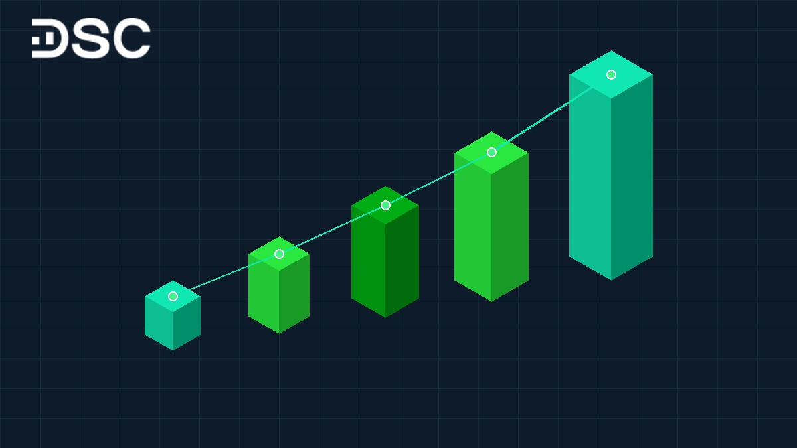
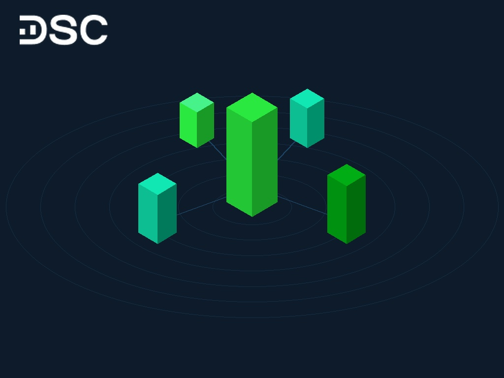

# GRDP là gì? Cách tính và bảng xếp hạng GRDP các tỉnh mới nhất 2025–2026

GRDP là tổng sản phẩm trên địa bàn. Chỉ số này đo lường giá trị gia tăng của hàng hóa và dịch vụ cuối cùng tại một tỉnh, thành phố.

Đây là thước đo then chốt phản ánh sức khỏe kinh tế địa phương và cơ hội phân bổ dòng vốn đầu tư. Dưới đây là định nghĩa, công thức tính và bảng số liệu GRDP cập nhật mới nhất giai đoạn 2025–2026.

## GRDP là gì?

GRDP là viết tắt của Gross Regional Domestic Product, nghĩa là Tổng sản phẩm trên địa bàn. Đây là một [chỉ số kinh tế vĩ mô](https://www.dsc.com.vn/kien-thuc/phan-tich-vi-mo-trong-dau-tu-chung-khoan-la-gi) cốt lõi dùng để đo lường kết quả sản xuất kinh doanh tại địa phương.

Định nghĩa chỉ số GRDP bao gồm 3 thành tố quan trọng:

* **Phạm vi địa lý hành chính**: Tính toán cho từng tỉnh hoặc thành phố trực thuộc trung ương xác định.
* **Giá trị sản phẩm cuối cùng**: Chỉ đo lường hàng hóa và dịch vụ hoàn chỉnh. Không tính sản phẩm trung gian nhằm tránh tính trùng.
* **Thời kỳ tính toán**: Thường được thống kê theo chu kỳ quý, 6 tháng, 9 tháng hoặc cả năm.

Tại Việt Nam, cơ quan biên soạn và công bố số liệu GRDP là Tổng cục Thống kê thuộc Bộ Kế hoạch và Đầu tư. Quy định này đảm bảo dữ liệu minh bạch và thống nhất giữa 63 tỉnh thành.

## Sự khác biệt giữa GRDP và GDP

Nhiều người thường nhầm lẫn giữa hai khái niệm GDP và GRDP. Tuy nhiên, hai chỉ số này có sự phân cấp rõ rệt về không gian và mục đích quản lý.

[tổng sản phẩm quốc nội GDP](https://www.dsc.com.vn/kien-thuc/gdp-la-gi) đại diện cho cả quốc gia. Trong khi đó, GRDP là lát cắt kinh tế chi tiết của từng địa phương. Nhà đầu tư cũng có thể tham khảo [chỉ số GDP PPP](https://www.dsc.com.vn/kien-thuc/gdp-ppp-la-gi-giai-thich-chi-tiet-va-so-sanh-voi-gdp-binh-thuong) để so sánh sức mua tương đương quốc tế.

Bảng đối chuẩn dưới đây làm rõ sự khác biệt giữa hai chỉ số:

| Tiêu chí so sánh | Tổng sản phẩm trên địa bàn (GRDP) | Tổng sản phẩm quốc nội (GDP) |
| :--- | :--- | :--- |
| **Tên tiếng Anh** | Gross Regional Domestic Product | Gross Domestic Product |
| **Phạm vi không gian** | Một tỉnh, thành phố hoặc vùng kinh tế | Toàn bộ lãnh thổ quốc gia |
| **Cơ quan biên soạn** | Tổng cục Thống kê trực tiếp biên soạn | Tổng cục Thống kê tổng hợp toàn quốc |
| **Mục đích sử dụng** | Đánh giá địa phương, phân bổ dự toán tỉnh | Điều hành chính sách tiền tệ, tài khóa vĩ mô |
| **Mối quan hệ số liệu** | Là bộ phận hợp thành của nền kinh tế | Là tổng thể bao trùm toàn bộ các vùng kinh tế |

Trước năm 2017, các địa phương tự công bố GRDP khiến tổng số liệu 63 tỉnh cao hơn nhiều so với GDP cả nước. Nguyên nhân là do tính trùng lặp giá trị hàng hóa lưu chuyển qua nhiều tỉnh.

Kể từ khi Tổng cục Thống kê biên soạn tập trung theo Nghị định 94/2016/NĐ-CP, khoảng cách chênh lệch này đã được xử lý triệt để. Số liệu công bố phản ánh đúng thực tế năng lực kinh tế của từng tỉnh thành.

## Cách tính GRDP chuẩn xác theo Tổng cục Thống kê

Chỉ số GRDP được tính toán thông qua 3 phương pháp thống kê quốc tế tiêu chuẩn. Mỗi phương pháp tiếp cận từ một góc nhìn nhưng đều cho kết quả thống nhất về giá trị gia tăng.

### Phương pháp sản xuất

Phương pháp sản xuất đo lường giá trị tạo thêm ở mỗi công đoạn sản xuất trên địa bàn. Phương pháp này trả lời câu hỏi: Địa phương đã tạo ra thêm bao nhiêu giá trị mới?

> **Công thức**: **GRDP = Tổng giá trị sản xuất (GO) - Chi phí trung gian (IC)**

Trong đó:

* **Tổng giá trị sản xuất (GO)**: Toàn bộ giá trị sản phẩm vật chất và dịch vụ hoàn thành trong kỳ.
* **Chi phí trung gian (IC)**: Toàn bộ chi phí nguyên vật liệu, nhiên liệu và dịch vụ mua ngoài dùng cho sản xuất.

Ví dụ minh họa: Một xưởng may tại Bắc Ninh xuất khẩu lô hàng đạt giá trị 10 tỷ VNĐ (GO). Chi phí mua vải, chỉ may và điện nước là 6 tỷ VNĐ (IC). Khi đó, giá trị GRDP đóng góp cho tỉnh là: 10 tỷ - 6 tỷ = 4 tỷ VNĐ.

### Phương pháp thu nhập

Phương pháp thu nhập tiếp cận từ phía dòng tiền phân phối cho các chủ thể tham gia sản xuất. Phương pháp này trả lời câu hỏi: Ai là người nhận thu nhập từ hoạt động sản xuất trên địa bàn?

> **Công thức**: **GRDP = Thu nhập người lao động + Thuế sản xuất + Khấu hao tài sản + Thặng dư sản xuất**

Chi tiết 4 thành phần trong công thức:

* **Thu nhập người lao động**: Toàn bộ tiền lương, tiền công, tiền thưởng và bảo hiểm do doanh nghiệp chi trả.
* **Thuế sản xuất trừ trợ cấp**: Thuế gián thu nộp ngân sách như thuế VAT, thuế môn bài, trừ đi trợ cấp sản xuất.
* **Khấu hao tài sản cố định**: Chi phí bù đắp hao mòn máy móc, nhà xưởng trong chu kỳ hoạt động.
* **Thặng dư sản xuất**: Lợi nhuận thuần còn lại của các doanh nghiệp sau khi thanh toán các nghĩa vụ trên.

Tổng các nguồn thu nhập của người lao động, doanh nghiệp và ngân sách đúng bằng giá trị gia tăng tạo ra tại địa phương.

### Phương pháp sử dụng

Phương pháp sử dụng đo lường toàn bộ chi tiêu mua sắm hàng hóa và dịch vụ cuối cùng trên địa bàn. Phương pháp này xem xét nhu cầu hấp thụ của nền kinh tế địa phương.

> **Công thức**: **GRDP = Tiêu dùng cuối cùng + Tích lũy tài sản + Chênh lệch xuất nhập khẩu hàng hóa dịch vụ**

Các yếu tố cấu thành bao gồm:

* **Tiêu dùng cuối cùng**: Chi tiêu sinh hoạt của người dân và chi tiêu thường xuyên của chính quyền tỉnh.
* **Tích lũy tài sản**: Đầu tư xây dựng cơ bản, mua sắm máy móc mới và biến động hàng tồn kho.
* **Chênh lệch xuất nhập khẩu**: Toàn bộ hàng hóa xuất bán ra ngoài tỉnh trừ đi phần nhập vào từ nơi khác.

Mọi hàng hóa nhập từ ngoài tỉnh đều phải khấu trừ để chỉ ghi nhận phần giá trị thực sự sinh ra tại địa phương.

### Cách tính tốc độ tăng trưởng GRDP

Bên cạnh quy mô tuyệt đối, tốc độ tăng trưởng GRDP là chỉ tiêu then chốt phản ánh đà mở rộng kinh tế của một tỉnh.

> **Công thức**: **Tốc độ tăng trưởng GRDP (%) = [(GRDP kỳ báo cáo theo giá so sánh / GRDP kỳ gốc theo giá so sánh) × 100] - 100**

Chỉ tiêu này bắt buộc tính theo giá so sánh để loại trừ biến động của lạm phát và giá cả thị trường. Nhờ vậy, số liệu phản ánh trung thực mức gia tăng về khối lượng sản phẩm vật chất và dịch vụ.

## Vai trò của GRDP đối với kinh tế và phân tích đầu tư

Chỉ số GRDP giữ vai trò then chốt trong định hướng vĩ mô của nhà nước và chiến lược phân bổ vốn của nhà đầu tư.

### Đối với cơ quan quản lý nhà nước

GRDP là căn cứ khoa học để phân bổ dự toán ngân sách hàng năm. Tỉnh có quy mô GRDP lớn sẽ đóng góp nguồn thu ngân sách trung ương cao hơn.

Ngoài ra, số liệu tăng trưởng giúp lãnh đạo địa phương quy hoạch hạ tầng và phát triển các khu công nghiệp trọng điểm.

### Đối với nhà đầu tư chứng khoán

Trong phân tích cơ bản, dữ liệu GRDP cung cấp bức tranh cụ thể về tiềm năng từng vùng kinh tế:

* **Nhận diện thủ phủ công nghiệp**: Tỉnh có GRDP công nghiệp tăng mạnh sẽ hút vốn FDI lớn. Yếu tố này trực tiếp hỗ trợ nhóm bất động sản công nghiệp.
* **Định vị điểm nóng đầu tư công**: Địa phương tích lũy tài sản cao thường đón nhận các dự án cao tốc, sân bay và cảng biển lớn.
* **Đánh giá sức mua tiêu dùng**: Địa phương có GRDP bình quân đầu người cao là thị trường trọng điểm cho ngành bán lẻ tiêu dùng.

## Bảng xếp hạng GRDP các tỉnh thành năm 2025–2026 mới nhất

Năm 2025 ghi nhận sự bứt phá vượt trội của các trung tâm công nghiệp và dịch vụ trên cả nước. Dưới đây là dữ liệu chính thức do Tổng cục Thống kê và Cục Thống kê các địa phương công bố.

### Top 10 tỉnh thành dẫn đầu về tốc độ tăng trưởng GRDP năm 2025

Tốc độ tăng trưởng kinh tế địa phương năm 2025 ghi nhận 6 tỉnh, thành phố đạt mức tăng trưởng trên 10%.

| Xếp hạng | Tỉnh / Thành phố | Tốc độ tăng trưởng GRDP 2025 (%) | Động lực tăng trưởng chính |
| :---: | :--- | :---: | :--- |
| **1** | Quảng Ninh | 11,89% | Công nghiệp chế biến chế tạo, du lịch và dịch vụ bứt phá |
| **2** | Hải Phòng | 11,81% | Thu hút FDI công nghệ cao, logistics cảng biển quốc tế |
| **3** | Ninh Bình | 10,65% | Sản xuất lắp ráp ô tô, công nghiệp phụ trợ và du lịch |
| **4** | Phú Thọ | 10,52% | Mở rộng các khu công nghiệp vệ tinh, hạ tầng kết nối |
| **5** | Bắc Ninh | 10,27% | Phục hồi chuỗi cung ứng điện tử bán dẫn, xuất khẩu |
| **6** | Quảng Ngãi | 10,02% | Lọc hóa dầu Dung Quất, luyện kim và cảng biển nước sâu |
| **7** | Đồng Nai | 9,63% | Đại dự án Sân bay Long Thành, hạ tầng logistics Đông Nam Bộ |
| **8** | Tây Ninh | 9,52% | Kinh tế cửa khẩu, nông nghiệp công nghệ cao và chế biến |
| **9** | Đà Nẵng | 9,18% | Dịch vụ công nghệ thông tin, du lịch nghỉ dưỡng chất lượng cao |
| **10** | Hà Tĩnh / Hưng Yên | 8,78% | Công nghiệp thép Vũng Áng, phát triển đô thị công nghiệp |

Quảng Ninh tiếp tục giữ ngôi đầu cả nước về tốc độ tăng trưởng kinh tế. Hải Phòng bám sát ở vị trí thứ hai nhờ năng lực thu hút dòng vốn đầu tư trực tiếp nước ngoài ấn tượng.

### Top 5 đầu tàu kinh tế về quy mô GRDP năm 2025–2026

Xét về quy mô, TP. Hồ Chí Minh và Hà Nội tiếp tục giữ vai trò trụ cột. Hai đô thị này đóng góp hơn 35% GDP toàn quốc.

| Địa phương | Quy mô GRDP 2025 (Ước tính) | Tăng trưởng 2025 (%) | Tỷ trọng đóng góp vào GDP cả nước |
| :--- | :--- | :---: | :---: |
| **TP. Hồ Chí Minh** | 2.972.939 tỷ VNĐ | 7,53% | Hơn 23,0% |
| **Hà Nội** | ~1.550.000 tỷ VNĐ | 8,16% | Gần 13,0% |
| **Hải Phòng** | 734.420 tỷ VNĐ | 11,81% | Động lực chính Vùng Bắc Bộ |
| **Đồng Nai** | 677.932 tỷ VNĐ | 9,63% | Trụ cột công nghiệp Đông Nam Bộ |
| **Bình Dương** | ~550.000 tỷ VNĐ | 7,85% | Thủ phủ khu công nghiệp phía Nam |

TP. Hồ Chí Minh đạt quy mô kỷ lục xấp xỉ 2,97 triệu tỷ đồng theo giá hiện hành. Mức tăng trưởng 7,53% cho thấy động lực phục hồi thương mại dịch vụ và tài chính sau giai đoạn khó khăn.

Giai đoạn 2026–2030, Chính phủ đặt mục tiêu cho các vùng kinh tế trọng điểm tăng trưởng GRDP bình quân từ 8% đến 11%/năm. Mục tiêu này góp phần đưa [tốc độ tăng trưởng kinh tế](https://www.dsc.com.vn/kien-thuc/toc-do-tang-truong-kinh-te-la-gi) cả nước đạt từ 7% đến 8%/năm.

## Ứng dụng chỉ số GRDP trong chiến lược chọn lọc cổ phiếu

Dữ liệu GRDP là cơ sở thực tiễn giúp nhà đầu tư cá nhân tìm kiếm cơ hội trên sàn chứng khoán.

Việc vận dụng [phương pháp phân tích ngành](https://www.dsc.com.vn/kien-thuc/huong-dan-phan-tich-nganh-trong-dau-tu-chung-khoan) gắn liền địa bàn phát triển GRDP mang lại nhiều ý tưởng giao dịch giá trị:

* **Bất động sản công nghiệp**: Các tỉnh tăng trưởng cao như Hải Phòng, Bắc Ninh hút FDI rất mạnh. Cổ phiếu hưởng lợi gồm BCM, IDC, KBC và SZC.
* **Cảng biển và vận tải**: GRDP tăng kéo theo nhu cầu lưu chuyển hàng hóa. Các mã cảng biển tại Hải Phòng và Cái Mép như GMD, HAH hưởng lợi trực tiếp.
* **Xây dựng và hạ tầng**: Các tỉnh đẩy mạnh đầu tư công sẽ tạo khối lượng công việc lớn cho nhà thầu xây lắp và vật liệu.

Chuyên gia Môi giới 1:1 tại DSC luôn bám sát dữ liệu vĩ mô địa phương nhằm phát hiện sớm các cổ phiếu hưởng lợi chu kỳ. Khách hàng được hỗ trợ xây dựng danh mục chuẩn với phí giao dịch ưu đãi từ 0,1%. Hãy đăng ký [mở tài khoản chứng khoán DSC](https://www.dsc.com.vn/mo-tai-khoan) online qua eKYC để đón đầu chu kỳ tăng trưởng.

  

  

    
Đón đầu chu kỳ tăng trưởng cùng chuyên gia DSC

    
Mở tài khoản eKYC trong 3 phút. Nhận tư vấn danh mục cổ phiếu hưởng lợi vĩ mô 1:1 hoàn toàn miễn phí từ Chứng khoán DSC.

  

  <a href="https://www.dsc.com.vn/mo-tai-khoan" style="background: #2BE841; color: #0D1B2A; padding: 14px 32px; border-radius: 30px; text-decoration: none; font-weight: 700; font-size: 16px; display: inline-block; position: relative; z-index: 1;">Mở tài khoản eKYC ngay</a>

## Các câu hỏi thường gặp về chỉ số GRDP

Phần giải đáp dưới đây giúp làm rõ những câu hỏi thường gặp nhất về chỉ số kinh tế địa phương.

* **GRDP khác gì GDP?**: GDP đo lường giá trị tạo ra trên toàn bộ lãnh thổ quốc gia. Ngược lại, GRDP chỉ đo lường trong phạm vi một tỉnh hoặc thành phố trực thuộc trung ương.

* **GRDP tiếng Anh là gì?**: Trong thuật ngữ kinh tế quốc tế, tên tiếng Anh đầy đủ của chỉ số này là Gross Regional Domestic Product.

* **GRDP là viết tắt của chỉ số nào?**: GRDP là viết tắt của Tổng sản phẩm trên địa bàn. Đây là chỉ tiêu tương đương với GDP ở cấp độ địa phương.

* **GRDP trên đầu người là gì?**: Chỉ số này lấy tổng GRDP trong năm chia cho dân số trung bình của tỉnh. Nó phản ánh năng suất lao động và mức sống bình quân của người dân địa phương.

* **Tại sao tổng GRDP 63 tỉnh thành từng lớn hơn GDP cả nước?**: Do tính trùng chi phí trung gian liên tỉnh. Từ năm 2017, Tổng cục Thống kê đã biên soạn tập trung để xóa bỏ sai lệch này.

* **Tra cứu số liệu GRDP chính thức của các tỉnh thành ở đâu?**: Bạn có thể tra cứu tại Niên giám Thống kê hàng năm của Tổng cục Thống kê. Các Cục Thống kê địa phương cũng công bố số liệu định kỳ theo quý và cả năm.

## Lời kết và hành động tiếp theo

GRDP là chỉ số kinh tế vĩ mô phản ánh rõ nét quy mô, tốc độ và chất lượng phát triển của từng địa phương. Việc cập nhật số liệu GRDP mới nhất giai đoạn 2025–2026 giúp nhà đầu tư nắm bắt các cực tăng trưởng năng động nhất.

Dữ liệu vĩ mô địa phương giúp bạn chủ động sàng lọc các mã cổ phiếu khu công nghiệp và hạ tầng tiềm năng. Để đồng hành cùng chuyên gia Môi giới 1:1, bạn hãy đăng ký [mở tài khoản chứng khoán DSC](https://www.dsc.com.vn/mo-tai-khoan) ngay hôm nay.

  
Khởi động hành trình đầu tư thông minh tại DSC

  
Giao dịch cổ phiếu an toàn với công nghệ hiện đại, phí cạnh tranh từ 0,1% và hỗ trợ tư vấn chiến lược 1:1 từ chuyên gia giàu kinh nghiệm.

  <a href="https://www.dsc.com.vn/mo-tai-khoan" style="background: #2BE841; color: #0D1B2A; padding: 15px 38px; border-radius: 30px; text-decoration: none; font-weight: 700; font-size: 16px; display: inline-block;">Mở tài khoản DSC miễn phí</a>

