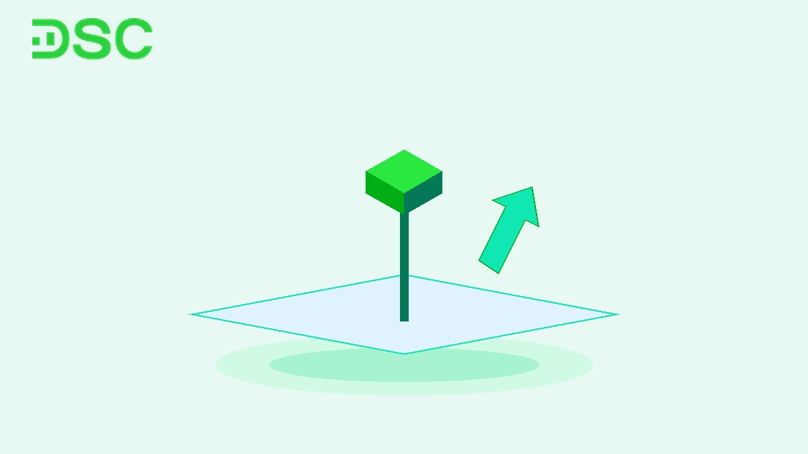
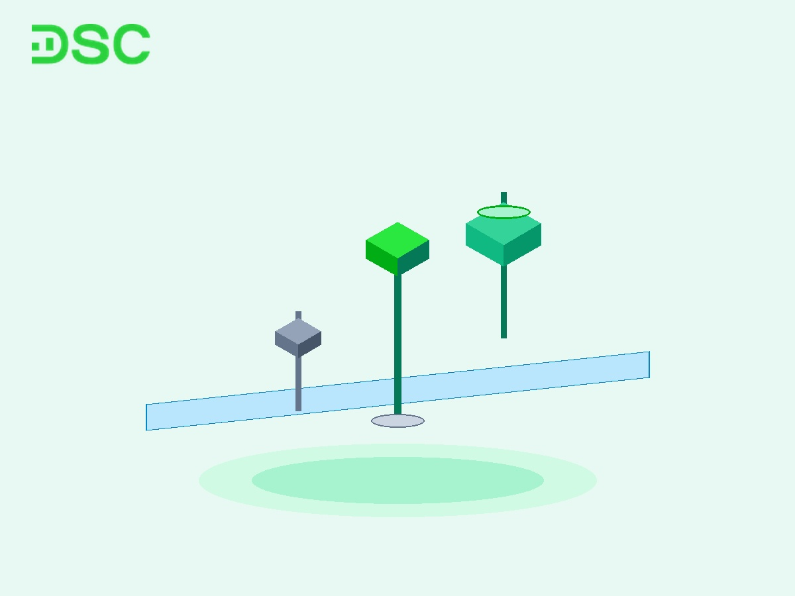

# Mô hình nến Hammer là gì? Cách giao dịch nến búa thực chiến

Mô hình nến Hammer (nến búa) là mẫu hình đảo chiều tăng giá quen thuộc trong [**phân tích kỹ thuật**](https://www.dsc.com.vn/kien-thuc/phan-tich-ky-thuat-la-gi). Mẫu hình thường xuất hiện tại vùng hỗ trợ sau một nhịp giảm sâu. Cây nến rút chân này thể hiện sự trỗi dậy mạnh mẽ của phe mua.

Đối với nhà đầu tư chủ động, nến búa giúp xác định điểm vào lệnh đón đầu sóng hồi phục. Bài viết này hướng dẫn chi tiết quy chuẩn nhận diện và phương pháp giao dịch thực chiến.

## Mô hình nến Hammer là gì?

Mô hình nến Hammer là một [**mô hình nến đảo chiều**](https://www.dsc.com.vn/kien-thuc/mo-hinh-nen-dao-chieu) tăng giá xuất hiện tại đáy của xu hướng giảm. Mẫu hình có thân nến nhỏ nằm ở đỉnh và bóng nến dưới dài. Hình dạng nến tương tự một chiếc búa thẳng đứng.

Trong phiên, áp lực bán ban đầu ép giá giảm sâu xuống dưới mức mở cửa. Tuy nhiên, lực cầu bắt đáy nhanh chóng hấp thụ toàn bộ lượng hàng giá thấp.

Phe mua đẩy giá hồi phục và đóng cửa sát mức cao nhất phiên. Điều này chứng minh phe bán đã kiệt sức và quyền kiểm soát chuyển sang phe mua.

## Đặc điểm nhận diện của nến Hammer chuẩn kỹ thuật

Để lọc tín hiệu nhiễu trên đồ thị, cây nến búa cần thỏa mãn 4 tiêu chí chuẩn:

* **Thân nến nhỏ**: Phần thân nến nằm co cụm tại vùng giá cao nhất phiên.
* **Bóng nến dưới rất dài**: Bóng dưới tối thiểu dài gấp 2 lần thân nến. Bóng nến càng dài chứng tỏ lực từ chối giá giảm càng mạnh mẽ.
* **Bóng nến trên triệt tiêu**: Bóng nến phía trên rất ngắn hoặc hoàn toàn không có.
* **Vị trí xuất hiện**: Nến phải hình thành sau một chuỗi phiên giảm rõ rệt hoặc tại vùng hỗ trợ.

Về mặt màu sắc, thị trường ghi nhận 2 dạng nến Hammer:

1. **Nến Hammer xanh (Tăng giá)**: Giá đóng cửa cao hơn giá mở cửa. Mẫu nến này mang xung lực mạnh do phe mua hoàn toàn thắng thế cuối phiên.
2. **Nến Hammer đỏ (Giảm giá)**: Giá đóng cửa thấp hơn một chút so với mở cửa. Do phe mua chưa kéo giá vượt tham chiếu, bạn cần chờ phiên sau xác nhận.

## Bảng đối sánh nến Hammer, Hanging Man, Inverted Hammer và Shooting Star

Nhiều nhà giao dịch thường nhầm lẫn giữa 4 mẫu nến đơn có hình dáng tương tự nhau. Bảng đối chiếu dưới đây phân định rạch ròi từng mô hình:

| Tiêu chí | Nến Hammer (Nến búa) | Nến Hanging Man (Người treo cổ) | [**Nến búa ngược**](https://www.dsc.com.vn/kien-thuc/mo-hinh-nen-bua-nguoc-inverted-hammer-la-gi) (Inverted Hammer) | Nến Shooting Star (Sao băng) |
| :--- | :--- | :--- | :--- | :--- |
| **Hình dáng nến** | Thân nhỏ ở trên, bóng dưới dài tối thiểu gấp 2 lần thân | Thân nhỏ ở trên, bóng dưới dài tối thiểu gấp 2 lần thân | Thân nhỏ ở dưới, bóng trên dài tối thiểu gấp 2 lần thân | Thân nhỏ ở dưới, bóng trên dài tối thiểu gấp 2 lần thân |
| **Vị trí xuất hiện** | Đáy xu hướng giảm | Đỉnh xu hướng tăng | Đáy xu hướng giảm | Đỉnh xu hướng tăng |
| **Tín hiệu kỹ thuật** | Đảo chiều **TĂNG** giá | Đảo chiều **GIẢM** giá | Đảo chiều **TĂNG** giá | Đảo chiều **GIẢM** giá |
| **Tâm lý phản ánh** | Phe mua từ chối giá thấp | Phe bán bắt đầu thâm nhập | Thăm dò lực cầu vùng thấp | Phe bán triệt tiêu đà tăng |

## Ý nghĩa tâm lý thị trường đằng sau nến Hammer

Một cây nến Hammer hình thành qua 3 giai đoạn tâm lý cung cầu:

* **Giai đoạn 1 (Bán tháo hoảng loạn)**: Theo quán tính xu hướng giảm, phe bán xả hàng mạnh ngay sau giờ mở cửa. Giá cổ phiếu bị ép rơi tự do về vùng đáy phiên.
* **Giai đoạn 2 (Tạo bẫy gấu - Bear Trap)**: Vùng giá chiết khấu kích thích dòng tiền lớn tham gia gom hàng tại hỗ trợ. Áp lực bán cạn dần khi gặp lực cầu đối ứng vững chắc.
* **Giai đoạn 3 (Phe mua phản công)**: Lực mua gia tăng mạnh mẽ, đẩy thị giá quay trở lại đỉnh phiên. Phe bán tháo vùng giá thấp bị mắc bẫy, tạo đà tâm lý hưng phấn.

## Hướng dẫn chiến lược giao dịch thực chiến với nến Hammer

Để tối ưu hóa lợi nhuận, bạn không nên mua đuổi ngay khi nến vừa đóng phiên. Hãy tuân thủ quy trình 3 bước chuẩn mực dưới đây:

### Bước 1: Xác định bối cảnh xu hướng và vùng hỗ trợ cứng

Nến Hammer chỉ có độ tin cậy cao khi nằm tại các ngưỡng kỹ thuật quan trọng. Đó có thể là đường xu hướng (Trendline) tăng dài hạn, đường MA50, hoặc vùng đáy cũ.

Nếu nến búa xuất hiện giữa giai đoạn đi ngang (Sideway), tín hiệu thường mang nhiều bẫy nhiễu. Bẫy giá rất dễ xảy ra.

### Bước 2: Chờ cây nến xác nhận và tín hiệu thanh khoản bùng nổ

Điều kiện tiên quyết là phiên kế tiếp phải xuất hiện nến xanh đóng cửa vượt đỉnh nến Hammer. Đây là tín hiệu then chốt. Cây nến xác nhận này chứng minh phe mua đã kiểm soát hoàn toàn thế trận.

Đồng thời, [**khối lượng giao dịch**](https://www.dsc.com.vn/kien-thuc/khoi-luong-giao-dich-la-gi) phiên nến búa cần vượt tối thiểu 20% đến 50% mức trung bình 20 phiên (MA20). Thanh khoản bùng nổ cho thấy dòng tiền tổ chức đã chính thức nhập cuộc.

### Bước 3: Thiết lập điểm vào lệnh, cắt lỗ và chốt lời kỷ luật

Kỷ luật là yếu tố sống còn. Sau khi hội tụ đủ điều kiện, nhà đầu tư thiết lập vị thế theo tỷ lệ Risk/Reward (R:R) tối thiểu 1:2:

* **Điểm vào lệnh (Entry)**: Mở vị thế mua khi giá vượt đỉnh nến Hammer khoảng 1 bước giá.
* **Điểm cắt lỗ (Stop Loss)**: Đặt dưới bóng nến dưới của nến Hammer từ 1 đến 2 bước giá. Mức dừng lỗ tương đương khoảng 0,5% đến 1%.
* **Điểm chốt lời (Take Profit)**: Đặt tại ngưỡng kháng cự tiếp theo theo [**các mô hình giá trong chứng khoán**](https://www.dsc.com.vn/kien-thuc/cac-mo-hinh-gia-trong-chung-khoan). Lợi nhuận kỳ vọng cần gấp tối thiểu 2 lần khoảng cách dừng lỗ.

Trên đồ thị cổ phiếu SSI, cây nến Hammer tăng xuất hiện tại đáy nhịp điều chỉnh. Đó là điểm vào lệnh lý tưởng. Ngay sau đó là các phiên tăng điểm bứt phá, mở ra cơ hội sinh lời lớn.

Ngược lại, đồ thị cổ phiếu VND minh họa rõ nét các cây nến râu trên dài xuất hiện khi lực bán còn lớn. Nếu thiếu cây nến xanh xác nhận bứt phá, cổ phiếu rất dễ rơi vào đợt giảm sâu. Rủi ro khi đó là rất lớn.

## 3 Bẫy rủi ro khi giao dịch nến Hammer trên thị trường chứng khoán Việt Nam

Giao dịch theo nến Nhật trên thị trường cơ sở Việt Nam có những đặc thù riêng:

* **Bẫy bắt dao rơi trong xu hướng giảm mạnh**: Khi thị trường chịu cú sốc tin tức, nến búa xuất hiện thường chỉ là nhịp nảy kỹ thuật. Mua vội khi xu hướng giảm chưa dừng sẽ khiến tài khoản thiệt hại nặng.
* **Bẫy nến rút chân thanh khoản thấp**: Nến búa có bóng dài nhưng thanh khoản dưới mức MA20 chủ yếu do lực bán tạm dừng. Tín hiệu này thiếu lực cầu thực và dễ bị trả điểm ở phiên sau.
* **Rủi ro kẹt hàng chu kỳ thanh toán T+2**: Do chu kỳ thanh toán là T+2, cổ phiếu mua tại phiên nến búa có thể xanh trong phiên T0. Tuy nhiên, nếu thị trường đảo chiều, nhà đầu tư phải chờ đến chiều ngày T+2 mới có thể bán cắt lỗ.

## Tối ưu hóa hiệu quả giao dịch Price Action cùng Chứng khoán DSC

Nhận diện chính xác mô hình nến Hammer đòi hỏi hệ thống theo dõi dữ liệu thị trường theo thời gian thực. Nhà đầu tư cần kết hợp chặt chẽ giữa hành động giá và kỷ luật quản trị vốn.

Trong năm 2026, nền tảng **DSC Trading** cung cấp bộ công cụ biểu đồ kỹ thuật chuyên sâu hỗ trợ quét nhanh nến đảo chiều. Chuyên gia **Môi giới 1:1 DSC** đồng hành tư vấn điểm giải ngân an toàn với gói **Margin ưu đãi từ 10% - 13,5%/năm**.

  

  

    
Nâng cao hiệu suất giao dịch cùng chuyên gia DSC

    
Mở tài khoản eKYC trong 3 phút • Hỗ trợ chiến lược tư vấn 1:1 • Ưu đãi Margin từ 10%/năm.

  

  <a href="https://www.dsc.com.vn/mo-tai-khoan" style="background: #2BE841; color: #0D1B2A; padding: 14px 32px; border-radius: 30px; text-decoration: none; font-weight: 700; font-size: 16px; display: inline-block; position: relative; z-index: 1;">Trao đổi với chuyên gia</a>

## Câu hỏi thường gặp về mô hình nến Hammer (FAQ)

Dưới đây là phần giải đáp ngắn gọn những thắc mắc phổ biến nhất của nhà đầu tư:

### **Mô hình nến Hammer là gì**?

Mô hình nến Hammer là mẫu hình nến đơn đảo chiều tăng giá xuất hiện tại đáy xu hướng giảm. Nến gồm thân nhỏ ở đỉnh và bóng dưới dài gấp đôi thân, báo hiệu lực cầu bắt đáy trỗi dậy.

### **Nến Hammer xanh và nến Hammer đỏ khác nhau thế nào**?

Nến Hammer xanh có giá đóng cửa cao hơn mở cửa, cho xác suất đảo chiều mạnh hơn. Nến Hammer đỏ có giá đóng cửa thấp hơn mở cửa, mang tín hiệu yếu hơn và cần phiên sau xác nhận.

### **Nến Hammer khác gì nến Người treo cổ (Hanging Man)**?

Nến Hammer và nến Hanging Man có cấu tạo giống nhau nhưng vị trí xuất hiện trái ngược. Nến Hammer ở đáy xu hướng giảm báo hiệu tăng giá, còn Hanging Man ở đỉnh xu hướng tăng cảnh báo đảo chiều giảm.

### **Làm thế nào để xác nhận tín hiệu đảo chiều của nến Hammer**?

Tín hiệu xác nhận khi phiên sau xuất hiện nến xanh đóng cửa vượt đỉnh nến Hammer. Thanh khoản phiên nến búa hoặc phiên sau cần vượt 20% đến 50% trung bình 20 phiên (MA20).

### **Đặt lệnh cắt lỗ (Stop Loss) và chốt lời với nến Hammer ở đâu**?

Lệnh dừng lỗ (Stop Loss) đặt ngay dưới mức giá thấp nhất của bóng nến búa khoảng 1 đến 2 bước giá. Mức chốt lời (Take Profit) đặt tại vùng kháng cự với tỷ lệ R:R tối thiểu từ 1:2.