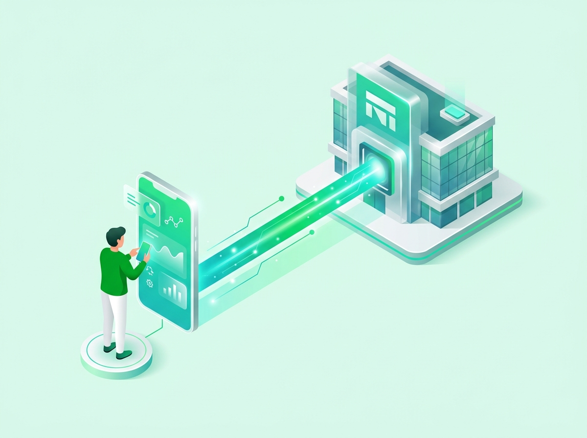

# Sàn chứng khoán là gì? 3 sàn giao dịch uy tín tại Việt Nam

Sàn chứng khoán là thị trường tập trung nơi diễn ra các hoạt động mua bán cổ phiếu, trái phiếu và chứng chỉ quỹ niêm yết. Tại Việt Nam, toàn bộ giao dịch chính thống được vận hành tập trung trên 3 sàn gồm HOSE, HNX và UPCoM.

Tính đến tháng 8/2026, thị trường ghi nhận gần 13,66 triệu tài khoản chứng khoán theo số liệu chính thức từ VSDC. Việc hiểu rõ cơ chế vận hành của từng sàn giúp nhà đầu tư mới bảo vệ nguồn vốn và tránh các bẫy lừa đảo mạo danh.

## Sàn giao dịch chứng khoán là gì?

Sàn giao dịch chứng khoán là thị trường có tổ chức và được pháp luật bảo hộ. Nơi đây cung cấp hạ tầng kỹ thuật để kết nối bên mua và bên bán các loại tài sản tài chính.

Các sản phẩm được giao dịch phổ biến bao gồm [cổ phiếu](https://www.dsc.com.vn/kien-thuc/co-phieu-la-gi-cac-loai-co-phieu-tren-thi-truong-chung-khoan-viet-nam), trái phiếu doanh nghiệp và chứng chỉ quỹ. Sàn giao dịch thiết lập mức giá công bằng cho tài sản thông qua khớp lệnh cung cầu tự động. Toàn bộ dữ liệu giá cả và khối lượng giao dịch đều được công bố công khai theo thời gian thực.

## Phân biệt Sở giao dịch chứng khoán và công ty chứng khoán

Nhiều nhà đầu tư mới thường nhầm lẫn giữa Sở giao dịch chứng khoán và công ty chứng khoán. Bạn không thể đến trực tiếp sàn HOSE hay HNX để nộp tiền mua cổ phiếu.

Nhà đầu tư cá nhân bắt buộc phải mở tài khoản qua một công ty chứng khoán thành viên. Đơn vị này kiểm tra số dư và chuyển lệnh của bạn vào hệ thống khớp lệnh của Sở.

| Tiêu chí | Sở giao dịch chứng khoán (HOSE, HNX) | Công ty chứng khoán (như DSC, SSI, VPS) |
|---|---|---|
| **Bản chất pháp lý** | Cơ quan tổ chức và vận hành thị trường tập trung | Định chế tài chính trung gian, thành viên thị trường |
| **Đối tượng phục vụ** | Các công ty chứng khoán thành viên và doanh nghiệp niêm yết | Nhà đầu tư cá nhân và tổ chức mở tài khoản |
| **Quyền tiếp cận của F0** | Nhà đầu tư không thể mở tài khoản hay đặt lệnh trực tiếp | Nhà đầu tư đăng ký tài khoản trực tuyến qua eKYC để giao dịch |
| **Dịch vụ cung cấp** | Cung cấp hạ tầng bảng điện, khớp lệnh và quản lý niêm yết | Mở tài khoản, cho vay Margin, tư vấn Môi giới 1:1 và quản lý tài sản |

Sau khi hiểu rõ vai trò trung gian, bạn có thể tìm hiểu [cách mở tài khoản chứng khoán](https://www.dsc.com.vn/kien-thuc/cach-mo-tai-khoan-chung-khoan) online. Quy trình này giúp kết nối trực tiếp vào hệ thống giao dịch của Sở.

## 4 chức năng cốt lõi của sàn giao dịch chứng khoán

Sàn chứng khoán giữ vai trò huyết mạch trong việc luân chuyển dòng tiền của toàn bộ nền kinh tế quốc gia. Bốn chức năng quan trọng nhất của sàn giao dịch bao gồm.

* **Huy động vốn trung và dài hạn**: Sàn chứng khoán hỗ trợ doanh nghiệp phát hành cổ phiếu ra công chúng. Nhờ đó, doanh nghiệp thu hút nguồn vốn lớn để mở rộng sản xuất kinh doanh.

* **Tạo tính thanh khoản cao**: Thị trường tập trung giúp nhà đầu tư chuyển đổi cổ phiếu thành tiền mặt nhanh chóng. Giao dịch được thanh toán an toàn theo chu kỳ T+2.

* **Định giá tài sản minh bạch**: Thị giá cổ phiếu hình thành liên tục dựa trên quy luật cung cầu thực tế. Mức giá này phản ánh khách quan triển vọng kinh doanh của từng doanh nghiệp.

* **Bảo vệ quyền lợi nhà đầu tư**: Mọi giao dịch chịu sự giám sát nghiêm ngặt từ Ủy ban Chứng khoán Nhà nước. Doanh nghiệp bắt buộc phải công bố thông tin tài chính định kỳ và minh bạch.

## 3 sàn giao dịch chứng khoán tập trung tại Việt Nam

Thị trường chứng khoán cơ sở Việt Nam hiện được vận hành thống nhất dưới sự điều phối của Sở Giao dịch Chứng khoán Việt Nam (VNX). Ba sàn giao dịch uy tín và hợp pháp bao gồm HOSE, HNX và UPCoM.

### Sở Giao dịch Chứng khoán Thành phố Hồ Chí Minh (HOSE)

Sở Giao dịch Chứng khoán Thành phố Hồ Chí Minh thành lập năm 2000. Đây là sàn giao dịch có quy mô vốn hóa lớn nhất cả nước, nơi quy tụ nhóm cổ phiếu VN30.

Tiêu chuẩn niêm yết trên HOSE đòi hỏi vốn điều lệ tối thiểu 120 tỷ VNĐ. Doanh nghiệp phải có kết quả kinh doanh 2 năm liền trước có lãi. Sàn HOSE áp dụng [biên độ giao dịch sàn chứng khoán HOSE HNX UPCOM](https://www.dsc.com.vn/kien-thuc/bien-do-giao-dich-san-chung-khoan-hose-hnx-upcom) là ±7% trong mỗi phiên giao dịch thông thường.

### Sở Giao dịch Chứng khoán Hà Nội (HNX)

Sở Giao dịch Chứng khoán Hà Nội thành lập năm 2005. Sàn HNX quản lý cổ phiếu của doanh nghiệp vừa và nhỏ cùng thị trường trái phiếu chính phủ. Đơn vị này đòi hỏi doanh nghiệp có vốn điều lệ tối thiểu 30 tỷ VNĐ.

Biên độ dao động giá trên sàn HNX được quy định ở mức ±10% mỗi ngày giao dịch. Biên độ này mang lại tiềm năng sinh lời ngắn hạn lớn cho nhà đầu tư. Tuy nhiên, bạn cần duy trì kỷ luật quản trị vốn để phòng ngừa rủi ro.

### Sàn Giao dịch UPCoM (Unlisted Public Company Market)

Sàn UPCoM ra đời năm 2009 dưới sự quản lý của HNX. Đây là sàn dành riêng cho các công ty đại chúng chưa niêm yết chính thức. Thị trường này giúp doanh nghiệp chuẩn hóa thông tin trước khi chuyển sàn sang HNX hoặc HOSE.

Biên độ dao động trên UPCoM lên tới ±15% mỗi phiên, cao nhất trong ba sàn giao dịch tập trung. Do tiêu chuẩn công bố thông tin nới lỏng hơn, nhà đầu tư cần chọn lọc kỹ năng lực tài chính của doanh nghiệp trước khi giải ngân.

| Tiêu chí | Sàn HOSE | Sàn HNX | Sàn UPCoM |
|---|---|---|---|
| **Cơ quan vận hành** | Sở Giao dịch Chứng khoán TP.HCM | Sở Giao dịch Chứng khoán Hà Nội | Vận hành bởi HNX |
| **Vốn điều lệ tối thiểu** | 120 tỷ VNĐ | 30 tỷ VNĐ | 10 tỷ VNĐ |
| **Thời gian có lãi** | 2 năm tài chính gần nhất | 1 năm tài chính gần nhất | Không bắt buộc có lãi |
| **Biên độ dao động giá** | ±7% | ±10% | ±15% |
| **Quy định lô chẵn** | 100 cổ phiếu | 100 cổ phiếu | 100 cổ phiếu |
| **Phiên mở/đóng cửa** | Có phiên ATO và ATC | Không có ATO, có ATC | Khớp liên tục toàn phiên |

## Khung thời gian và phương thức khớp lệnh trên sàn chứng khoán

Các sàn chứng khoán hoạt động từ thứ Hai đến thứ Sáu hàng tuần. Hệ thống đóng cửa vào thứ Bảy, Chủ nhật và các dịp nghỉ lễ quốc gia. Nhà đầu tư cần nắm vững [giờ giao dịch chứng khoán Việt Nam](https://www.dsc.com.vn/kien-thuc/gio-giao-dich-chung-khoan-viet-nam) để canh thời điểm vào lệnh tối ưu.

Thị trường chia thời gian giao dịch trong ngày thành các phiên khớp lệnh với cơ chế xác định giá khác nhau.

| Khung giờ | Sàn HOSE | Sàn HNX | Sàn UPCoM |
|---|---|---|---|
| **09:00 – 09:15** | Khớp lệnh định kỳ mở cửa (ATO) | Khớp lệnh liên tục | Khớp lệnh liên tục |
| **09:15 – 11:30** | Khớp lệnh liên tục | Khớp lệnh liên tục | Khớp lệnh liên tục |
| **11:30 – 13:00** | Nghỉ trưa thị trường | Nghỉ trưa thị trường | Nghỉ trưa thị trường |
| **13:00 – 14:30** | Khớp lệnh liên tục | Khớp lệnh liên tục | Khớp lệnh liên tục |
| **14:30 – 14:45** | Khớp lệnh định kỳ đóng cửa (ATC) | Khớp lệnh định kỳ đóng cửa (ATC) | Khớp lệnh liên tục |
| **14:45 – 15:00** | Giao dịch thỏa thuận | Giao dịch sau giờ (lệnh PLO) | Giao dịch thỏa thuận |

## Cảnh báo nhận diện bẫy sàn chứng khoán quốc tế lừa đảo

Thị trường phát triển kéo theo nhiều tổ chức lập sàn ảo nhằm lừa đảo chiếm đoạt tài sản. Pháp luật Việt Nam chưa cấp phép cho bất kỳ sàn chứng khoán quốc tế nào hoạt động trong nước.

Để bảo vệ tài sản, bạn cần cảnh giác với 3 dấu hiệu lừa đảo phổ biến sau đây.

* **Cam kết bao lỗ và lợi nhuận phi thực tế**: Kẻ gian thường hứa hẹn mức sinh lời 20–30%/tháng mà không gặp rủi ro. Mọi cam kết lợi nhuận cố định trên thị trường chứng khoán đều là hành vi lừa đảo.

* **Yêu cầu nạp tiền vào tài khoản cá nhân**: Giao dịch chính thống chỉ chấp nhận nạp tiền vào tài khoản định danh của công ty chứng khoán. Yêu cầu chuyển tiền vào số tài khoản cá nhân chắc chắn là lừa đảo.

* **Lôi kéo vào các hội nhóm kín với chuyên gia ảo**: Kẻ gian lập các nhóm chat mạng xã hội và dùng tài khoản mồi khoe lãi liên tục. Sau khi bạn nạp tiền lớn, hệ thống sẽ lập tức khóa tài khoản.

## Lợi ích và nguyên tắc quản trị rủi ro khi đầu tư chứng khoán

Đầu tư qua các sàn chứng khoán mang lại cơ hội sinh lời hấp dẫn so với gửi tiết kiệm. Lợi nhuận đến từ cổ tức tiền mặt định kỳ và mức tăng trưởng thị giá của doanh nghiệp.

Thị trường luôn đi kèm rủi ro biến động giá khi bối cảnh kinh tế xuất hiện khó khăn. Nhà đầu tư không nên dồn toàn bộ vốn vào một cổ phiếu duy nhất. Bạn nên phân bổ danh mục vào 3–5 doanh nghiệp có nền tảng tài chính vững mạnh.

Việc thiết lập mức cắt lỗ tự động 7–8% giúp bạn bảo vệ vốn hiệu quả trước mọi biến động. Bạn có thể tham khảo [cách đầu tư chứng khoán cho người mới bắt đầu](https://www.dsc.com.vn/kien-thuc/cach-dau-tu-chung-khoan-cho-nguoi-moi-bat-dau) để trang bị kiến thức chuẩn xác.

## Khởi đầu giao dịch chứng khoán an toàn cùng DSC

Nhà đầu tư cá nhân không cần số vốn lớn để bước chân vào các sàn chứng khoán chính thống. Bạn chỉ cần mở tài khoản trực tuyến qua ứng dụng công nghệ để bắt đầu tích lũy những lô cổ phiếu đầu tiên.

Tại Chứng khoán DSC, quy trình mở tài khoản eKYC được số hóa hoàn toàn trong 3 phút mà không cần đến quầy giao dịch. Khách hàng được hỗ trợ 1:1 từ chuyên gia môi giới giàu kinh nghiệm và áp dụng mức phí giao dịch ưu đãi chỉ từ 0,1%.

  

  

    
Mở tài khoản giao dịch chứng khoán DSC trong 3 phút

    
Định danh eKYC 100% online • Kết nối trực tiếp 3 sàn HOSE, HNX, UPCoM • Đồng hành 1:1 cùng chuyên gia phân tích.

  

  <a href="https://www.dsc.com.vn/mo-tai-khoan" style="background: #2BE841; color: #0D1B2A; padding: 14px 32px; border-radius: 30px; text-decoration: none; font-weight: 700; font-size: 16px; display: inline-block; position: relative; z-index: 1;">Mở tài khoản — 3 phút</a>

Nhà đầu tư có thể [Mở tài khoản chứng khoán DSC](https://www.dsc.com.vn/mo-tai-khoan) ngay hôm nay để nhận tư vấn danh mục và bắt đầu hành trình đầu tư bền vững.

## Câu hỏi thường gặp về sàn chứng khoán (FAQ)

### Sở giao dịch chứng khoán là gì?

Sở giao dịch chứng khoán là tổ chức pháp lý được Nhà nước cấp phép nhằm thiết lập và vận hành thị trường giao dịch chứng khoán tập trung. Đơn vị này ban hành quy chế niêm yết, giám sát công bố thông tin và quản lý hạ tầng công nghệ khớp lệnh cho toàn thị trường.

### 10 sàn chứng khoán lớn nhất thế giới là gì?

Nhóm 5 sàn lớn nhất thế giới dẫn đầu bởi sàn New York (NYSE), NASDAQ, Thượng Hải (SSE), Tokyo (TSE) và Euronext. Các vị trí tiếp theo thuộc về sàn Thâm Quyến (SZSE), London (LSE), Mumbai (BSE), NSE Ấn Độ và Hong Kong (HKEX).

### Sàn HOSE giao dịch đến mấy giờ?

Sàn HOSE kết thúc phiên giao dịch khớp lệnh định kỳ đóng cửa (ATC) vào lúc 14:45 từ thứ Hai đến thứ Sáu hàng tuần. Sau 14:45, sàn chỉ tiếp tục thực hiện các giao dịch thỏa thuận cho đến 15:00 trước khi chính thức đóng cửa hệ thống trong ngày.

### Sàn HNX là gì?

Sàn HNX là Sở Giao dịch Chứng khoán Hà Nội. Thị trường này quản lý cổ phiếu của doanh nghiệp vừa và nhỏ, UPCoM cùng trái phiếu chính phủ. Sàn HNX hoạt động dưới sự giám sát của Ủy ban Chứng khoán Nhà nước và trực thuộc VNX.