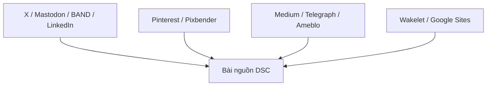

# Bộ thử toàn kênh

Mở preview.html để xem 11 bản và copy nội dung. Cột channel trên Sheet có link bấm; T/U/V lần lượt là tài khoản, trang mở đăng, ảnh Drive. Tiêu đề đề xuất và hướng dẫn từng nền tảng nằm trong notes. Không có UTM. Mọi bản là Draft, chưa đăng; index Unknown.

Ảnh Drive: https://drive.google.com/file/d/1MzHmQx7tXMFWdkeYK0WIGUtEgg4g0dtR/view

Nguồn kiến thức: bài DSC trong source_url. Đối chiếu thuật ngữ: https://www.morningstar.com/investing-definitions/economic-moat

