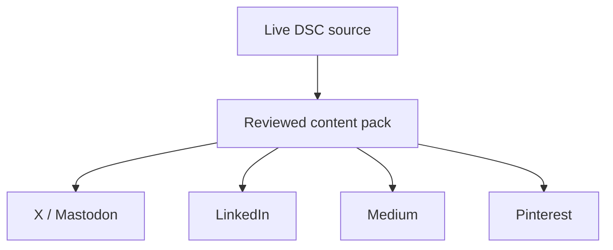
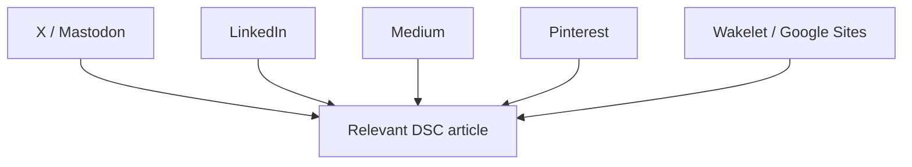

# DSC Syndication

Google Sheet: https://docs.google.com/spreadsheets/d/1urr2pvtQRWof_uC-X3RA_D6EMUvHLRhZJbx1PS1TBY0/edit

Use `/syndicate <slug>` to prepare, `/syndicate sync` to reconcile, `/syndicate weekly` for a weekly batch. These are agent skill instructions, not unattended shell automation.

Edit ledger.csv locally or Publishing on Sheets. Run `python scripts/syndicate.py build` to regenerate the local read-only dashboard. CSV is UTF-8; retain column headers and immutable IDs. Archive rather than delete. Sync requires an active agent with the Google Drive connector.

## Format, date and asset conventions

Formats tab (and formats.csv) defines the format for each channel: purpose, structure, heading hierarchy, editorial length, image, hashtags and manual posting. Long articles have a separate title plus H2 sections. The Sheet represents headings with Markdown markers; apply the destination editor's actual Heading style after plain-text paste. The latest all-channels-v3/preview.html supports rich HTML copy and includes semantic h1/h2 elements. Social variants include relevant hashtags; resource hubs/long articles do not append unrelated social hashtags.

Publishing now has title and hashtags columns. Local date fields are ISO YYYY-MM-DD; Sheets stores actual date serials with dd/MM/yyyy formatting for posted_at/checked_at, Checks.checked_at/next_check and Sync Log.time. Read serials and normalize with from_sheet_row; write with sheet_row. Blank dates stay blank.

Asset fields in Sheets contain online URLs, never Windows/local paths. Local infographic source lives in assets/ and its upload state is in assets/drive-asset.json. Upload only with the configured service account; do not use the connected dscnews8386 account as a fallback. Service accounts cannot own files in My Drive: a storageQuotaExceeded failure requires the intended owner's OAuth connection or Shared Drive, not more folder permissions. Until resolved, source DSC imagery is explicitly labeled as a reference; the custom vertical infographic is not considered delivered to Drive.

Current user preference: for formats requiring no new design, reuse the verified DSC source image online in asset_path and asset_url. For a required new image awaiting creation, approval or upload, leave both fields blank and explain in notes. In the current trial, Pinterest/Pixbender need new designs; the other nine variants reuse the original DSC image. See image-plan.csv. Visual Styles tab, visual-styles.md and design-preview.html describe four proposed social layouts; these studies are not final approved assets.

Statuses: Draft → Approved → Posted; alternatives Skipped, Needs-fix, Archived. Posted requires a real public URL. Store approval and corrections in notes. Never put passwords in these files or Sheets.

## Content and links

Keep Facebook Page and Zalo OA excluded. X/Mastodon use concise insights; LinkedIn uses professional analysis; Medium answers one narrow question; Pinterest uses useful visual checklists. Wakelet and Google Sites organize selected resources. BAND, Telegraph, Ameblo and Pixbender remain review candidates, not mandatory destinations.

No compulsory cross-link wheels, keyword anchors or tiered link automation. Use plain source links; the user opted out of UTM. Keep the legacy utm_url field blank for compatibility. channel_url opens the known account, compose_url opens a posting entry point (login/editor permission may be required), asset_url links to the Drive image. The channel cell in Sheets is also clickable. Canonical is separate from a source backlink. Source facts must be rechecked when time-sensitive.

## Index checks

Checks tab records public accessibility, actual backlink target/rel, robots/noindex, canonical, method, evidence and next check. Missing data or a blocked tool is Unknown, not proof of non-indexing. States: Unknown, Found-in-search, GSC-indexed, GSC-not-indexed. Record date and evidence for every positive observation; search absence is inconclusive. Use GSC only on verified accessible properties. Review at 7/14/28 days; these are operational checkpoints, not indexing deadlines. No indexing guarantee.

References: https://developers.google.com/search/docs/crawling-indexing/ask-google-to-recrawl ; https://buffer.com/resources/repurposing-content-guide/ ; https://blog.hubspot.com/marketing/how-to-syndicate-content

## Sync implementation

Agent reads remote literal values, runs three-way merge against sync-baseline.json, reviews conflicts, writes changed remote cells, applies local proposal, then reads back and checkpoints only on equality. The Python helper never contacts Google itself. Keep backups before applying a proposal. Channels use channel as key; Checks and Sync Log are append-only. Dashboard formulas belong to Sheets and are never copied into ledger.

Publishing layout preference: keep G:L as title, content, hashtags, compose_url, channel_url, asset_url for manual copy-and-post. Other fields follow after this block. This is a display order only: local CSV FIELDS remains unchanged. During sync, always read the live header row and map reads/writes by header name; reorder sheet_row output to the live headers before writing. Never assume the local CSV column positions match Publishing. Native column moves preserve formatting, validation, hyperlinks and formula references.
